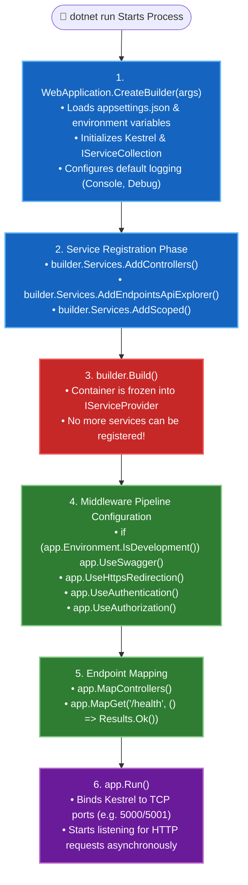

# 02. Creating Your First ASP.NET Core Project

---

## 📖 The Real-World Story: The Skyscraper Blueprint

When building a modern skyscraper, you don't start by pouring concrete into a hole and hoping the elevators fit.
Construction happens in two strict, non-negotiable phases:

1. **The Blueprint & Procurement Phase (`WebApplicationBuilder`):**
   The head engineer brings together the plumbing contractors, the electrical engineers, the elevator manufacturers, and the city inspectors. You specify exactly what components the building will have (`builder.Services.Add...()`). During this phase, nobody is living in the building, and no water is flowing through the pipes.

2. **The Commissioning & Operation Phase (`WebApplication`):**
   The blueprint is signed off, certified, and frozen (`builder.Build()`). At this moment, you cannot hire any more subcontractors. You then lay out the public corridors, the security turnstiles, and the emergency stairwells (`app.Use...()`). Finally, you cut the ribbon and open the doors to the public (`app.Run()`).

This two-phase architecture prevents dangerous race conditions and ensures that every single service is validated and ready before the first customer steps through the revolving doors.

---

## 🏗️ Deep Technical Architecture: The `Program.cs` Lifecycle



---

### 1. ASP.NET Core Project Structure

When you create a new ASP.NET Core project, you get a clean, highly standardized directory layout:

```text
MyFirstApi/
├── bin/                             # Compiled binaries (.dll, .exe, .pdb)
├── obj/                             # Intermediate build artifacts & Roslyn cache
├── Properties/
│   └── launchSettings.json          # Local developer profiles (ports, IIS Express, env vars)
├── appsettings.json                 # Global configuration (connection strings, logging)
├── appsettings.Development.json     # Overrides applied only during local development
├── Controllers/                     # (Optional) Controller-based API classes
├── Program.cs                       # Application entry point, services & pipeline
└── MyFirstApi.csproj                # Project manifest, SDK declaration, NuGet packages
```

---

### 2. Creating a Project via the .NET CLI

You can generate any type of project from your command line:

```bash
# 1. Create a modern Minimal Web API
dotnet new webapi -n MyFirstApi

# 2. Create an empty web project (lowest memory overhead)
dotnet new web -n MinimalEmpty

# 3. Create a full MVC Web Application
dotnet new mvc -n MyMvcApp

# Navigate into the project and execute
cd MyFirstApi
dotnet run
```

---

### 3. Understanding the `.csproj` File

```xml
<Project Sdk="Microsoft.NET.Sdk.Web">

  <PropertyGroup>
    <TargetFramework>net10.0</TargetFramework>
    <Nullable>enable</Nullable>
    <ImplicitUsings>enable</ImplicitUsings>
  </PropertyGroup>

  <ItemGroup>
    <PackageReference Include="Microsoft.AspNetCore.OpenApi" Version="10.0.*" />
    <PackageReference Include="Swashbuckle.AspNetCore" Version="7.0.*" />
  </ItemGroup>

</Project>
```

- **`Sdk="Microsoft.NET.Sdk.Web"`:** Automatically imports the entire ASP.NET Core Shared Framework (`Microsoft.AspNetCore.App`). You do **not** need to install separate NuGet packages for Kestrel, Routing, or Dependency Injection—they are built into the SDK.
- **`<Nullable>enable</Nullable>`:** Turns on C# Nullable Reference Types, catching `NullReferenceException` bugs at compile time.
- **`<ImplicitUsings>enable</ImplicitUsings>`:** Automatically includes common namespaces (`System`, `System.Threading.Tasks`, `Microsoft.AspNetCore.Builder`, `Microsoft.AspNetCore.Http`, etc.) without polluting the top of your `.cs` files.

---

### 4. Anatomy of Modern `Program.cs`

In modern .NET (C# 10 through C# 13), top-level statements eliminate legacy boilerplate (`namespace`, `class Program`, `static void Main(string[] args)`):

```csharp
var builder = WebApplication.CreateBuilder(args);

// --- Phase 1: Service Registration (Dependency Injection) ---
builder.Services.AddEndpointsApiExplorer();
builder.Services.AddSwaggerGen();

var app = builder.Build();

// --- Phase 2: Middleware Pipeline Execution ---
if (app.Environment.IsDevelopment())
{
    app.UseSwagger();
    app.UseSwaggerUI();
}

app.UseHttpsRedirection();

// --- Phase 3: Route Endpoints ---
app.MapGet("/api/greeting", () => new { Message = "Hello, ASP.NET Core!", Timestamp = DateTime.UtcNow });

app.Run();
```

---

### 5. Environments: Development vs. Production

ASP.NET Core uses the **`ASPNETCORE_ENVIRONMENT`** environment variable to dictate application behavior:

| Environment | Purpose | Key Behaviors |
| :--- | :--- | :--- |
| **`Development`** | Local developer machines | Detailed error pages, Swagger UI enabled, unminified assets, verbose logging. |
| **`Staging`** | Pre-production testing | Production-like settings, sanitized error pages, smoke-test logging. |
| **`Production`** | Live cloud / customer traffic | Strict security, generic error pages, Swagger disabled, high-performance optimized logging. |

You check the environment programmatically using:
```csharp
if (app.Environment.IsDevelopment())
{
    // Enable diagnostics
}
else
{
    app.UseExceptionHandler("/error");
    app.UseHsts();
}
```

---

### 6. Launch Settings vs. Production URLs

The `Properties/launchSettings.json` file is **only used by local development tools** (`dotnet run`, Visual Studio, and VS Code):

```json
{
  "profiles": {
    "http": {
      "commandName": "Project",
      "dotnetRunMessages": true,
      "launchBrowser": true,
      "applicationUrl": "http://localhost:5000",
      "environmentVariables": {
        "ASPNETCORE_ENVIRONMENT": "Development"
      }
    },
    "https": {
      "commandName": "Project",
      "dotnetRunMessages": true,
      "launchBrowser": true,
      "applicationUrl": "https://localhost:7001;http://localhost:5000",
      "environmentVariables": {
        "ASPNETCORE_ENVIRONMENT": "Development"
      }
    }
  }
}
```

> [!IMPORTANT]
> When you deploy to Docker, Kubernetes, Azure, or Linux, **`launchSettings.json` is completely ignored**. In production, bind URLs using the `ASPNETCORE_URLS` environment variable (e.g. `ASPNETCORE_URLS=http://0.0.0.0:8080`) or through command-line args (`dotnet MyFirstApi.dll --urls "http://*:8080"`).

---

## 💻 Practical Code: Simulating the Builder and App Lifecycle

Check out [FirstProjectDemo.cs](./FirstProjectDemo.cs) for a complete simulation of how `WebApplicationBuilder`, service registration locks, environment toggling, and endpoint binding execute.

---

## ⚠️ Interview Traps & Production Gotchas

> [!WARNING]
> **Trap 1: Trying to Register Services After `builder.Build()`.**
> Once `builder.Build()` is called, the DI container is compiled and frozen into an immutable `IServiceProvider`. Attempting to modify `builder.Services` after `builder.Build()` will throw an `InvalidOperationException`. All registrations must be finalized before building the app.

> [!CAUTION]
> **Trap 2: Committing Secrets to `appsettings.json`.**
> Never place database passwords, JWT private keys, or API tokens directly inside `appsettings.json` or `appsettings.Development.json`! These files get committed to public GitHub repositories. Use **Secret Manager (`dotnet user-secrets`)** in development and **Environment Variables / Key Vault** in production.
