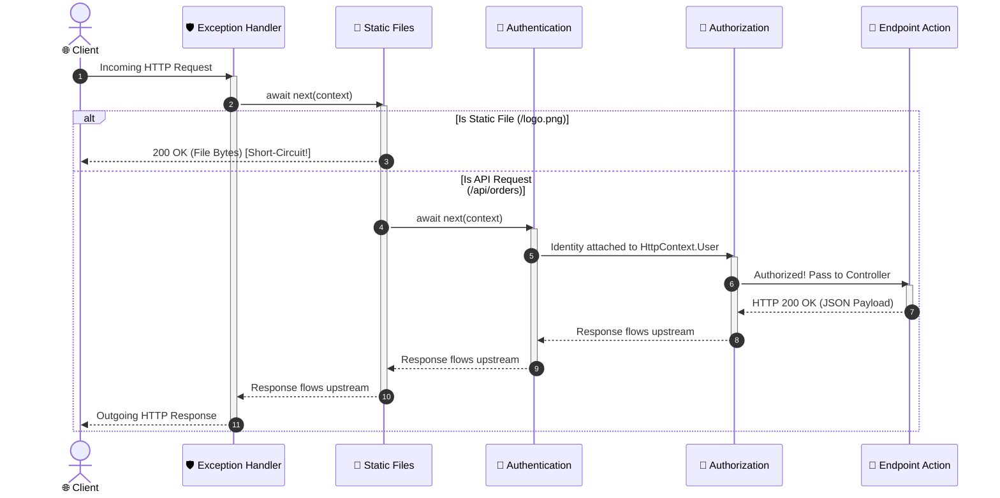

# 03. Understanding the Request Pipeline & Middleware

---

## 📖 The Real-World Story: The Nightclub Security Checkpoint

Imagine you are visiting an exclusive VIP nightclub in downtown Manhattan:

1. **The Paramedic at the Door (Exception Handling Middleware):**
   They don't check tickets. They simply stand at the outer entrance watching everyone enter. If anyone passes out, gets injured, or starts a fire anywhere inside the club, the paramedic intercepts the chaos, stabilizes the person, and hands them a polite care package without burning down the club.
2. **The Turnstile / Scanner (HTTPS Redirection & HSTS):**
   If you try to enter through the dark side alley (insecure `http://`), the security turnstile physically blocks you and shunts you to the well-lit main entrance (`https://`).
3. **The Coat Check Attendant (Static Files Middleware):**
   If you are just dropping off your jacket or picking up a printed flyer from the lobby rack (`style.css`, `logo.png`), the coat check attendant serves you immediately and sends you on your way. You never need to meet the bouncers or enter the inner sanctum. **(Short-circuiting the pipeline!)**
4. **The ID Scanner (Authentication Middleware):**
   Inspects your government passport or driver's license. It stamps your hand with your verified identity: *"This is Alice, age 28"*.
5. **The Velvet Rope Bouncer (Authorization Middleware):**
   Checks the VIP guest list. If the private room says "Band Members Only" and Alice is not in the band, the bouncer immediately hands Alice an HTTP 403 Forbidden wristband and turns her around.
6. **The Bartender / DJ (The Endpoint / Controller):**
   Alice made it through all checkpoints. The bartender pours her drink and the DJ plays her requested song.

Notice the magic: **On the way out, Alice passes back through every checkpoint in reverse order!** The cloak check can log her departure time, and the paramedic confirms she walked out alive.

---

## 🧅 Deep Technical Architecture: The Russian Doll / Onion Model



---

### 1. What is Middleware?
In ASP.NET Core, **middleware** is software assembled into an application pipeline to handle requests and responses. Each component:
- Chooses whether to pass the request to the next component in the pipeline.
- Can perform work both **before** and **after** the next component is invoked.

The pipeline delegate signature is defined as:
```csharp
public delegate Task RequestDelegate(HttpContext context);
```

---

### 2. The Three Middleware Primitives: `Use`, `Run`, and `Map`

#### A. `app.Use` (Chaining Middleware)
Passes execution down to the next delegate using `next()`:
```csharp
app.Use(async (context, next) =>
{
    // 1. Logic BEFORE the downstream endpoint runs
    var stopwatch = Stopwatch.StartNew();

    await next(context); // Calls the next middleware

    // 2. Logic AFTER the downstream endpoint returns
    stopwatch.Stop();
    Console.WriteLine($"Request {context.Request.Path} took {stopwatch.ElapsedMilliseconds}ms");
});
```

#### B. `app.Run` (Terminal Middleware)
Short-circuits the pipeline. It never calls `next()`:
```csharp
app.Run(async context =>
{
    await context.Response.WriteAsync("Terminal Response: The pipeline stops here!");
});
```

#### C. `app.Map` & `app.MapWhen` (Branching the Pipeline)
Splits the pipeline into a separate sub-branch based on request path or condition:
```csharp
app.Map("/api/internal", internalBranch =>
{
    internalBranch.Use(async (context, next) =>
    {
        // Internal security check only for /api/internal/*
        await next(context);
    });
    internalBranch.Run(async context => await context.Response.WriteAsync("Internal Portal"));
});
```

---

### 3. Middleware Execution Order is Non-Negotiable

The order in which middleware is added in `Program.cs` defines the exact order in which it executes:

```csharp
var app = builder.Build();

// 1. Exception handling must be FIRST to catch exceptions thrown downstream
app.UseExceptionHandler("/error");

// 2. Security redirections
app.UseHsts();
app.UseHttpsRedirection();

// 3. Static files served early to bypass routing and auth overhead
app.UseStaticFiles();

// 4. Routing selects which endpoint should execute
app.UseRouting();

// 5. CORS must run before Authentication
app.UseCors("AllowFrontend");

// 6. Authentication identifies WHO the user is
app.UseAuthentication();

// 7. Authorization determines WHAT the user can do
app.UseAuthorization();

// 8. Endpoints execute the matching controller or minimal API
app.MapControllers();

app.Run();
```

---

### 4. Custom Middleware Implementation Styles

#### Style 1: Convention-Based Middleware (Most Common)
```csharp
public class PerformanceMonitoringMiddleware
{
    private readonly RequestDelegate _next;
    private readonly ILogger<PerformanceMonitoringMiddleware> _logger;

    public PerformanceMonitoringMiddleware(RequestDelegate next, ILogger<PerformanceMonitoringMiddleware> logger)
    {
        _next = next;
        _logger = logger;
    }

    public async Task InvokeAsync(HttpContext context)
    {
        var sw = Stopwatch.StartNew();
        try
        {
            await _next(context);
        }
        finally
        {
            sw.Stop();
            _logger.LogInformation("HTTP {Method} {Path} responded with {Status} in {Ms}ms",
                context.Request.Method, context.Request.Path, context.Response.StatusCode, sw.ElapsedMilliseconds);
        }
    }
}

// Clean extension method syntax:
public static class MiddlewareExtensions
{
    public static IApplicationBuilder UsePerformanceMonitoring(this IApplicationBuilder builder)
        => builder.UseMiddleware<PerformanceMonitoringMiddleware>();
}
```

---

### 5. Static Files Middleware (`UseStaticFiles`)
By default, ASP.NET Core does not serve raw HTML, CSS, JavaScript, or image files unless `app.UseStaticFiles()` is called.
- Files must be placed in the **`wwwroot`** folder (the web root).
- `wwwroot/images/logo.png` is requested via `https://localhost:5000/images/logo.png`.
- Requests matching a physical file in `wwwroot` are served immediately and short-circuit routing and authentication.

---

## 💻 Practical Code: Simulating the Middleware Onion Pipeline

Check out [MiddlewareDemo.cs](./MiddlewareDemo.cs) for a complete working implementation of the Russian Doll pipeline with custom logging, auth guards, exception handling, and short-circuiting.

---

## ⚠️ Interview Traps & Production Gotchas

> [!CAUTION]
> **Trap 1: Modifying Response Headers AFTER calling `next()`.**
> Once a downstream middleware (or endpoint) writes the first byte to `context.Response.Body`, the HTTP headers are sent over the TCP wire and **locked**. Trying to do `context.Response.Headers.Add(...)` after `await next()` will throw `InvalidOperationException: Headers are read-only, response has already started`. Use `context.Response.OnStarting(callback)` if you need to append headers just before the stream flushes.

> [!WARNING]
> **Trap 2: `UseAuthentication()` Placed AFTER `UseAuthorization()`.**
> If you write `app.UseAuthorization()` before `app.UseAuthentication()`, the authorization middleware checks `context.User` before the authentication middleware had a chance to decrypt the cookie or validate the JWT! As a result, every single user is treated as anonymous, and every `[Authorize]` endpoint fails with 401 Unauthorized.
