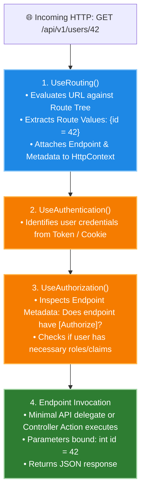

# 04. Routing and Endpoints in ASP.NET Core

---

## 📖 The Real-World Story: The Automated Postal Sorting Center

Imagine an automated postal sorting facility:
Every second, thousands of letters arrive in postal trucks. Each envelope has:
1. **A Destination Address (`/api/v1/customers/42/invoices`):** Tells the facility the exact country, city, street, and mailbox.
2. **A Delivery Stamp (`GET`, `POST`, `DELETE`):** Tells the facility whether to *inspect* the mailbox, *drop a new package* inside, or *demolish* the box.
3. **Sticky Notes on the Envelope (`?currency=USD&sort=desc`):** Special instructions for how the recipient should process the parcel.

The postal scanner evaluates the address against a digital roadmap. If the address matches a house whose mailbox requires a security key, the facility holds the letter until security validates the sender. If the address doesn't exist anywhere on the map, the facility marks it **Return to Sender: 404 Not Found**.

This intelligent matching and dispatching engine is **Routing in ASP.NET Core**.

---

## 🗺️ Deep Technical Architecture: Endpoint Routing (Two-Phase Execution)

In modern ASP.NET Core, routing operates in **two decoupled phases**:
1. **Endpoint Matching (`UseRouting`):** Selects which endpoint matches the URL and attaches metadata to the `HttpContext`.
2. **Endpoint Execution (`UseEndpoints` / `Map...`):** Runs authorization checks and finally invokes the endpoint handler.



---

### 1. What is Routing?
Routing is the process of examining an incoming HTTP request's **URL path** and **HTTP Method**, extracting parameters, and dispatching the request to the matching executable delegate or controller action.

---

### 2. Conventional Routing vs. Attribute Routing

#### A. Conventional Routing (Classic MVC)
Defines global URI templates in `Program.cs`. Routes are resolved by convention:
```csharp
app.MapControllerRoute(
    name: "default",
    pattern: "{controller=Home}/{action=Index}/{id?}");
```
- A request to `/Products/Details/5` executes `ProductsController.Details(int id)`.
- Best for server-rendered HTML applications with standardized page structures.

#### B. Attribute Routing (RESTful APIs)
Routes are declared directly above controllers and actions using C# attributes:
```csharp
[ApiController]
[Route("api/[controller]")] // Resolves to /api/users
public class UsersController : ControllerBase
{
    [HttpGet("{id:int}")]    // Matches GET /api/users/42
    public IActionResult GetById(int id) => Ok(new { UserId = id });
}
```
- Best for REST APIs because URIs are explicitly coupled to their exact endpoints and immune to global pattern changes.

---

### 3. Route Parameters vs. Query String Parameters

| Feature | Route Parameters | Query String Parameters |
| :--- | :--- | :--- |
| **Location** | In the URL path: `/users/{id}` | After the `?` symbol: `/users?role=admin&page=2` |
| **Purpose** | Uniquely identifies a specific resource | Filters, sorts, searches, or paginates resources |
| **Example URL** | `https://api.contoso.com/orders/8849` | `https://api.contoso.com/orders?status=shipped&limit=20` |
| **ASP.NET Binding** | Automatically bound to method parameter by name | Automatically bound to method parameter by name |

#### Optional Parameters and Default Values:
```csharp
// Optional parameter with '?'
app.MapGet("/reports/{year?}", (int? year) => $"Report for year: {year ?? DateTime.UtcNow.Year}");

// Default value directly in route pattern
app.MapGet("/catalog/{category=all}", (string category) => $"Viewing category: {category}");
```

---

### 4. Route Constraints (Preventing Bad Matches)

Route constraints validate the data format of URL segments **before** route selection completes:

```csharp
// Constraint: id MUST be an integer
app.MapGet("/users/{id:int}", (int id) => $"User ID: {id}");

// Constraint: id MUST be a valid GUID
app.MapGet("/files/{id:guid}", (Guid id) => $"File GUID: {id}");

// Range and Length constraints
app.MapGet("/members/{age:range(18, 120)}", (int age) => $"Adult member: {age}");
app.MapGet("/codes/{promo:length(6)}", (string promo) => $"Promo code: {promo}");
```

> [!NOTE]
> **Route Constraint Failure Behavior:** If a request comes in for `/users/abc`, the `{id:int}` constraint **fails**, meaning the route table does not match this endpoint. The framework returns **404 Not Found** (not 400 Bad Request), allowing other route overloads to attempt matching.

---

### 5. HTTP Methods (Verbs) & REST Semantics

| HTTP Verb | Operation | Idempotent? | Safe (Read-only)? | Typical Response |
| :--- | :--- | :---: | :---: | :--- |
| **GET** | Read resource | ✅ Yes | ✅ Yes | `200 OK` + Data |
| **POST** | Create new resource | ❌ No | ❌ No | `201 Created` + `Location` header |
| **PUT** | Replace existing resource completely | ✅ Yes | ❌ No | `200 OK` or `204 No Content` |
| **PATCH** | Partially update resource | ❌ No | ❌ No | `200 OK` or `204 No Content` |
| **DELETE** | Remove resource | ✅ Yes | ❌ No | `200 OK` or `204 No Content` |

*Idempotent: Calling the endpoint multiple times with the same parameters produces the identical server state.*

---

### 6. Modern Minimal API Endpoint Mapping & Route Groups

In modern ASP.NET Core, Minimal APIs provide a clean, high-performance way to define endpoints without controller boilerplate:

```csharp
var app = builder.Build();

// Route Group with common prefix and authorization
var api = app.MapGroup("/api/v1/orders")
             .RequireAuthorization();

api.MapGet("/", () => Results.Ok(new[] { "Order 1", "Order 2" }));
api.MapGet("/{id:guid}", (Guid id) => Results.Ok(new { OrderId = id }));
api.MapPost("/", (CreateOrderDto dto) => Results.Created($"/api/v1/orders/{Guid.NewGuid()}", dto));
api.MapDelete("/{id:guid}", (Guid id) => Results.NoContent());
```

---

## 💻 Practical Code: Simulating the Endpoint Routing Engine

Check out [RoutingDemo.cs](./RoutingDemo.cs) to see how URL parsing, route template extraction, constraint validation, and method dispatching work.

---

## ⚠️ Interview Traps & Production Gotchas

> [!WARNING]
> **Trap 1: Ambiguous Match Exception.**
> If you define two routes with identical specificity:
> - `[HttpGet("users/{id}")]`
> - `[HttpGet("users/{name}")]`
> 
> When a request arrives for `/users/john`, the routing engine cannot decide between the two and throws an **`AmbiguousMatchException: The request matched multiple endpoints`** returning a 500 error! Always use route constraints like `{id:int}` to disambiguate.

> [!CAUTION]
> **Trap 2: Using PUT for Partial Updates.**
> Under HTTP RFC standards, `PUT` represents a complete replacement. If an entity has fields `Name`, `Email`, and `Age`, and a client sends `PUT /users/1` with only `{"Name": "Bob"}`, the database record's `Email` and `Age` should theoretically be wiped to `null`! Use **`PATCH`** for partial modifications.
