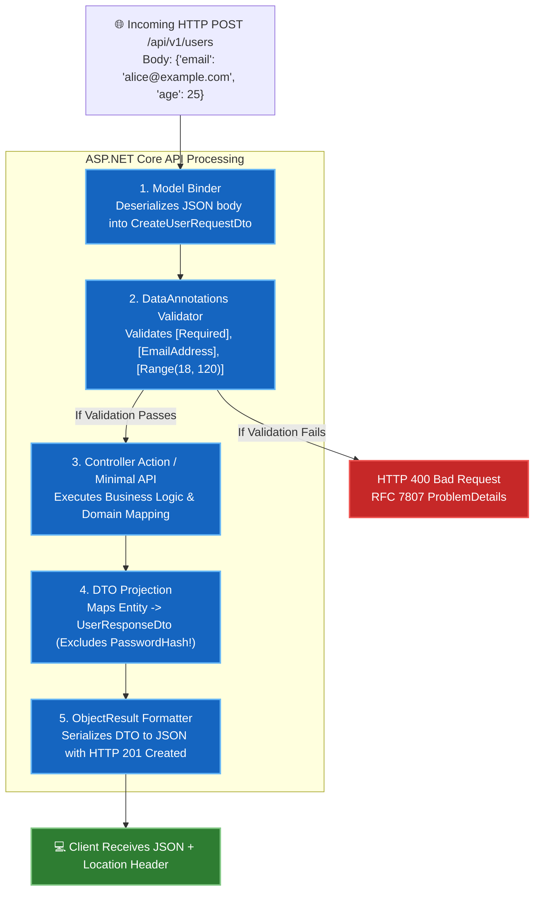

# 05. Building REST APIs in ASP.NET Core

---

## 📖 The Real-World Story: The Diplomatic Courier & The Sovereign Embassy

Imagine an international embassy in a foreign capital:

If a foreign citizen wants to request a trade license or visa:
1. **You Never Allow Them Into the Secret Vaults (The Entity Hazard):**
   The embassy will never give a visitor the keys to the private diplomatic vault or the database containing classified internal security notes (`User.PasswordHash`, `User.InternalSecurityFlags`). 
2. **Standardized Diplomatic Dossiers (DTOs - Data Transfer Objects):**
   Instead, the visitor must fill out a specific public application form (The Request DTO). When the embassy grants the visa, they issue a standardized, stamped visa paper (The Response DTO) containing only the information the visitor is permitted to see.
3. **The Diplomatic Seal (HTTP Status Codes):**
   Every reply arrives with an unmistakable international seal:
   - Green Seal (**200 OK / 201 Created**): "Approved and issued."
   - Yellow Seal (**400 Bad Request / 422 Unprocessable Entity**): "Your form was filled out incorrectly."
   - Red Seal (**401 Unauthorized / 403 Forbidden**): "You lack diplomatic credentials."
   - Black Seal (**404 Not Found**): "The requested embassy record does not exist."
4. **Standard Incident Reports (RFC 7807 Problem Details):**
   If an error occurs, the embassy provides a standard, machine-readable incident document rather than an unformatted internal error message.

This diplomatic protocol is the foundation of **REST APIs in ASP.NET Core**.

---

## 🏛️ Deep Technical Architecture: The REST Request-Response Cycle



---

### 1. What is REST?
**REST (Representational State Transfer)** is an architectural style designed by Roy Fielding in 2000 for distributed hypermedia systems. Key constraints include:
- **Client-Server Separation:** UI concerns are completely separated from data storage concerns.
- **Statelessness:** Every request from client to server must contain all necessary information to understand and process the request; no session state is retained on the server.
- **Cacheability:** Responses must explicitly declare whether they are cacheable.
- **Uniform Interface:** Resources are identified by URIs, manipulated through representations (JSON/XML), and messages are self-descriptive.

---

### 2. Minimal APIs vs. Controller-Based APIs

Modern ASP.NET Core gives you two distinct, first-class ways to build APIs:

#### A. Minimal APIs (Modern, Fast, Low-Ceremony)
```csharp
var builder = WebApplication.CreateBuilder(args);
var app = builder.Build();

app.MapGet("/api/products/{id:int}", async (int id, IProductService service) =>
{
    var product = await service.GetByIdAsync(id);
    return product is not null 
        ? Results.Ok(product) 
        : Results.NotFound(new { Message = $"Product #{id} not found" });
});

app.Run();
```
*Best for: Microservices, cloud functions, high-performance endpoints with minimal memory overhead.*

#### B. Controller-Based APIs (Structured, Enterprise, Attribute-Driven)
```csharp
[ApiController]
[Route("api/v1/[controller]")]
public class ProductsController : ControllerBase
{
    private readonly IProductService _service;

    public ProductsController(IProductService service) => _service = service;

    [HttpGet("{id:int}")]
    [ProducesResponseType(StatusCodes.Status200OK, Type = typeof(ProductResponseDto))]
    [ProducesResponseType(StatusCodes.Status404NotFound)]
    public async Task<ActionResult<ProductResponseDto>> GetById(int id)
    {
        var product = await _service.GetByIdAsync(id);
        if (product is null) return NotFound();
        return Ok(product);
    }
}
```
*Best for: Large enterprise applications with complex cross-cutting filters, extensive teams, and unified conventions.*

---

### 3. The Power of `[ApiController]`
Adding the `[ApiController]` attribute to a controller class activates essential behaviors:
1. **Automatic Model Validation (HTTP 400):** You do **not** need to write `if (!ModelState.IsValid) return BadRequest(ModelState);`. The framework intercepts invalid models before your action runs and returns an RFC 7807 ProblemDetails payload automatically.
2. **Automatic Parameter Source Inference:**
   - Complex types (`CreateUserDto`) automatically bind from `[FromBody]`.
   - Primitive types (`int id`, `string sort`) automatically bind from `[FromRoute]` or `[FromQuery]`.
   - Service types automatically bind from `[FromServices]`.

---

### 4. Model Binding Sources

You can explicitly enforce where data originates using attributes:
- **`[FromRoute]`:** Bound from URL path template (`/users/{id}`).
- **`[FromQuery]`:** Bound from URL query string (`/users?role=admin&page=1`).
- **`[FromBody]`:** Deserialized from HTTP request body (JSON/XML).
- **`[FromHeader]`:** Read from HTTP headers (`X-Client-Version`).
- **`[FromServices]`:** Injected directly from the Dependency Injection container into the method.

---

### 5. Data Validation via DataAnnotations

```csharp
public class RegisterUserRequestDto
{
    [Required(ErrorMessage = "Email is required.")]
    [EmailAddress(ErrorMessage = "Invalid email format.")]
    public string Email { get; set; } = string.Empty;

    [Required]
    [StringLength(100, MinimumLength = 8, ErrorMessage = "Password must be between 8 and 100 characters.")]
    public string Password { get; set; } = string.Empty;

    [Range(18, 120, ErrorMessage = "Age must be between 18 and 120.")]
    public int Age { get; set; }
}
```

---

### 6. Why DTOs are Mandatory (The Over-Posting Vulnerability)

Never bind HTTP requests directly to database entities:

```csharp
// ❌ DANGEROUS: Binding directly to Database Entity
[HttpPost]
public async Task<IActionResult> CreateUser(AppUser user)
{
    // A malicious user can send:
    // { "Username": "Hacker", "IsAdmin": true, "AccountBalance": 1000000 }
    // The model binder binds IsAdmin = true directly into the DB entity!
    _db.Users.Add(user);
    await _db.SaveChangesAsync();
    return Ok(user);
}

// ✅ SECURE: Binding to a strictly controlled DTO
[HttpPost]
public async Task<IActionResult> CreateUser(CreateUserRequestDto dto)
{
    var user = new AppUser
    {
        Username = dto.Username,
        Email = dto.Email,
        IsAdmin = false, // Controlled by server logic only!
        AccountBalance = 0
    };
    _db.Users.Add(user);
    await _db.SaveChangesAsync();
    return CreatedAtAction(nameof(GetUserById), new { id = user.Id }, new UserResponseDto(user.Id, user.Username, user.Email));
}
```

---

### 7. Standardized Error Responses: RFC 7807 Problem Details

Modern APIs return standardized JSON problem details:

```json
{
  "type": "https://tools.ietf.org/html/rfc7231#section-6.5.1",
  "title": "One or more validation errors occurred.",
  "status": 400,
  "traceId": "00-4bf92f3577b34da6a3ce929d0e0e4736-00",
  "errors": {
    "Email": ["The Email field is not a valid e-mail address."],
    "Age": ["Age must be between 18 and 120."]
  }
}
```

---

## 💻 Practical Code: Complete REST API Simulation

Check out [RestApiDemo.cs](./RestApiDemo.cs) for a complete working demonstration of DTO validation, model binding, status code handling, and ProblemDetails generation.

---

## ⚠️ Interview Traps & Production Gotchas

> [!WARNING]
> **Trap 1: Returning `IQueryable<T>` Directly from API Actions.**
> Returning an EF Core `IQueryable<T>` directly from an action causes JSON serialization to trigger database execution **during** output streaming. If a database error occurs halfway through, headers have already been sent as HTTP 200 OK, resulting in a corrupted, half-serialized JSON response! Always execute the query with `.ToListAsync()` or project into a DTO before returning.

> [!CAUTION]
> **Trap 2: Ignoring 201 Created Location Headers.**
> When creating a resource via `POST`, REST standards require returning **HTTP 201 Created** along with a **`Location`** response header pointing to the newly created resource URI (e.g. `Location: /api/v1/users/42`). Use `CreatedAtAction()` or `Results.Created()` rather than a plain `200 OK`.
