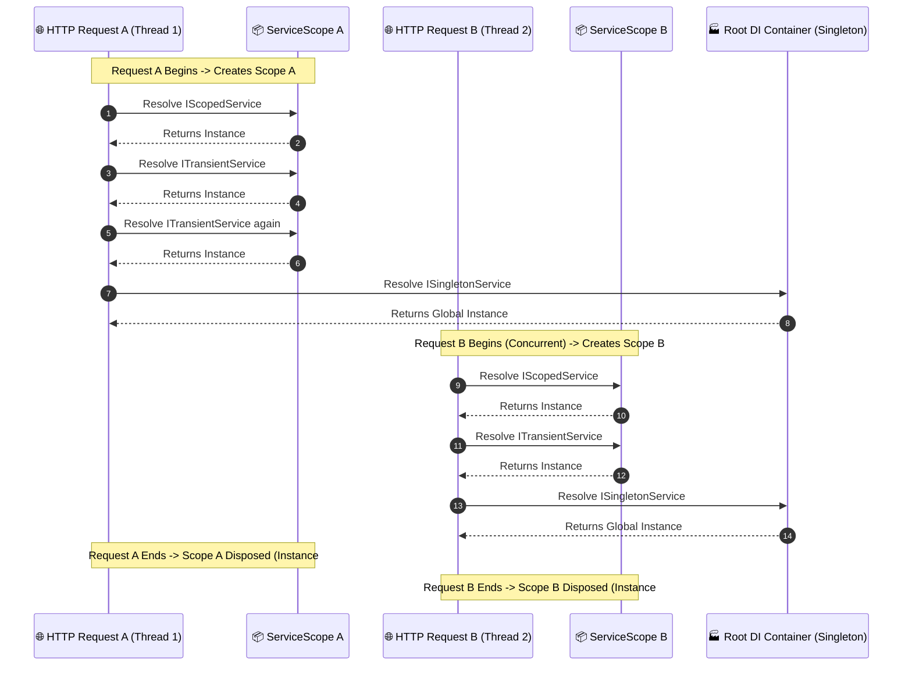

# 06. Dependency Injection in ASP.NET Core

---

## 📖 The Real-World Story: The Michelin-Starred Kitchen & The Dishwasher

Imagine a Michelin-starred restaurant kitchen:

If a head chef had to stop cooking, leave the kitchen, drive out to a farm, milk a cow, forge an iron skillet, and chop firewood every time a customer ordered an omelet, the restaurant would go bankrupt in thirty minutes. **That is tight coupling (`new MyDatabaseConnection()`).**

Instead, a modern kitchen operates on **Inversion of Control (IoC)**:
The head chef stands at their prep station and declares on a checklist what tools they require:
*"To prepare meals, I require a knife (`IKnife`), a frying pan (`IPan`), and fresh eggs (`IIngredients`)."*

The Kitchen Dispatcher (The DI Container) supplies these items before the chef touches a spatula:

1. **The Paper Towel (`Transient` Lifetime):**
   Every time the chef reaches for a paper towel, they tear off a brand-new sheet. It is used once, thrown in the bin, and never reused.
2. **The Cutting Board for Table #4 (`Scoped` Lifetime):**
   When Table #4 orders dinner, a dedicated cutting board is assigned to their meal. The appetizer chef and the entrée chef working on Table #4 share this exact board. When Table #4 finishes dessert and leaves (the HTTP request completes), the board is cleaned and sanitized (`Dispose()`).
3. **The Walk-in Industrial Cold Freezer (`Singleton` Lifetime):**
   Built once when the restaurant opened. Every chef, on every shift, for every table, for the entire life of the restaurant shares this exact same cold storage room.

---

## ⏱️ Deep Technical Architecture: The Three Service Lifetimes



---

### 1. What is Dependency Injection?
**Dependency Injection (DI)** is a software design pattern implementing **Inversion of Control (IoC)** between classes and their dependencies. Instead of a class instantiating its own dependencies using `new`, the dependencies are injected from the outside (typically via the class constructor).

---

### 2. Service Lifetime Breakdown

| Lifetime | Method | When Instance is Created | Typical Use Cases |
| :--- | :--- | :--- | :--- |
| **`Transient`** | `AddTransient<T, U>()` | Every single time requested from the container. | Lightweight, stateless utilities, formatters, calculators. |
| **`Scoped`** | `AddScoped<T, U>()` | Once per client HTTP request lifecycle (`IServiceScope`). | Entity Framework `DbContext`, user profile contexts, repositories. |
| **`Singleton`** | `AddSingleton<T, U>()` | Once when first requested (or at startup); lives forever. | In-memory caches, background queue workers, configuration options. |

---

### 3. Registering Services in `Program.cs`

```csharp
var builder = WebApplication.CreateBuilder(args);

// Registering Interfaces to Implementations:
builder.Services.AddTransient<ITokenGenerator, JwtTokenGenerator>();
builder.Services.AddScoped<IOrderRepository, SqlOrderRepository>();
builder.Services.AddSingleton<ICacheService, InMemoryCacheService>();

var app = builder.Build();
```

---

### 4. Constructor Injection in Controllers and Minimal APIs

#### A. Controller Constructor Injection:
```csharp
[ApiController]
[Route("api/[controller]")]
public class OrdersController : ControllerBase
{
    private readonly IOrderRepository _repository;
    private readonly ILogger<OrdersController> _logger;

    // The DI container automatically resolves dependencies during instantiation
    public OrdersController(IOrderRepository repository, ILogger<OrdersController> logger)
    {
        _repository = repository;
        _logger = logger;
    }

    [HttpGet]
    public async Task<IActionResult> GetOrders()
    {
        _logger.LogInformation("Fetching orders...");
        return Ok(await _repository.GetAllAsync());
    }
}
```

#### B. Minimal API Parameter Injection:
In Minimal APIs, dependencies can be declared directly as lambda parameters without attributes:
```csharp
app.MapGet("/api/orders", async (IOrderRepository repository, ILogger<Program> logger) =>
{
    logger.LogInformation("Direct injection into minimal API lambda");
    return Results.Ok(await repository.GetAllAsync());
});
```

---

### 5. The Dangerous "Captive Dependency" Bug

> [!CAUTION]
> **What is a Captive Dependency?**
> A Captive Dependency occurs when a service with a **longer lifetime** (e.g. `Singleton`) holds onto a service with a **shorter lifetime** (e.g. `Scoped`).

```csharp
// ❌ CRITICAL BUG: Injecting Scoped DbContext into a Singleton Service!
builder.Services.AddScoped<AppDbContext>();
builder.Services.AddSingleton<OrderMetricsCollector>(); // Has AppDbContext in constructor!

public class OrderMetricsCollector
{
    private readonly AppDbContext _db; // ⚠️ CAPTURED FOREVER!

    public OrderMetricsCollector(AppDbContext db)
    {
        _db = db;
    }
}
```

#### Why is this catastrophic in production?
1. **Memory Leak:** The `AppDbContext` instance is never garbage collected because the Singleton holds a live reference forever.
2. **Concurrency Collisions:** `DbContext` is **not thread-safe**. When concurrent HTTP requests trigger `OrderMetricsCollector`, multiple threads attempt to execute queries across the same `DbContext` instance, throwing `InvalidOperationException: A second operation was started on this context before a previous operation completed`.

#### How to Fix It:
Inject `IServiceScopeFactory` into the Singleton, and manually create short-lived scopes when work is performed:
```csharp
public class OrderMetricsCollector
{
    private readonly IServiceScopeFactory _scopeFactory;

    public OrderMetricsCollector(IServiceScopeFactory scopeFactory) => _scopeFactory = scopeFactory;

    public async Task RecordMetricAsync()
    {
        using var scope = _scopeFactory.CreateScope();
        var db = scope.ServiceProvider.GetRequiredService<AppDbContext>();
        // db is cleanly created and disposed within this method!
    }
}
```

---

## 💻 Practical Code: Simulating DI Lifetimes & Captive Detection

Check out [DependencyInjectionDemo.cs](./DependencyInjectionDemo.cs) for a complete working simulation of the DI container, lifetime tracking GUIDs, and scope disposal verification.

---

## ⚠️ Interview Traps & Production Gotchas

> [!WARNING]
> **Trap 1: Resolving Scoped Services in Background Workers (`IHostedService`).**
> `IHostedService` / `BackgroundService` runs as a `Singleton` outside the context of any incoming HTTP request. If you inject a Scoped service directly into its constructor, application startup will crash with `InvalidOperationException: Cannot resolve scoped service from root provider`. Always inject `IServiceScopeFactory`.

> [!TIP]
> **Trap 2: `IDisposable` Cleanup by DI.**
> Any service implementing `IDisposable` registered with `Transient` or `Scoped` is automatically tracked and disposed by the container when the scope ends. **Never** manually call `service.Dispose()` on an injected dependency—the DI container owns the lifetime!
