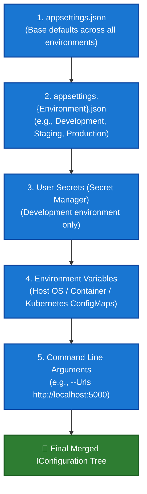

# 07. Configuration and Environments in ASP.NET Core

---

## 📖 The Real-World Story: The Electrician’s Circuit Breaker & The Stage Lighting Grid

Imagine a massive world-tour concert arena:

1. **The Factory Default Presets (`appsettings.json`):**
   When the soundboard is shipped from the manufacturer, it has baseline default settings: volume at 50%, speakers wired in stereo, emergency cutoff enabled. These settings are safe and baseline for everyone.
2. **The Tour Rehearsal Adjustments (`appsettings.Development.json`):**
   When sound technicians are running practice rehearsals with no fans in the arena, they flip the board to "Rehearsal Mode." Extra diagnostics are turned on, detailed error beeps sound on faulty cables, and safety limits are relaxed for audio stress testing.
3. **The City Venue Overrides (Environment Variables):**
   When the tour lands in Tokyo or London, the city power grid imposes unique voltage constraints. The local venue chief plugs in environmental adapters. **These local environmental settings immediately override whatever default values were printed in the manual.**
4. **The Stage Manager’s Keycard (User Secrets & Key Vault):**
   The master pyrotechnics launch codes and bank payout credentials aren't taped to the public soundboard for every crew member to photograph. They are locked inside a fireproof biometric keycard safe (`dotnet user-secrets` in local dev; Azure Key Vault in production).

In ASP.NET Core, **Configuration** operates under this exact hierarchical layering principle: settings flow from base defaults, through environment-specific overrides, up to environment variables and secure secret stores.

---

## 🎛️ Deep Technical Architecture: The Configuration Provider Hierarchy

When `WebApplication.CreateBuilder(args)` initializes, it builds an `IConfiguration` pipeline by registering providers in a **strict order of precedence** (last provider registered wins):



---

### 1. `appsettings.json` and `appsettings.Development.json`

Configuration files are structured hierarchically using JSON:

```json
// appsettings.json
{
  "Logging": {
    "LogLevel": {
      "Default": "Information",
      "Microsoft.AspNetCore": "Warning"
    }
  },
  "PaymentGateway": {
    "BaseUrl": "https://api.stripe.com/v1",
    "TimeoutSeconds": 30,
    "RetryAttempts": 3
  },
  "AllowedHosts": "*"
}
```

```json
// appsettings.Development.json
{
  "Logging": {
    "LogLevel": {
      "Default": "Debug",
      "Microsoft.AspNetCore": "Information"
    }
  },
  "PaymentGateway": {
    "BaseUrl": "https://sandbox.api.stripe.com/v1"
  }
}
```

When running in `Development`, `PaymentGateway:BaseUrl` becomes the sandbox URL, while `TimeoutSeconds` (30) and `RetryAttempts` (3) are cleanly inherited from `appsettings.json`.

---

### 2. Reading Configuration Values

ASP.NET Core provides multiple mechanisms to consume configuration:

#### A. Direct Indexer & Sections:
```csharp
var timeout = builder.Configuration["PaymentGateway:TimeoutSeconds"];
var retry = builder.Configuration.GetValue<int>("PaymentGateway:RetryAttempts", defaultValue: 1);
```

#### B. Strongly-Typed Configuration via Options Pattern (Best Practice):
Instead of passing loosely-typed strings across your application, bind sections to strongly typed C# classes:

```csharp
public class PaymentOptions
{
    public const string SectionName = "PaymentGateway";

    [Required]
    [Url]
    public string BaseUrl { get; set; } = string.Empty;

    [Range(1, 120)]
    public int TimeoutSeconds { get; set; } = 30;

    [Range(1, 5)]
    public int RetryAttempts { get; set; } = 3;
}
```

Register in `Program.cs` with validation:
```csharp
builder.Services.AddOptions<PaymentOptions>()
    .Bind(builder.Configuration.GetSection(PaymentOptions.SectionName))
    .ValidateDataAnnotations()
    .ValidateOnStart(); // Catches misconfigurations at boot before first HTTP request!
```

---

### 3. Comparing the Three Options Interfaces

| Interface | Service Lifetime | Reloads on File Change? | Best Used For |
| :--- | :--- | :---: | :--- |
| **`IOptions<T>`** | `Singleton` | ❌ No | Static configuration that never changes without app restart. Safely inject into Singletons. |
| **`IOptionsSnapshot<T>`** | `Scoped` | ✅ Yes (per request) | Reloads when configuration updates on disk; evaluated once per HTTP request. Cannot be injected into Singletons! |
| **`IOptionsMonitor<T>`** | `Singleton` | ✅ Yes (real-time) | Real-time notifications via `OnChange` callback; safe to inject into Singletons. |

---

### 4. Environments: Development vs. Staging vs. Production

ASP.NET Core uses the `ASPNETCORE_ENVIRONMENT` environment variable to determine runtime behavior:

```csharp
var app = builder.Build();

if (app.Environment.IsDevelopment())
{
    app.UseDeveloperExceptionPage();
    app.UseSwagger();
    app.UseSwaggerUI();
}
else
{
    app.UseExceptionHandler("/Error");
    app.UseHsts();
}
```

Common environment values:
- `Development`: Optimized for developer velocity, verbose errors, hot reload.
- `Staging`: Production mirror for QA, automated load tests, integration tests.
- `Production`: Optimized for high throughput, security, sanitized error messages.

---

### 5. Managing Secrets Securely

> [!CAUTION]
> **Never commit API keys, connection strings, or JWT signing secrets to Git!**

#### Local Development: Secret Manager (`User Secrets`)
Stored outside the project directory in your user profile:
```bash
# Initialize User Secrets in your project
dotnet user-secrets init

# Set a local secret
dotnet user-secrets set "PaymentGateway:ApiKey" "sk_test_51MzExampleSecret123"

# List configured secrets
dotnet user-secrets list
```
On Windows: `%APPDATA%\Microsoft\UserSecrets\<guid>\secrets.json`  
On macOS/Linux: `~/.microsoft/usersecrets/<guid>/secrets.json`

#### Production: Azure Key Vault / AWS Secrets Manager / HashiCorp Vault
In production, register cloud secret providers into the builder pipeline:
```csharp
if (builder.Environment.IsProduction())
{
    builder.Configuration.AddAzureKeyVault(
        new Uri("https://my-prod-vault.vault.azure.net/"),
        new DefaultAzureCredential());
}
```

---

### 6. Logging Configuration & Minimum Log Levels

Logging levels control verbosity in ascending order:
`Trace` (0) → `Debug` (1) → `Information` (2) → `Warning` (3) → `Error` (4) → `Critical` (5)

Configured per category in `appsettings.json`:
```json
"Logging": {
  "LogLevel": {
    "Default": "Information",
    "Microsoft.AspNetCore.Hosting": "Warning",
    "Microsoft.EntityFrameworkCore.Database.Command": "Warning"
  }
}
```

---

## 💻 Practical Code: Configuration Pipeline & Options Simulation

Check out [ConfigurationDemo.cs](./ConfigurationDemo.cs) for a runnable simulation demonstrating:
1. Hierarchical provider layering and override resolution.
2. Strongly-typed Options pattern binding and data annotation validation.
3. Reload notification simulation with `IOptionsMonitor<T>`.

---

## ⚠️ Interview Traps & Production Gotchas

> [!WARNING]
> **Trap 1: Injecting `IOptionsSnapshot<T>` into a Singleton Service.**  
> Because `IOptionsSnapshot<T>` is registered with a `Scoped` lifetime (to ensure consistent options throughout an HTTP request), injecting it into a `Singleton` service triggers a **Captive Dependency exception** (`InvalidOperationException: Cannot consume scoped service from singleton`). Always use `IOptionsMonitor<T>` in singletons.

> [!TIP]
> **Trap 2: Environment Variable Delimiter Syntax across Operating Systems.**  
> In JSON, nested keys use colons: `PaymentGateway:ApiKey`. However, on Linux and Docker bash shells, colons are invalid in variable names. Use **double underscores (`__`)** instead:  
> `export PaymentGateway__ApiKey="sk_live_12345"`  
> ASP.NET Core automatically maps `__` to `:` during environment variable parsing.

> [!CAUTION]
> **Trap 3: Calling `builder.Configuration.Build()` inside `Program.cs`.**  
> Developers often call `builder.Configuration.Build()` manually to read a value during startup. This builds an extra copy of the entire configuration tree, resulting in double file reads, disconnected reload tokens, and subtle memory overhead. Access values directly using `builder.Configuration["Key"]` instead.
