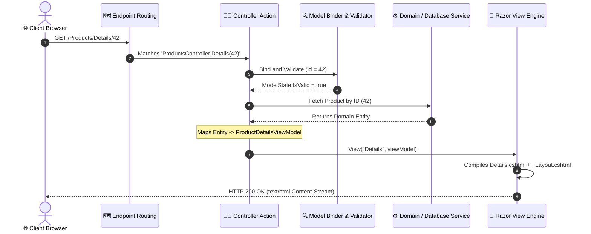

# 08. Controllers and MVC Architecture in ASP.NET Core

---

## 📖 The Real-World Story: The Fine-Dining Restaurant Front-of-House

Imagine visiting a Michelin-starred Parisian restaurant:

1. **The Waiter / Captain (The Controller):**
   The waiter welcomes you at your table. They take your order ("Table 3 wants the duck confit"), validate your request ("Is anyone allergic to nuts?"), and deliver the order slips back to the kitchen staff. **The waiter does not cook the meat.** They simply orchestrate communication between the guest and the kitchen.
2. **The Kitchen Dish / Recipe Record (The Model & ViewModel):**
   In the kitchen, the chef prepares the ingredients and sets the hot dish on a platter with inventory tracking codes. The ViewModel is custom-tailored for the table: it contains only the edible food and wine pairing notes needed for tonight's dinner presentation.
3. **The Ceramic Plating & Dining Ambience (The View & Layout):**
   Before the dish reaches your table, it is plated on fine porcelain, garnished with micro-greens, placed under dim chandelier lighting, and set upon an ironed tablecloth. This visual presentation is the **Razor View**. The tablecloth and chandelier are the shared **`_Layout.cshtml`** that frame every course served tonight.

This clean separation of responsibilities ensures that changes to the restaurant's decor (View) never break the cooking recipes (Model), and the waiter (Controller) can serve hundreds of different meals through a standard procedure.

---

## 🎭 Deep Technical Architecture: The MVC Request Lifecycle



---

### 1. Controllers and Actions

In ASP.NET Core MVC, a controller inherits from `Microsoft.AspNetCore.Mvc.Controller`:

```csharp
public class ProductsController : Controller
{
    private readonly IProductService _productService;

    public ProductsController(IProductService productService)
    {
        _productService = productService;
    }

    // GET: /Products
    public async Task<IActionResult> Index()
    {
        var products = await _productService.GetFeaturedProductsAsync();
        var viewModel = products.Select(p => new ProductSummaryViewModel
        {
            Id = p.Id,
            Title = p.Name,
            FormattedPrice = p.Price.ToString("C")
        }).ToList();

        return View(viewModel); // Resolves Views/Products/Index.cshtml
    }

    // GET: /Products/Create
    public IActionResult Create()
    {
        return View(new CreateProductViewModel());
    }

    // POST: /Products/Create
    [HttpPost]
    [ValidateAntiForgeryToken] // Protects against Cross-Site Request Forgery
    public async Task<IActionResult> Create(CreateProductViewModel model)
    {
        if (!ModelState.IsValid)
        {
            // Validation failed: Re-render form with field error messages
            return View(model);
        }

        await _productService.AddProductAsync(model.ToEntity());
        TempData["SuccessMessage"] = "Product created successfully!";
        return RedirectToAction(nameof(Index)); // PRG (Post-Redirect-Get) Pattern
    }
}
```

---

### 2. Passing State: `ViewData` vs. `ViewBag` vs. `TempData`

| Mechanism | Type Safety | Scope & Lifetime | Storage Mechanism |
| :--- | :---: | :--- | :--- |
| **`ViewData`** | Weakly Typed (`Dictionary<string, object>`) | Single request (Controller to current View) | In-memory request dictionary |
| **`ViewBag`** | Dynamic (`dynamic`) wrapper over `ViewData` | Single request (Controller to current View) | In-memory dynamic properties |
| **`TempData`** | Weakly Typed (`Dictionary<string, object>`) | Survives a single redirect (PRG pattern) | Encrypted Cookie / Session provider |

```csharp
// Setting data in Controller:
ViewData["Title"] = "Catalog";
ViewBag.CategoryCount = 12;
TempData["Alert"] = "Saved successfully!";

// Consuming in Razor View (.cshtml):
<h1>@ViewData["Title"]</h1>
<p>Total Categories: @ViewBag.CategoryCount</p>
@if (TempData["Alert"] != null)
{
    <div class="alert alert-success">@TempData["Alert"]</div>
}
```

---

### 3. Razor Syntax & Shared Layouts

Razor files blend C# code seamlessly with HTML using the `@` symbol:

```html
@model List<ProductSummaryViewModel>

@{
    ViewData["Title"] = "Product Showcase";
}

<div class="row">
    @foreach (var item in Model)
    {
        <div class="col-md-4 card mb-3">
            <h3>@item.Title</h3>
            <p class="badge bg-primary">@item.FormattedPrice</p>
            <a asp-action="Details" asp-route-id="@item.Id" class="btn btn-outline-dark">
                View Details
            </a>
        </div>
    }
</div>
```

#### The Shared Layout (`Views/Shared/_Layout.cshtml`):
```html
<!DOCTYPE html>
<html>
<head>
    <title>@ViewData["Title"] - MyStore</title>
    <link rel="stylesheet" href="~/css/site.css" />
</head>
<body>
    <header><nav><!-- Navigation Bar --></nav></header>
    <main class="container">
        @RenderBody() <!-- Injects the child view content here! -->
    </main>
    <footer>&copy; @DateTime.UtcNow.Year MyStore</footer>
    @await RenderSectionAsync("Scripts", required: false)
</body>
</html>
```

---

### 4. Tag Helpers vs. HTML Helpers

Tag Helpers enable server-side C# code to participate in creating and rendering HTML elements using natural HTML attributes:

```html
<!-- Modern Tag Helpers (Clean, standard HTML) -->
<form asp-controller="Products" asp-action="Create" method="post">
    <div class="form-group">
        <label asp-for="Title"></label>
        <input asp-for="Title" class="form-control" />
        <span asp-validation-for="Title" class="text-danger"></span>
    </div>
    <button type="submit" class="btn btn-success">Save Product</button>
</form>

<!-- Legacy HTML Helpers (Obsolete & clumsy C# syntax) -->
@Html.BeginForm("Create", "Products", FormMethod.Post)
@Html.LabelFor(m => m.Title)
@Html.TextBoxFor(m => m.Title, new { @class = "form-control" })
@Html.ValidationMessageFor(m => m.Title)
```

---

### 5. MVC vs. Razor Pages

| Architectural Dimension | ASP.NET Core MVC | Razor Pages |
| :--- | :--- | :--- |
| **Organizational Philosophy** | Separation by technical concern (`Controllers/`, `Views/`, `Models/`) | Feature / Page co-location (`Index.cshtml` + `Index.cshtml.cs`) |
| **Handling Requests** | Action methods with explicit attribute/conventional routes | Page handlers (`OnGet()`, `OnPostAsync()`) |
| **Best Suited For** | Large applications with rich REST APIs and complex shared views | Server-rendered line-of-business forms and portal applications |

---

## 💻 Practical Code: Simulating the MVC Dispatcher & View Engine

Check out [MvcDemo.cs](./MvcDemo.cs) for a runnable simulation demonstrating:
1. Controller action dispatching and ViewModel mapping.
2. Validation enforcement with `ModelStateDictionary`.
3. The Post-Redirect-Get (PRG) pattern utilizing simulated `TempData`.

---

## ⚠️ Interview Traps & Production Gotchas

> [!WARNING]
> **Trap 1: Forgetting the Post-Redirect-Get (PRG) Pattern.**  
> If an action handles a `POST` request and directly returns `View(model)` upon success, the user will trigger duplicate form submissions whenever they press F5 / Refresh in their browser ("Confirm form resubmission" popup). **Always** return `RedirectToAction` upon successful POST operations.

> [!CAUTION]
> **Trap 2: Mass Assignment (Over-Posting) Vulnerabilities.**  
> Never bind database entities directly to Controller action parameters:
> ```csharp
> // ❌ DANGEROUS: Attacker sends JSON with "IsAdmin": true or "AccountBalance": 999999
> [HttpPost]
> public IActionResult UpdateProfile(User user) { ... }
> 
> // ✅ SAFE: Bind dedicated ViewModels / DTOs containing only permitted fields
> [HttpPost]
> public IActionResult UpdateProfile(UpdateProfileViewModel vm) { ... }
> ```

> [!TIP]
> **Trap 3: Omitting `[ValidateAntiForgeryToken]` on POST Actions.**  
> HTML forms without anti-forgery tokens are vulnerable to CSRF attacks, where malicious third-party websites submit unauthorized actions on behalf of authenticated users. In modern ASP.NET Core, Tag Helpers generate token hidden inputs automatically, but you must still decorate actions with `[ValidateAntiForgeryToken]` (or use `[AutoValidateAntiforgeryToken]`).
