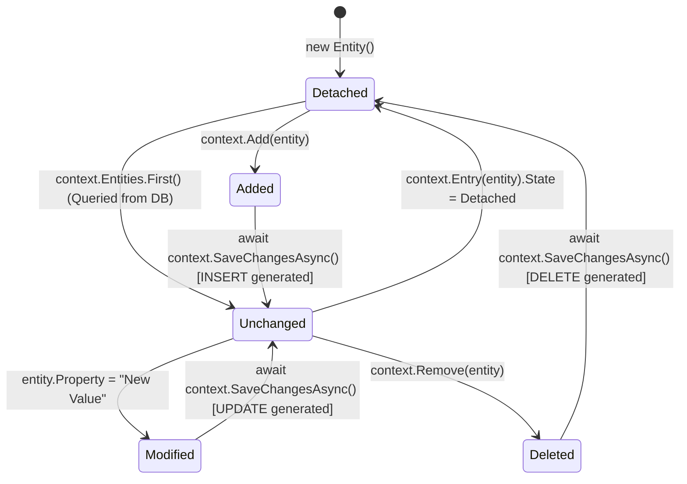

# 09. Database Integration with Entity Framework Core

---

## 📖 The Real-World Story: The Automated Fulfillment Warehouse & The Change Tracker

Imagine a high-tech robotic fulfillment warehouse:

1. **The Physical Steel Storage Racks (The Relational SQL Database):**
   Heavy, permanent, structured shelving units holding millions of pallets of goods. You don't walk into the steel racks and casually rearrange the concrete foundations. You follow strict structural rules.
2. **The Warehouse Shift Supervisor (The `DbContext`):**
   When an order arrives, a dedicated supervisor steps up with a digital clipboard. The `DbContext` represents a single work session (a scoped lifetime!). It opens a secure communication radio to the steel racks, pulls down records, holds them in memory, and coordinates updates.
3. **The Laser Barcode Scanner (The EF Core Change Tracker):**
   As items are modified on the supervisor's workbench, the change tracker monitors every object:
   - *"Did you change the customer's shipping address?"* $\rightarrow$ Marked as **`Modified`**.
   - *"Did you create a brand-new box?"* $\rightarrow$ Marked as **`Added`**.
   - *"Did you discard a broken part?"* $\rightarrow$ Marked as **`Deleted`**.
4. **The Dispatch Button (`SaveChangesAsync()`):**
   Nothing is permanently altered in the physical warehouse until the supervisor clicks "Commit." EF Core inspects the change tracker, synthesizes optimized SQL transactions (`INSERT`, `UPDATE`, `DELETE`), flushes them down the wire to SQL Server, and resets entity states to **`Unchanged`**.
5. **The Structural Blueprints (Database Migrations):**
   When the warehouse expands to add a cold-storage wing (adding a new table or column), an architect drafts a migration blueprint (`dotnet ef migrations add AddColdStorage`). The construction crew applies the blueprint (`dotnet ef database update`) without destroying the existing inventory.

---

## 🔄 Deep Technical Architecture: The Entity State Machine

Every entity tracked by EF Core transitions through strict lifecycle states:



---

### 1. Essential NuGet Packages

Install the modern EF Core packages via the .NET CLI:

```bash
# Core EF runtime & SQL Server provider
dotnet add package Microsoft.EntityFrameworkCore.SqlServer

# Design-time tools for running migrations
dotnet add package Microsoft.EntityFrameworkCore.Design
dotnet add package Microsoft.EntityFrameworkCore.Tools

# Global CLI tool
dotnet tool install --global dotnet-ef
```

---

### 2. Entity Classes and Relationships

```csharp
// Principal Entity
public class Author
{
    public int Id { get; set; }
    public string FullName { get; set; } = string.Empty;
    public string Email { get; set; } = string.Empty;

    // Navigation Property: 1 Author has Many Books (1:N)
    public List<Book> Books { get; set; } = new();
}

// Dependent Entity
public class Book
{
    public int Id { get; set; }
    public string Title { get; set; } = string.Empty;
    public decimal Price { get; set; }
    public DateTime PublishedOnUtc { get; set; }

    // Foreign Key & Navigation
    public int AuthorId { get; set; }
    public Author Author { get; set; } = null!;
}
```

---

### 3. The `DbContext` & Fluent API Configuration

```csharp
public class ApplicationDbContext : DbContext
{
    public ApplicationDbContext(DbContextOptions<ApplicationDbContext> options) : base(options) { }

    public DbSet<Author> Authors => Set<Author>();
    public DbSet<Book> Books => Set<Book>();

    protected override void OnModelCreating(ModelBuilder modelBuilder)
    {
        base.OnModelCreating(modelBuilder);

        modelBuilder.Entity<Book>(b =>
        {
            b.HasKey(x => x.Id);
            b.Property(x => x.Title).IsRequired().HasMaxLength(200);
            b.Property(x => x.Price).HasPrecision(18, 2);
            
            // Explicit 1:Many Relationship mapping
            b.HasOne(x => x.Author)
             .WithMany(a => a.Books)
             .HasForeignKey(x => x.AuthorId)
             .OnDelete(DeleteBehavior.Cascade);
        });
    }
}
```

---

### 4. Connection Strings & Registration in `Program.cs`

In `appsettings.json`:
```json
{
  "ConnectionStrings": {
    "DefaultConnection": "Server=localhost,1433;Database=BookStoreDb;User Id=sa;Password=YourStrong(!)Password;TrustServerCertificate=True;"
  }
}
```

In `Program.cs`:
```csharp
builder.Services.AddDbContext<ApplicationDbContext>(options =>
    options.UseSqlServer(builder.Configuration.GetConnectionString("DefaultConnection"),
        sqlServerOptions => sqlServerOptions.EnableRetryOnFailure(
            maxRetryCount: 5,
            maxRetryDelay: TimeSpan.FromSeconds(30),
            errorNumbersToAdd: null)));
```

---

### 5. CLI Migrations Workflow

```bash
# 1. Create a migration snapshot comparing current entities against previous snapshot
dotnet ef migrations add InitialCreate

# 2. Inspect generated SQL script before applying to production
dotnet ef migrations script

# 3. Apply pending migrations to the target database
dotnet ef database update

# 4. Remove the latest unapplied migration
dotnet ef migrations remove
```

---

### 6. Querying & Asynchronous CRUD Operations

```csharp
// 1. Asynchronous Read with Projection (No Tracking = High Performance)
var bookSummaries = await context.Books
    .AsNoTracking()
    .Where(b => b.Price > 20.0m)
    .OrderBy(b => b.Title)
    .Select(b => new BookDto(b.Id, b.Title, b.Price, b.Author.FullName))
    .ToListAsync();

// 2. Read with Eager Loading (Include)
var authorWithBooks = await context.Authors
    .Include(a => a.Books)
    .FirstOrDefaultAsync(a => a.Id == authorId);

// 3. Create (Add)
var newBook = new Book { Title = "C# Mastery", Price = 49.99m, AuthorId = 1 };
await context.Books.AddAsync(newBook);
await context.SaveChangesAsync();

// 4. Update
var book = await context.Books.FindAsync(bookId);
if (book != null)
{
    book.Price = 39.99m; // Change tracker marks as 'Modified'
    await context.SaveChangesAsync();
}

// 5. Delete
var obsolete = await context.Books.FindAsync(bookId);
if (obsolete != null)
{
    context.Books.Remove(obsolete); // Change tracker marks as 'Deleted'
    await context.SaveChangesAsync();
}
```

---

### 7. The Repository & Unit of Work Pattern

Decouples database persistence logic from business logic, making unit testing straightforward:

```csharp
public interface IBookRepository
{
    Task<Book?> GetByIdAsync(int id);
    Task<IReadOnlyList<Book>> GetAllAsync();
    Task AddAsync(Book book);
    void Remove(Book book);
    Task<int> SaveChangesAsync();
}
```

---

## 💻 Practical Code: Simulating EF Core Change Tracking & Async CRUD

Check out [DatabaseEfCoreDemo.cs](./DatabaseEfCoreDemo.cs) for a runnable simulation demonstrating:
1. In-memory `DbContext` and `DbSet` simulation.
2. The Change Tracker state machine (`Added`, `Modified`, `Deleted`, `Unchanged`).
3. LINQ query filtering, eager relationship loading, and SQL command synthesis.

---

## ⚠️ Interview Traps & Production Gotchas

> [!CAUTION]
> **Trap 1: The Infamous N+1 Query Problem.**  
> If lazy loading is enabled and you iterate through a list of 100 books accessing `book.Author.Name`, EF Core fires **1 initial query** for the books, plus **100 individual queries** for each author (101 round trips to SQL!).  
> **Solution:** Always use **Eager Loading** with `.Include(b => b.Author)` or **Projections** with `.Select()`.

> [!WARNING]
> **Trap 2: DbContext is NOT Thread-Safe.**  
> Never inject a single `DbContext` into a `Singleton` service or share an instance across parallel threads (`Task.WhenAll`):
> ```csharp
> // ❌ DISASTER: Multiple threads querying the same DbContext instance concurrently!
> var task1 = context.Books.ToListAsync();
> var task2 = context.Authors.ToListAsync();
> await Task.WhenAll(task1, task2); // Throws InvalidOperationException!
> ```

> [!TIP]
> **Trap 3: Forgetting `AsNoTracking()` on Read-Only Queries.**  
> By default, EF Core allocates change-tracking snapshots in memory for every entity returned by a query. For read-only REST APIs, append `.AsNoTracking()` to cut memory usage by up to 50% and dramatically accelerate query throughput.
