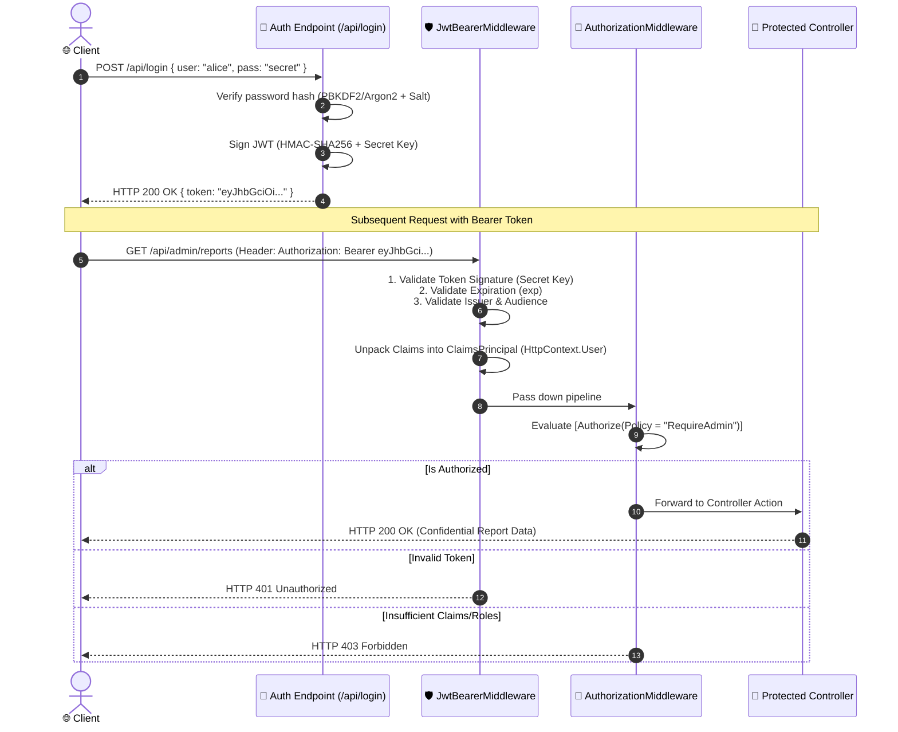

# 10. Authentication and Authorization in ASP.NET Core

---

## 📖 The Real-World Story: The International Airport Security Checkpoints

Imagine arriving for an international flight at an international airport:

1. **Passport Control (Authentication — *Who are you?*):**
   You step up to the border officer. You present your passport and let the camera scan your face. The officer checks security databases to verify that you are truly Alice. Once verified, the officer hands you an approved boarding pass. **Authentication establishes your verified digital identity.**
2. **The VIP First-Class Lounge (Role-Based Authorization — *What club do you belong to?*):**
   At the entrance to the exclusive Delta SkyClub or Emirates Lounge, a guard inspects your boarding pass. If your ticket says "Economy Class," the guard stops you. If your boarding pass has the stamp `"Role: FirstClass"`, the doors slide open.
3. **The Cockpit Door (Policy-Based Authorization — *Do you meet a complex set of rules?*):**
   The cockpit requires much more than an "Employee" badge. To enter the cockpit, the security system evaluates a **Policy**:
   - Must hold `"Role: Pilot"`, AND
   - Must have an active flight biometric scan, AND
   - Must be scheduled to pilot *this specific flight number today*.
   If any single requirement fails, the steel door remains deadbolted.

---

## 🔐 Deep Technical Architecture: JWT Bearer Pipeline & ClaimsPrincipal



---

### 1. Authentication vs. Authorization

| Concept | Question Answered | HTTP Failure Code | Typical Middleware |
| :--- | :--- | :---: | :--- |
| **Authentication (AuthN)** | *"Who are you?"* | **401 Unauthorized** | `UseAuthentication()` |
| **Authorization (AuthZ)** | *"What are you allowed to do?"* | **403 Forbidden** | `UseAuthorization()` |

---

### 2. Cookie Authentication vs. JWT Bearer Tokens

| Feature | Cookie Authentication | JWT Bearer Tokens |
| :--- | :--- | :--- |
| **Primary Target** | Traditional browser web apps (MVC, Razor Pages, Blazor Server) | Single Page Apps (Angular, React, Vue), Mobile Apps, Microservices |
| **Storage Location** | Browser HTTP-Only, Secure, SameSite Cookie | In-memory JavaScript state, Mobile Keychain, Secure Storage |
| **Server State** | Session state or encrypted cookie ticket | Stateless (self-contained claims signed by cryptography) |
| **CSRF Vulnerability** | Vulnerable if SameSite is relaxed (requires Anti-Forgery Tokens) | Immune to CSRF (tokens are passed explicitly in headers) |

---

### 3. Anatomical Breakdown of a JSON Web Token (JWT)

A JWT is composed of three Base64Url-encoded sections separated by dots (`.`):
$$\text{JWT} = \text{Base64Url}(\text{Header}) \,.\, \text{Base64Url}(\text{Payload}) \,.\, \text{Signature}$$

```
eyJhbGciOiJIUzI1NiIsInR5cCI6IkpXVCJ9.eyJzdWIiOiIxMjM0NTYiLCJuYW1lIjoiQWxpY2UiLCJyb2xlIjoiQWRtaW4iLCJleHAiOjE3NjM1MDAwMDB9.5zF...
```

1. **Header:** Contains algorithm and token type (`{"alg": "HS256", "typ": "JWT"}`).
2. **Payload (Claims):** Key-value identity statements (`sub`, `name`, `role`, `exp`, `iss`, `aud`).
3. **Signature:** Cryptographic hash of `(Header + Payload)` produced with the server's private secret key.

---

### 4. Configuring JWT Authentication in `Program.cs`

```csharp
var builder = WebApplication.CreateBuilder(args);

builder.Services.AddAuthentication(JwtBearerDefaults.AuthenticationScheme)
    .AddJwtBearer(options =>
    {
        options.TokenValidationParameters = new TokenValidationParameters
        {
            ValidateIssuer = true,
            ValidIssuer = "https://auth.mycompany.com",
            ValidateAudience = true,
            ValidAudience = "https://api.mycompany.com",
            ValidateLifetime = true,
            ClockSkew = TimeSpan.FromMinutes(1), // Mitigate clock drift
            ValidateIssuerSigningKey = true,
            IssuerSigningKey = new SymmetricSecurityKey(
                Encoding.UTF8.GetBytes(builder.Configuration["Jwt:SigningKey"]!))
        };
    });

builder.Services.AddAuthorization(options =>
{
    // Role-based policy
    options.AddPolicy("RequireManagerRole", policy =>
        policy.RequireRole("Manager", "Director"));

    // Complex claim policy
    options.AddPolicy("MustBeSeniorEmployee", policy =>
        policy.RequireClaim("Department", "Engineering")
              .RequireAssertion(ctx => ctx.User.HasClaim(c => c.Type == "YearsExperience" && int.Parse(c.Value) >= 5)));
});

var app = builder.Build();

app.UseAuthentication(); // 1. Identifies the user
app.UseAuthorization();  // 2. Evaluates access permissions
```

---

### 5. Securing Endpoints with Attributes

```csharp
[ApiController]
[Route("api/[controller]")]
public class PayrollController : ControllerBase
{
    // Publicly accessible
    [HttpGet("public-rates")]
    [AllowAnonymous]
    public IActionResult GetPublicRates() => Ok(new { StandardRate = 25.0 });

    // Requires any authenticated user (401 if missing token)
    [HttpGet("my-payslip")]
    [Authorize]
    public IActionResult GetMyPayslip()
    {
        var userId = User.FindFirstValue(ClaimTypes.NameIdentifier);
        return Ok(new { UserId = userId, Gross = 5000 });
    }

    // Requires specific authorization policy (403 if role fails)
    [HttpPost("adjust-salary")]
    [Authorize(Policy = "RequireManagerRole")]
    public IActionResult AdjustSalary([FromBody] SalaryAdjustmentDto dto)
    {
        return Ok(new { Message = "Salary updated." });
    }
}
```

---

### 6. Secure Password Storage: Salted Hashing

> [!CAUTION]
> **Never use MD5, SHA-1, or plain SHA-256 for passwords!** Fast hash algorithms can be cracked at billions of hashes per second using consumer GPUs.

ASP.NET Core Identity uses **PBKDF2** (Password-Based Key Derivation Function 2) with HMAC-SHA256, a 128-bit cryptographically secure random salt, and 100,000+ iterations:

$$\text{StoredHash} = \text{FormatByte} \,\|\, \text{Salt (16 bytes)} \,\|\, \text{PBKDF2}(\text{Password}, \text{Salt}, 100000, 32)$$

---

## 💻 Practical Code: Simulating JWT Generation, ClaimsPrincipal & Policy Evaluation

Check out [AuthDemo.cs](./AuthDemo.cs) for a runnable simulation demonstrating:
1. PBKDF2 salted password hashing and timing-safe verification.
2. Lightweight HMAC-SHA256 JWT generation and signature validation.
3. Constructing a `ClaimsPrincipal` and testing Role and Policy authorization checks.

---

## ⚠️ Interview Traps & Production Gotchas

> [!CAUTION]
> **Trap 1: Putting Sensitive Information (Passwords, SSNs) inside JWT Claims.**  
> JWT payloads are **encoded**, NOT encrypted! Anyone with the token can paste it into `jwt.io` and read every claim in plain text. Store only non-sensitive identifiers and roles in claims.

> [!WARNING]
> **Trap 2: Swapping the Order of `UseAuthentication()` and `UseAuthorization()`.**  
> If you call `app.UseAuthorization()` before `app.UseAuthentication()`, the authorization system runs when `HttpContext.User` is still empty and unauthenticated, resulting in unexpected 401 or 403 errors across your entire application.

> [!TIP]
> **Trap 3: Stateless JWT Invalidation (Revocation).**  
> Because JWTs are stateless, they cannot be invalidated on the server before their `exp` timestamp without keeping an in-memory or Redis-based token blocklist. Keep access tokens short-lived (5 to 15 minutes) and issue rotating **Refresh Tokens** stored in your database.
