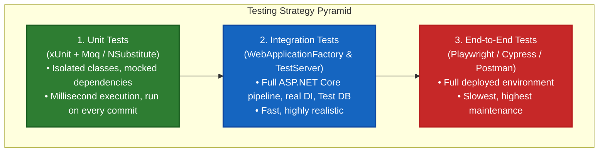

# 11. Testing and Debugging in ASP.NET Core

---

## 📖 The Real-World Story: The Aircraft Stress Facility & The Flight Data Recorder

Imagine an aerospace engineering facility manufacturing commercial jetliners:

1. **The Test Bench Stress Machine (Unit Testing with xUnit & Mocks):**
   Before the titanium hydraulic valve is installed into an airplane, engineers bolt it into an isolated test bench. They don't need real jet fuel or a 30,000-foot sky. They attach a simulated electronic pump (**a Mock Object**) that feeds fake fluid pressure into the valve. If the valve fails under 5,000 PSI, they discover it in milliseconds on the bench without risking human lives.
2. **The Integrated Wind Tunnel (Integration Testing with `WebApplicationFactory`):**
   Once the parts pass bench tests, engineers mount the complete cockpit, wing, hydraulic system, and flight computer into an aerodynamic wind tunnel. They fire up simulated wind, power the avionics, and verify that pressing the rudder pedal actually tilts the physical flaps. In ASP.NET Core, **`WebApplicationFactory`** spins up your entire real web server in-memory, wiring real middleware and dependency injection without binding physical network ports.
3. **The Black Box Flight Recorder (`ILogger` & Diagnostics):**
   When the jet takes flight, the cockpit flight recorder records temperature, pressure, pilot inputs, and engine RPMs continuously. In production software, **Structured Logging (`ILogger`)** records contextual telemetry. If an unhandled turbine flameout occurs, the safety response system (**Exception Handling Middleware**) safely deploys auxiliary power so the plane can land smoothly.

---

## 📐 Deep Technical Architecture: The Modern .NET Testing Pyramid



---

### 1. Structured Logging with `ILogger`

Structured logging preserves parameters as queryable JSON properties rather than flattening them into unindexed strings:

```csharp
// ❌ ANTI-PATTERN: String Interpolation destroys searchability in Datadog/Seq!
logger.LogInformation($"Order {orderId} placed by user {userId} for ${amount}");

// ✅ BEST PRACTICE: Semantic Message Templates with Named Placeholders
logger.LogInformation("Order {OrderId} placed by user {UserId} for {Amount:C}", orderId, userId, amount);
```

#### Correlating Logs with Scopes (`BeginScope`):
```csharp
using (logger.BeginScope(new Dictionary<string, object> { ["CorrelationId"] = correlationId }))
{
    logger.LogInformation("Processing payment");
    logger.LogInformation("Shipping goods");
    // All logs inside this block automatically carry 'CorrelationId'!
}
```

---

### 2. Modern Exception Handling (`IExceptionHandler` in .NET 8/9/10)

Instead of scattering `try/catch` across dozens of controllers, register a centralized exception handler:

```csharp
public class GlobalExceptionHandler : IExceptionHandler
{
    private readonly ILogger<GlobalExceptionHandler> _logger;

    public GlobalExceptionHandler(ILogger<GlobalExceptionHandler> logger) => _logger = logger;

    public async ValueTask<bool> TryHandleAsync(
        HttpContext httpContext,
        Exception exception,
        CancellationToken cancellationToken)
    {
        _logger.LogError(exception, "Unhandled exception occurred: {Message}", exception.Message);

        var problemDetails = new ProblemDetails
        {
            Status = StatusCodes.Status500InternalServerError,
            Title = "An unexpected server error occurred",
            Detail = exception.Message,
            Instance = httpContext.Request.Path
        };

        httpContext.Response.StatusCode = StatusCodes.Status500InternalServerError;
        await httpContext.Response.WriteAsJsonAsync(problemDetails, cancellationToken);

        return true; // Exception was handled successfully!
    }
}
```

Registered in `Program.cs`:
```csharp
builder.Services.AddExceptionHandler<GlobalExceptionHandler>();
builder.Services.AddProblemDetails();

var app = builder.Build();
app.UseExceptionHandler();
```

---

### 3. Unit Testing with xUnit & Mocking

Install standard test packages in your test project:
```bash
dotnet add package xunit
dotnet add package Moq
dotnet add package FluentAssertions
```

```csharp
public class OrderServiceTests
{
    [Fact]
    public async Task PlaceOrder_ValidRequest_ReturnsSuccessfulOrderResult()
    {
        // 1. Arrange (Setup isolated dependencies)
        var mockRepo = new Mock<IOrderRepository>();
        var mockPayment = new Mock<IPaymentGateway>();
        var mockLogger = new Mock<ILogger<OrderService>>();

        mockPayment.Setup(p => p.ChargeAsync(It.IsAny<decimal>()))
                   .ReturnsAsync(true);

        var service = new OrderService(mockRepo.Object, mockPayment.Object, mockLogger.Object);

        // 2. Act
        var result = await service.PlaceOrderAsync(new OrderRequest { Amount = 99.00m });

        // 3. Assert
        Assert.True(result.IsSuccess);
        mockRepo.Verify(r => r.SaveAsync(It.IsAny<Order>()), Times.Once);
    }

    [Theory]
    [InlineData(-50.0)]
    [InlineData(0.0)]
    public async Task PlaceOrder_InvalidAmount_ThrowsArgumentException(decimal invalidAmount)
    {
        var service = new OrderService(Mock.Of<IOrderRepository>(), Mock.Of<IPaymentGateway>(), Mock.Of<ILogger<OrderService>>());

        await Assert.ThrowsAsync<ArgumentException>(() => 
            service.PlaceOrderAsync(new OrderRequest { Amount = invalidAmount }));
    }
}
```

---

### 4. Integration Testing with `WebApplicationFactory`

Runs your actual ASP.NET Core stack in-memory using an optimized `TestServer`:

```csharp
public class ProductsApiIntegrationTests : IClassFixture<WebApplicationFactory<Program>>
{
    private readonly HttpClient _client;

    public ProductsApiIntegrationTests(WebApplicationFactory<Program> factory)
    {
        _client = factory.CreateClient();
    }

    [Fact]
    public async Task GetProducts_ReturnsSuccessAndCorrectJson()
    {
        // Act
        var response = await _client.GetAsync("/api/v1/products");

        // Assert
        response.EnsureSuccessStatusCode(); // HTTP 200 OK
        Assert.Equal("application/json; charset=utf-8", response.Content.Headers.ContentType?.ToString());

        var products = await response.Content.ReadFromJsonAsync<List<ProductDto>>();
        Assert.NotNull(products);
        Assert.NotEmpty(products);
    }
}
```

---

### 5. Measuring Code Coverage with `coverlet`

```bash
# Run tests and collect coverage metric
dotnet test --collect:"XPlat Code Coverage"

# Generate human-readable HTML coverage reports
dotnet tool install --global dotnet-reportgenerator-globaltool
reportgenerator -reports:"**/coverage.cobertura.xml" -targetdir:"coveragereport" -reporttypes:Html
```

---

## 💻 Practical Code: Simulating Unit Tests, Mocking & Assertions

Check out [TestingDemo.cs](./TestingDemo.cs) for a runnable simulation demonstrating:
1. Writing xUnit-style `[Fact]` and `[Theory]` tests with isolated simulated mocks.
2. Verifying mock invocations (`Times.Once`).
3. Calculating test pass rates and simulated code coverage metrics.

---

## ⚠️ Interview Traps & Production Gotchas

> [!WARNING]
> **Trap 1: String Interpolation in Logging Statements.**  
> Writing `logger.LogInformation($"Customer {id} purchased {item}")` executes string allocation and formatting on **every single request**, even when the current log level is set to `Warning` (meaning the log is discarded!). Structured parameters (`logger.LogInformation("Customer {Id} purchased {Item}", id, item)`) avoid allocation when logging is disabled.

> [!CAUTION]
> **Trap 2: `WebApplicationFactory` and `Program.cs` Visibility.**  
> In modern .NET projects using top-level statements, the compiler generates an `internal class Program`. To allow your test project's `WebApplicationFactory<Program>` to access it, you must add `public partial class Program { }` at the bottom of `Program.cs` or add `[InternalsVisibleTo]` to your `.csproj`.

> [!TIP]
> **Trap 3: Testing Business Logic inside Controllers instead of Services.**  
> Controllers should remain "skinny"—handling only HTTP model binding, status code selection, and response formatting. If your controller contains 150 lines of tax calculations, moving that logic into an injected Domain Service allows 100% unit test coverage in microseconds without mocking HTTP contexts.
