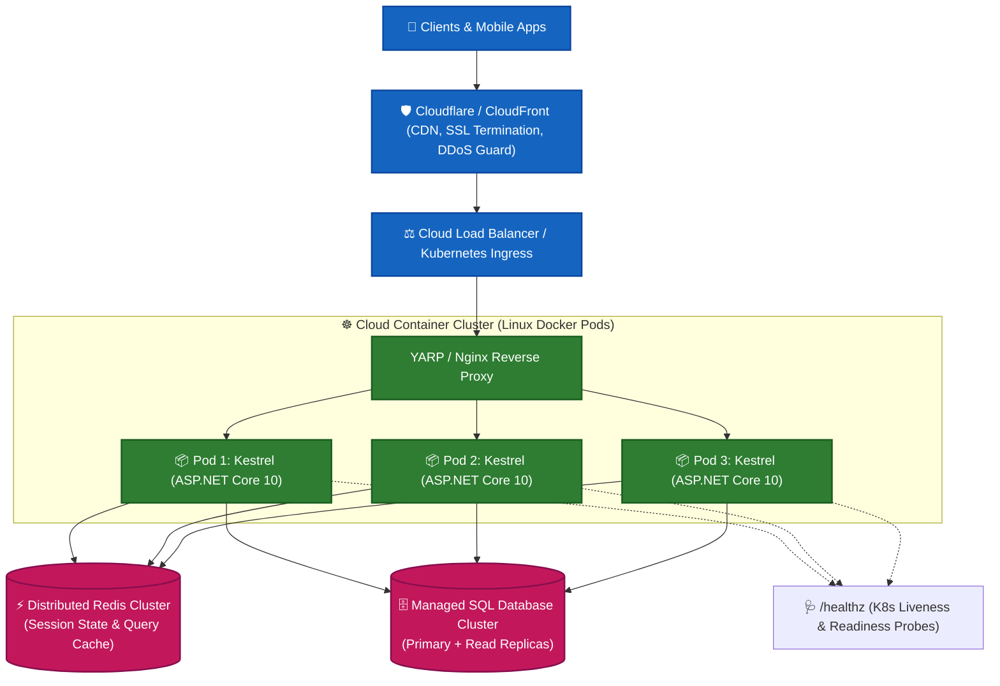

# 12. Deployment, Cloud Operations and Performance Optimization

---

## 📖 The Real-World Story: The Global Intermodal Freight Network

Imagine shipping goods manufactured in one country to store shelves worldwide:

1. **Packaging & Shrink-Wrapping (`dotnet publish`):**
   Before cargo is moved, factory workers don't transport raw assembly tools and drafting schematics. They package the finished consumer goods into lightweight, compact boxes stripped of debugging tools and source code.
2. **The Standardized Shipping Container (Docker & Containers):**
   In the 1950s, Malcolm McLean invented the standardized intermodal shipping container. Whether loaded onto a crane in Shanghai, a freighter across the Pacific, a freight train in Chicago, or an 18-wheeler truck in Texas, **the container never changes and fits every transport mechanism on Earth.** Docker does this for ASP.NET Core: code packaged with its runtime dependencies runs identically on a developer’s MacBook, an on-premise server, or a cloud Kubernetes cluster.
3. **The Harbor Harbormaster (Reverse Proxy: Nginx / YARP / Cloudflare):**
   Giant container ships don't dock directly at your local grocery store. A harbor port accepts incoming cargo, terminates maritime protocols (SSL/TLS termination), absorbs rogue storm surges (DDoS defense), and routes trucks down designated highway lanes. Kestrel sits safely behind this reverse proxy.
4. **The Regional Fulfillment Depot (In-Memory & Distributed Caching):**
   If everyone in a city orders the same hot toy, the store doesn't order each individual toy from the overseas factory 10,000 miles away. They keep 5,000 units in a local depot (Redis / Memory Cache) to fulfill orders in minutes instead of weeks.
5. **The Harbor Tollbooth (Rate Limiting Middleware):**
   Only 50 trucks are permitted through the tunnel per minute. If 1,000 trucks rush the gate, the tollbooth holds back excess traffic, returning **HTTP 429 Too Many Requests** to prevent the city bridges from collapsing.

---

## 🌐 Deep Technical Architecture: Modern Production Topology



---

### 1. Publishing with the .NET CLI

Compile and package your application for production deployment:

```bash
# 1. Framework-Dependent Deployment (Smallest output, requires .NET runtime on host server)
dotnet publish -c Release -o ./publish

# 2. Self-Contained Deployment for Linux x64 (Includes .NET runtime, zero host prerequisites)
dotnet publish -c Release -r linux-x64 --self-contained true -o ./publish-linux

# 3. High-Performance Ahead-of-Time (Native AOT) Compilation
# Produces lightning-fast startup and tiny memory footprints (<30MB)
dotnet publish -c Release -r linux-x64 /p:PublishAot=true
```

---

### 2. Multi-Stage Production `Dockerfile`

Multi-stage builds prevent SDK tooling and source code from leaking into production container images, minimizing image size from ~800MB down to ~100MB:

```dockerfile
# -------------------------------------------------------------
# Stage 1: Build & Publish (Uses heavy .NET SDK)
# -------------------------------------------------------------
FROM mcr.microsoft.com/dotnet/sdk:10.0 AS build
WORKDIR /src

# Copy project files first to leverage Docker layer caching for NuGet restore
COPY ["MyApi.csproj", "./"]
RUN dotnet restore "MyApi.csproj"

# Copy remaining source code and compile
COPY . .
RUN dotnet publish "MyApi.csproj" -c Release -o /app/publish /p:UseAppHost=false

# -------------------------------------------------------------
# Stage 2: Production Runtime (Ultra-lightweight ASP.NET runtime)
# -------------------------------------------------------------
FROM mcr.microsoft.com/dotnet/aspnet:10.0-chiseled AS final
WORKDIR /app
EXPOSE 8080
ENV ASPNETCORE_HTTP_PORTS=8080

COPY --from=build /app/publish .

# Run as non-root user (provided by chiseled base images)
USER $APP_UID
ENTRYPOINT ["dotnet", "MyApi.dll"]
```

---

### 3. Caching Strategies: In-Memory vs. Distributed

| Dimension | `IMemoryCache` (In-Memory) | `IDistributedCache` (Redis / NCache) |
| :--- | :--- | :--- |
| **Storage Location** | Local RAM of the web server process | External, dedicated high-speed cache cluster |
| **Multi-Server Sync** | Inconsistent across multiple container replicas | 100% consistent across all scaled app pods |
| **Survives App Restarts?** | ❌ No (cache wiped on deployment) | ✅ Yes (data persists across app deployments) |
| **Lookup Latency** | Sub-microsecond (direct memory read) | Low millisecond (~1–2ms via Redis socket) |

```csharp
// Redis Distributed Cache registration in Program.cs
builder.Services.AddStackExchangeRedisCache(options =>
{
    options.Configuration = builder.Configuration.GetConnectionString("Redis");
    options.InstanceName = "CatalogCache_";
});

// Cache-Aside Pattern Implementation
public async Task<ProductDto?> GetProductAsync(int id, IDistributedCache cache, AppDbContext db)
{
    string cacheKey = $"product:{id}";
    string? cachedJson = await cache.GetStringAsync(cacheKey);

    if (cachedJson != null)
    {
        return JsonSerializer.Deserialize<ProductDto>(cachedJson);
    }

    var product = await db.Products.FindAsync(id);
    if (product != null)
    {
        var dto = new ProductDto(product.Id, product.Name, product.Price);
        var options = new DistributedCacheEntryOptions
        {
            AbsoluteExpirationRelativeToNow = TimeSpan.FromHours(1),
            SlidingExpiration = TimeSpan.FromMinutes(15)
        };
        await cache.SetStringAsync(cacheKey, JsonSerializer.Serialize(dto), options);
        return dto;
    }

    return null;
}
```

---

### 4. Built-In Rate Limiting Middleware

Protect your endpoints against abuse and brute-force flooding:

```csharp
builder.Services.AddRateLimiter(options =>
{
    // Fixed Window Limiter: 100 requests per 1-minute window
    options.AddFixedWindowLimiter("FixedPolicy", opt =>
    {
        opt.Window = TimeSpan.FromMinutes(1);
        opt.PermitLimit = 100;
        opt.QueueLimit = 10;
        opt.QueueProcessingOrder = QueueProcessingOrder.OldestFirst;
    });

    // Token Bucket: Burst allowance
    options.AddTokenBucketLimiter("BurstPolicy", opt =>
    {
        opt.TokenLimit = 20;
        opt.ReplenishmentPeriod = TimeSpan.FromSeconds(10);
        opt.TokensPerPeriod = 5;
        opt.AutoReplenishment = true;
    });

    options.RejectionStatusCode = StatusCodes.Status429TooManyRequests;
});

var app = builder.Build();
app.UseRateLimiter();

app.MapGet("/api/search", () => "Search results")
   .RequireRateLimiting("FixedPolicy");
```

---

### 5. Health Checks & Kubernetes Probes

```csharp
builder.Services.AddHealthChecks()
    .AddSqlServer(builder.Configuration.GetConnectionString("DefaultConnection")!, name: "sql_db")
    .AddRedis(builder.Configuration.GetConnectionString("Redis")!, name: "redis_cache");

var app = builder.Build();

// Liveness probe (Is the web process alive?)
app.MapHealthChecks("/healthz/live", new HealthCheckOptions
{
    Predicate = _ => false
});

// Readiness probe (Are database and cache connections ready to accept traffic?)
app.MapHealthChecks("/healthz/ready", new HealthCheckOptions
{
    Predicate = check => check.Tags.Contains("ready")
});
```

---

### 6. Automated CI/CD Pipeline (GitHub Actions Workflow)

Create `.github/workflows/deploy.yml`:

```yaml
name: Build, Test & Deploy ASP.NET Core

on:
  push:
    branches: [ "main" ]

jobs:
  build-and-test:
    runs-on: ubuntu-latest
    steps:
    - uses: actions/checkout@v4

    - name: Setup .NET
      uses: actions/setup-dotnet@v4
      with:
        dotnet-version: '10.0.x'

    - name: Restore Dependencies
      run: dotnet restore

    - name: Build Application
      run: dotnet build --no-restore --configuration Release

    - name: Run Automated Tests
      run: dotnet test --no-build --configuration Release --verbosity normal

    - name: Publish Production Artifacts
      run: dotnet publish -c Release -o ./publish

    - name: Build and Push Docker Image
      uses: docker/build-push-action@v5
      with:
        context: .
        push: true
        tags: ghcr.io/myorg/myapp:latest
```

---

## 💻 Practical Code: Simulating Health Probes, Rate Limiters & Cache-Aside

Check out [DeploymentDemo.cs](./DeploymentDemo.cs) for a runnable simulation demonstrating:
1. Multi-component health check diagnostic engine (`Healthy`, `Degraded`, `Unhealthy`).
2. Token-bucket rate limiting algorithm with burst allowance and 429 status code emission.
3. Cache-aside design pattern with simulated hit/miss latency metrics.

---

## ⚠️ Interview Traps & Production Gotchas

> [!CAUTION]
> **Trap 1: Exposing Kestrel Directly to the Public Internet without a Reverse Proxy.**  
> While Kestrel is exceptionally fast, modern production setups should place a reverse proxy (e.g. Cloudflare, Nginx, or AWS ALB) in front of Kestrel for edge SSL/TLS offloading, gzip/brotli compression, rate limiting, and HTTP request body filtering before packets hit your app container.

> [!WARNING]
> **Trap 2: Cache Stamped / Thundering Herd Problem.**  
> When a heavily accessed cached key expires, hundreds of concurrent HTTP requests simultaneously miss the cache and overwhelm the underlying SQL database with identical queries.  
> **Solution:** Use locking or modern hybrid cache libraries like `.NET 9+ HybridCache` which natively feature request de-duplication (stampede protection).

> [!TIP]
> **Trap 3: Liveness vs. Readiness Probes in Kubernetes.**  
> A failed **Liveness probe** instructs Kubernetes to immediately kill and reboot your container pod. A failed **Readiness probe** simply temporarily pulls your container out of the load balancer rotation until the database reconnects. Never perform external database network checks inside a Liveness probe, otherwise a momentary DB blip will trigger a cascading restart loop across your entire cluster!
