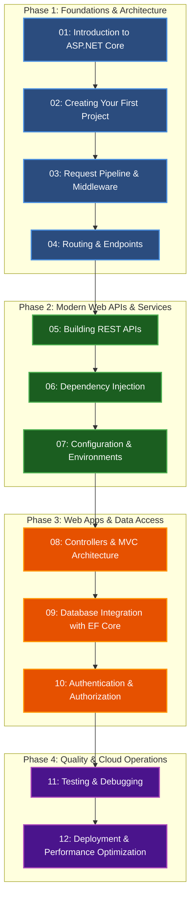

# 🌐 ASP.NET Core Basics: Masterclass & Practical Architecture

Welcome to the **ASP.NET Core Basics** section of the C# Learning Curriculum. This guide takes you from the fundamentals of HTTP web servers to building production-grade, high-performance REST APIs, MVC web applications, database-driven services with EF Core, JWT authentication pipelines, and containerized cloud deployments.

---

## ⚡ Quickstart: Run the Interactive ASP.NET Core Runner

```bash
dotnet run --project ASP.NET-Core-Basics
```
*(Enter a module number from `1` to `12` to run an isolated architectural simulation, or press **Enter** to run all modules).*

---

## 🗺️ Curriculum Roadmap



---

## 📚 Complete Module Directory

| Module | Title | Core Concepts Covered | Folder Link |
| :---: | :--- | :--- | :---: |
| **01** | **Introduction to ASP.NET Core** | What is ASP.NET Core, .NET vs .NET Core, Kestrel, reverse proxy, client-server, HTTP/HTTPS | [01-Introduction](./01-Introduction/README.md) |
| **02** | **Creating Your First Project** | Project structure, `dotnet new`, `Program.cs`, `.csproj`, `launchSettings.json`, environments | [02-First-Project](./02-First-Project/README.md) |
| **03** | **Request Pipeline & Middleware** | The Russian doll pipeline, `Use`/`Run`/`Map`, built-in & custom middleware, execution order | [03-Middleware](./03-Middleware/README.md) |
| **04** | **Routing and Endpoints** | Conventional vs attribute routing, endpoint routing, constraints, query strings, Minimal APIs | [04-Routing](./04-Routing/README.md) |
| **05** | **Building REST APIs** | REST constraints, Minimal APIs, controllers, status codes, model binding, DTOs, RFC 7807 | [05-REST-APIs](./05-REST-APIs/README.md) |
| **06** | **Dependency Injection** | Inversion of Control, Transient vs Scoped vs Singleton, captive dependencies, constructor injection | [06-Dependency-Injection](./06-Dependency-Injection/README.md) |
| **07** | **Configuration & Environments** | `appsettings.json`, environment variables, Options pattern, User Secrets, logging configuration | [07-Configuration](./07-Configuration/README.md) |
| **08** | **Controllers and MVC** | Model-View-Controller, Razor syntax, layouts, partial views, `ViewData`/`TempData`, Tag Helpers | [08-MVC](./08-MVC/README.md) |
| **09** | **Database Integration (EF Core)** | Relational DBs, `DbContext`, `DbSet`, migrations, CRUD, LINQ queries, relationships, async DB ops | [09-Database-EF-Core](./09-Database-EF-Core/README.md) |
| **10** | **Authentication & Authorization** | Auth vs AuthZ, ASP.NET Core Identity, Cookie auth, JWT Bearer tokens, Claims, Roles, Policies | [10-Authentication](./10-Authentication/README.md) |
| **11** | **Testing and Debugging** | Debugging tools, `ILogger`, unit testing controllers, mocking dependencies, integration tests | [11-Testing](./11-Testing/README.md) |
| **12** | **Deployment and Performance** | `dotnet publish`, Docker containers, IIS/Linux reverse proxies, caching, rate limiting, health checks | [12-Deployment](./12-Deployment/README.md) |

---

## 💡 How Each Module Is Structured
Every module contains:
1. **The Real-World Analogy / Story Hook**: Understanding complex distributed systems through clear physical analogies (airports, restaurant kitchens, postal services, bank vaults).
2. **Deep Technical Mechanics**: Internal architecture covering Kestrel, socket engines, HTTP state machines, CLR memory footprints, and async execution flows.
3. **Mermaid Flowcharts & Topologies**: Architecture schematics to visualize pipelines, memory boundaries, and lifecycles.
4. **Complete, Practical C# Demos**: Working code examples covering real scenarios.
5. **Interview Traps & Production Edge Cases**: Common developer pitfalls, performance anti-patterns, and security concerns.
