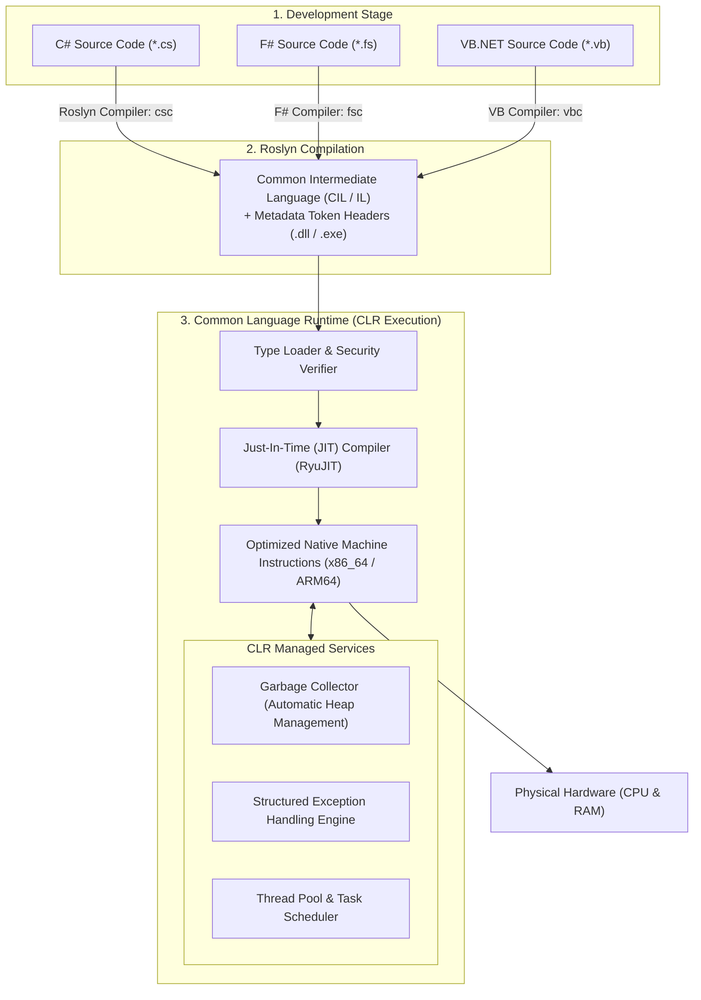

# Topic 01: Introduction to C# and .NET

## 🌟 The Story: The Universal Translation Tower

Imagine you are managing an international construction project with engineers from Japan, architects from France, electricians from Germany, and builders from Brazil. 

If everyone speaks only their native tongue, chaotic misunderstandings and stalled progress are inevitable. You need two things to succeed:
1. **A Common Working Standard:** A universal blueprint format and terminology that everyone agrees to follow.
2. **A Master General Contractor:** An omnipresent coordinator who translates every instruction into the exact local actions needed on the ground, watches over safety, cleans up debris, and makes sure materials aren't wasted.

**In the software world:**
- **C#** is the elegant, precision-crafted language you use to draft your designs.
- **The .NET Common Type System (CTS) & Common Language Specification (CLS)** are the universal blueprint standards that ensure C#, F#, and VB.NET understand each other's types seamlessly.
- **The Common Language Runtime (CLR)** is the tireless General Contractor. It takes your instructions, translates them into the native electrical impulses of your specific CPU (Intel, AMD, ARM, Apple Silicon), manages computer memory, and cleans up discarded data so your application never crashes from memory leaks.

---

## 🔬 The Technical Deep Dive

### 1. What is C#?
C# is an elegant, modern, object-oriented, type-safe programming language created by Microsoft and designed by Anders Hejlsberg (who also designed Turbo Pascal and TypeScript). 

It combines the raw computing efficiency of C++ with the developer productivity and safety of managed environments.

### 2. C# Compared to Other Giants
| Dimension | C# | Java | C++ | Python |
|---|---|---|---|---|
| **Paradigm** | Multi-paradigm (OOP, Functional, Generic, Pattern-Driven) | Primarily Object-Oriented | Multi-paradigm, Systems-level | Dynamic, Scripting, Multi-paradigm |
| **Execution** | Managed via CLR (JIT & Native AOT) | Managed via JVM (Bytecode JIT) | Unmanaged (Direct machine code) | Interpreted / CPython bytecode |
| **Memory Model** | Automatic Garbage Collection + Manual Pointer options (`unsafe`) | Automatic Garbage Collection | Manual (`new` / `delete`) or Smart Pointers | Automatic Reference Counting + Cyclic GC |
| **Type Safety** | Static, Strong, Nullable-aware (`string?`) | Static, Strong | Static, Weak (pointer reinterpretation allowed) | Dynamic, Strong |
| **Performance** | Extremely High (approaching C++ with modern `Span<T>` and SIMD) | High | Maximum (zero-cost abstractions) | Moderate / Slow (CPython GIL bottleneck) |
| **Core Ecosystem** | Cross-platform .NET (Web, Cloud APIs, Games/Unity, Desktop, AI) | Enterprise Servers, Android | Operating Systems, AAA Game Engines, Drivers | Machine Learning, Data Science, Scripting |

---

### 3. The Pillars of the .NET Architecture



#### A. Intermediate Language (IL)
When you build a C# program, it does **not** compile directly into machine code (0s and 1s for Intel or ARM). Instead, the **Roslyn compiler** translates C# into **Intermediate Language (IL)**—a processor-independent, low-level instruction set.

#### B. The Common Language Runtime (CLR)
The CLR is the heartbeat of .NET. When you execute an application:
1. **Verification:** The CLR verifies the IL code to guarantee type safety and prevent illegal memory access.
2. **JIT Compilation (RyuJIT):** The Just-In-Time compiler translates the IL into native machine instructions tailored specifically for the CPU running the code.
3. **Execution & Memory Services:** The CLR allocates memory, monitors execution threads, and triggers Garbage Collection when memory pressure builds.

#### C. CTS & CLS
- **CTS (Common Type System):** Dictates how data types (`System.Int32`, `System.String`) are represented in memory. A 32-bit integer in C# is identical in structure to an integer in F#.
- **CLS (Common Language Specification):** A baseline set of rules that language designers must adhere to if they want their library to be consumable by any other .NET language.

---

### 4. SDK vs. Runtime: The Kitchen Analogy
- **The .NET Runtime:** Think of a **Restaurant Dining Table**. It has the plates, spoons, and napkins required to *consume* the meal. If an end-user only wants to run an existing C# app on their laptop, they only need the lightweight .NET Runtime.
- **The .NET SDK (Software Development Kit):** Think of the **Industrial Kitchen**. It contains the ovens, chef knives, recipe books, prep stations, and the dining table. It includes the Roslyn compiler (`csc`), the CLI (`dotnet`), project templates, MSBuild, and the Runtime. You need the SDK to *cook* (write, build, test, and debug) applications.

---

### 5. Project Anatomy & The `.csproj` File
A .NET project is defined by an XML-based project file (`.csproj`):

```xml
<Project Sdk="Microsoft.NET.Sdk">
  <PropertyGroup>
    <!-- Target application type: Exe (Console), WinExe (Desktop), or Library (Class Library) -->
    <OutputType>Exe</OutputType>
    
    <!-- Target Framework Moniker (TFM) designating the .NET API surface -->
    <TargetFramework>net10.0</TargetFramework>
    
    <!-- Eliminates boilerplate 'using System;' across all files -->
    <ImplicitUsings>enable</ImplicitUsings>
    
    <!-- Enables modern compiler-enforced null safety checks -->
    <Nullable>enable</Nullable>
    
    <!-- Recommended professional practice: warnings are treated as build errors -->
    <TreatWarningsAsErrors>false</TreatWarningsAsErrors>
  </PropertyGroup>
</Project>
```

---

## 🛠 Command Line Mastery (The `dotnet` CLI)

```powershell
# Check installed SDKs and Runtimes
dotnet --list-sdks
dotnet --list-runtimes

# Create a brand new console application in a folder named 'MyApp'
dotnet new console -n MyApp

# Restore NuGet dependencies from internet registries
dotnet restore

# Build code and verify compiler errors without launching
dotnet build

# Build and execute the project immediately
dotnet run

# Run automated tests
dotnet test

# Compile an optimized production release bundle
dotnet publish -c Release -o ./publish
```
