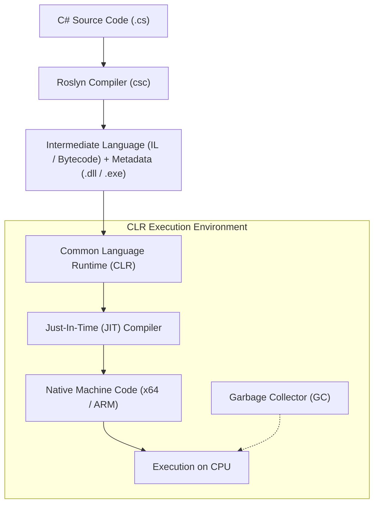

# Topic 01: Introduction to C# and .NET

## 📖 Theoretical Overview

### 1. What is C#?
C# (pronounced "C-Sharp") is a modern, object-oriented, type-safe, and high-performance programming language developed by Microsoft and led by Anders Hejlsberg. It runs on the cross-platform **.NET** runtime.

### 2. C# vs. Other Languages
| Feature | C# | Java | C++ | Python |
|---|---|---|---|---|
| **Type System** | Static, Strong, Nullable-aware | Static, Strong | Static, Unsafe allowed | Dynamic, Strong |
| **Execution** | Managed (JIT / AOT) | Managed (JVM Bytecode) | Native Compiled | Interpreted / Bytecode |
| **Memory** | Garbage Collected | Garbage Collected | Manual (`new` / `delete`) | Reference Counted GC |
| **Modern Features** | Pattern matching, records, async streams | Records, virtual threads | RAII, templates | Duck typing, concise |
| **Primary Ecosystem** | Cross-platform .NET (Web, Cloud, Desktop, Mobile) | Enterprise, Android | Systems, Games, OS | AI/ML, Scripting, Data |

### 3. What is .NET, CLR, CTS, and CLS?
- **.NET:** The unified open-source development platform for building cloud, web, desktop, and mobile applications.
- **CLR (Common Language Runtime):** The execution engine that handles garbage collection, JIT compilation, thread management, and security.
- **CTS (Common Type System):** Specifies how types are defined and behave in memory across all .NET languages.
- **CLS (Common Language Specification):** A set of rules ensuring interoperability between .NET languages (e.g. C#, F#, VB.NET).

### 4. SDK vs. Runtime
- **.NET Runtime:** Just enough infrastructure to *run* existing .NET applications.
- **.NET SDK (Software Development Kit):** Includes the Runtime PLUS the CLI tools, Roslyn compiler, MSBuild, and templates needed to *build* apps.

---

## 📊 Compilation & Execution Lifecycle



---

## 🛠 Project Structure & .csproj
A typical C# console application consists of:
- `Program.cs`: The entry point of the executable.
- `Project.csproj`: An XML file managing project SDKs, target framework (`net10.0`), NuGet dependencies, and compiler settings.

```xml
<Project Sdk="Microsoft.NET.Sdk">
  <PropertyGroup>
    <OutputType>Exe</OutputType>
    <TargetFramework>net10.0</TargetFramework>
    <Nullable>enable</Nullable>
    <ImplicitUsings>enable</ImplicitUsings>
  </PropertyGroup>
</Project>
```
