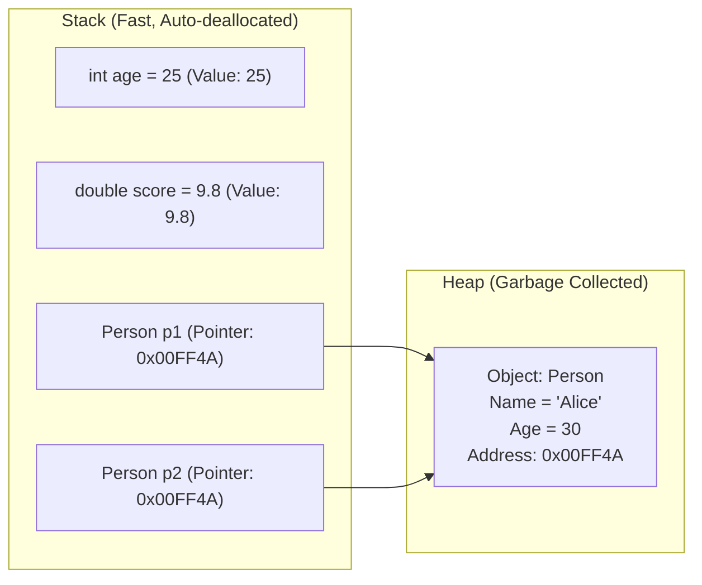

# Topic 02: C# Language Fundamentals

## 📖 Theoretical Overview

### 1. Program Structure & Entry Point
Every C# program requires an entry point. Historically, this was `static void Main(string[] args)` inside a class. Since C# 9, **Top-Level Statements** allow writing procedural code directly without wrapping it inside a boilerplate class or method.

### 2. Statements, Expressions & Blocks
- **Expression:** Evaluates to a value (e.g., `4 + 5`, `Math.Sqrt(16)`).
- **Statement:** A complete unit of execution terminated by a semicolon (e.g., variable assignment, `if` statement).
- **Block:** A sequence of statements enclosed in braces `{ ... }` that creates a new lexical scope.

### 3. Variables, Constants & `var`
- `const`: Immutable value known at compile time.
- `var`: Strongly-typed local variable where the compiler infers the type from the right-hand assignment. It is **not** dynamic.

### 4. Value Types vs. Reference Types
- **Value Types** (`int`, `float`, `bool`, `struct`, `enum`): Stored directly where declared (typically on the Stack). Copying creates a duplicate value.
- **Reference Types** (`class`, `string`, `record`, `array`, `delegate`): The variable stores a reference (memory pointer) on the Stack that points to the actual data allocated on the managed Heap.

---

## 📊 Memory Allocation: Stack vs. Heap

---

### 5. Type Casting & Parsing
- **Implicit Casting:** Safe widening conversions without data loss (`int` -> `double`).
- **Explicit Casting:** Potentially lossy narrowing conversions requiring `(targetType)` syntax (`(int)9.99` becomes `9`).
- **Parsing:** Converting strings to primitives via `int.Parse("123")` or the safer `int.TryParse("123", out int val)`.
