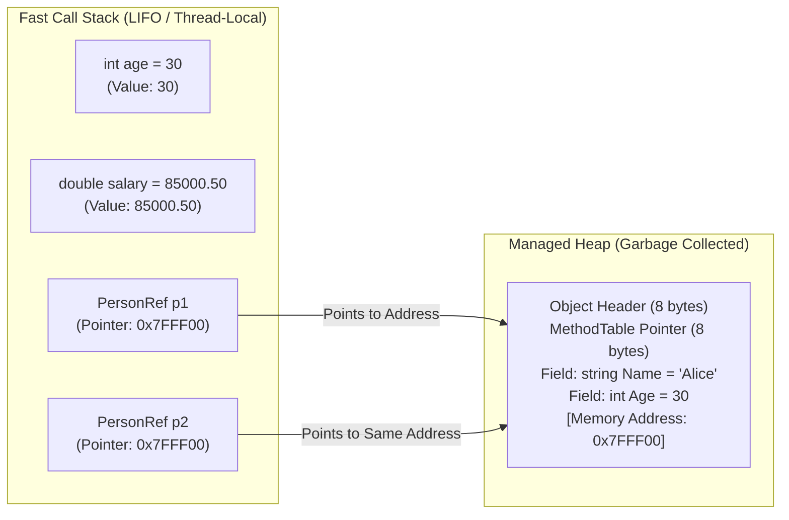

# Topic 02: C# Language Fundamentals

## 🌟 The Story: The Sticky Note vs. The Secret Vault

To understand how computer languages work with memory, picture an executive's desk:

### 1. The Sticky Note on Your Desk (Value Type on the Stack)
When a colleague writes down a phone number on a yellow sticky note and hands it to you, you hold the actual data right on top of your desk.
- If another colleague asks for the number, you grab a fresh sticky note, copy the digits over, and hand it to them.
- If they take their note and scribble over it, does your note change? **No.** You each hold an independent, self-contained copy of the information.
- This is how **Value Types** (`int`, `double`, `bool`, `struct`) work on the **Stack**. They are lightning-fast to create and disappear automatically the moment your method finishes.

### 2. The Vault Keycard (Reference Type on the Heap)
Now imagine you rent a massive safety deposit vault in the bank basement containing confidential corporate blueprints.
- You don't carry the giant metal vault in your briefcase. Instead, you carry a small plastic **Keycard** with the vault's address (`0x00FF4A`).
- If you give your partner a duplicate keycard, you are **not** duplicating the vault—you are duplicating the **reference (the pointer)** to that single vault.
- If your partner visits the vault and adds a red stamp to the blueprint, what do you see when you visit the vault tomorrow? **The red stamp.**
- This is how **Reference Types** (`class`, `string`, `array`, `record`) work on the **Heap**. The variable on your Stack merely holds the memory address pointing to the real object living in the managed Heap.

---

## 🔬 The Technical Deep Dive

### 1. Program Structure & Entry Points
Every executable C# program requires an entry point. 

#### Traditional Entry Point (C# 1.0 - 8.0):
```csharp
namespace MyApp
{
    internal class Program
    {
        static void Main(string[] args)
        {
            Console.WriteLine("Hello, World!");
        }
    }
}
```

#### Modern Top-Level Statements (C# 9+):
The compiler automatically synthesizes the `Program` class and `Main` method behind the scenes:
```csharp
Console.WriteLine("Hello, World!");
```

---

### 2. Variables, Constants, and the `var` Keyword
- `const`: Evaluated entirely at **compile-time**. The compiler replaces every occurrence of the constant across your code directly with the literal value.
- `var`: **Type inference at compile-time**. It does **not** make C# dynamically typed! The Roslyn compiler deduces the exact type from the right-hand assignment. Once inferred, the type is locked and cannot change.

```csharp
const double TaxRate = 0.18; // Inlined at compile time
var company = "Contoso";     // Inferred as System.String (strictly typed!)
// company = 123;            // COMPILE ERROR: Cannot implicitly convert int to string
```

---

### 3. Memory Architecture: Stack vs. Heap



---

### 4. Type Conversions & The Dangerous Overflow Trap

#### Implicit vs. Explicit Conversions
- **Implicit (Widening):** Converting a smaller range type into a larger range type (`int` -> `long` -> `double`). No data loss can occur.
- **Explicit (Narrowing / Casting):** Converting a larger range or floating-point type into a smaller integer (`double` -> `int`). Truncates fractional parts and risks overflow.

#### The `checked` Keyword: Preventing Silent Disasters
In standard unchecked mode, if an integer exceeds `int.MaxValue` (2,147,483,647), it silently wraps around to negative numbers (`-2,147,483,648`). In banking or safety-critical software, this is catastrophic.

Wrapping math inside a `checked` block forces the CLR to throw an `OverflowException` rather than corrupting data:

```csharp
// Silent rollover trap:
int max = int.MaxValue;
int overflow = max + 1; // Silently becomes -2,147,483,648!

// Protected calculation:
checked
{
    // Throws System.OverflowException: Arithmetic operation resulted in an overflow.
    int safeCalc = max + 1; 
}
```

---

### 5. Robust Parsing: `Parse` vs. `TryParse`
- `int.Parse("abc")`: Throws a `FormatException`, forcing expensive OS exception stack frame creation.
- `int.TryParse("abc", out int result)`: Returns a clean `false` without throwing an exception or allocating memory. Always prefer `TryParse` when handling user input.

```csharp
if (int.TryParse(Console.ReadLine(), out int userAge))
{
    Console.WriteLine($"Valid age recorded: {userAge}");
}
else
{
    Console.WriteLine("Invalid numeric format entered.");
}
```

---

### 6. Professional XML Documentation
C# supports triple-slash `///` XML comments parsed by compilers and IDEs into IntelliSense tooltips and API documentation files:

```csharp
/// <summary>
/// Calculates the total invoice price after applying mandatory regional taxes.
/// </summary>
/// <param name="subtotal">The raw cost of goods before tax.</param>
/// <param name="taxRate">The percentage rate expressed as a decimal (e.g. 0.18 for 18%).</param>
/// <returns>The total rounded payable sum.</returns>
/// <exception cref="ArgumentOutOfRangeException">Thrown when subtotal or tax rate is negative.</exception>
public static double CalculateTotal(double subtotal, double taxRate)
{
    if (subtotal < 0 || taxRate < 0)
        throw new ArgumentOutOfRangeException("Amounts cannot be negative.");

    return subtotal * (1.0 + taxRate);
}
```
