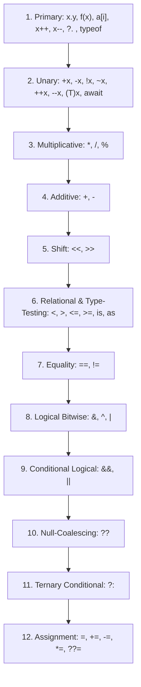

# Topic 03: Operators in C#

## 📖 Theoretical Overview

### 1. Categories of Operators
- **Arithmetic:** `+`, `-`, `*`, `/`, `%`
- **Relational / Comparison:** `==`, `!=`, `<`, `>`, `<=`, `>=`
- **Logical:** `&&` (Short-circuit AND), `||` (Short-circuit OR), `!` (NOT)
- **Bitwise:** `&` (AND), `|` (OR), `^` (XOR), `~` (Complement), `<<` (Left Shift), `>>` (Right Shift)
- **Null Operators:**
  - `??` (Null-Coalescing): Returns the left-hand operand if not null; otherwise evaluates right-hand.
  - `??=` (Null-Coalescing Assignment): Assigns the right-hand value only if the left-hand is null.
- **Type Inspection & Casting Operators:**
  - `is`: Checks if an object is compatible with a given type or matches a pattern.
  - `as`: Safely casts an object to a reference or nullable type; returns `null` instead of throwing `InvalidCastException`.
  - `typeof`: Gets the `System.Type` object for an explicit compile-time type.

---

## 📊 Operator Precedence Hierarchy

