# Topic 03: Operators & Type Testing

## 🌟 The Story: The VIP Club Bouncer & The Sneaky Cashier

Operators are the verbs of programming—they dictate how data interacts, transforms, and makes decisions. To truly grasp their behavior, picture two real-world scenarios:

### 1. The Short-Circuiting Bouncer (`&&` vs. `&`)
Imagine a security guard guarding the VIP entrance of a concert hall with two rules:
> *"You must possess a valid VIP wristband **AND** you must be at least 21 years old."*

A guest arrives at the door. The guard checks their wrist: **No wristband.** 
Does the guard waste time asking for their driver's license to check their age? **No.** The moment the first condition fails, entry is denied immediately.

- In C#, `&&` (Conditional AND) and `||` (Conditional OR) are **smart bouncers**. If the left operand determines the outcome, the right operand is **never executed**.
- Contrast this with `&` and `|`: they are oblivious guards who insist on checking both your wrist and your ID every single time, even when the outcome is already known!
- **The Pitfall:** If you write `if (isValid && ++counter > 5)`, and `isValid` is false, `counter` is **never incremented**!

### 2. The Sneaky Cashier (Prefix `++i` vs. Postfix `i++`)
Imagine shopping at a counter:
- **Postfix (`i++`):** You tell the cashier, *"Charge me based on my current balance right now, and after you hand me the receipt, increment my tally by 1."*
- **Prefix (`++i`):** You tell the cashier, *"First add 1 to my tally right now, and then charge me using that brand-new incremented number."*

When placed on a line by itself, `i++;` and `++i;` produce the same result. But when embedded inside an assignment or calculation (`y = 5 * ++x;` vs `y = 5 * x++;`), the order of operations produces completely different results!

---

## 🔬 The Technical Deep Dive

### 1. The Spectrum of Operators

```mermaid
flowchart TD
    subgraph Precedence_Hierarchy["Operator Precedence & Evaluation Order (High to Low)"]
        P1["1. Primary: x.y, f(x), a[i], x++, x--, ?., typeof, default"]
        P2["2. Unary: +x, -x, !x, ~x, ++x, --x, (T)x"]
        P3["3. Multiplicative: *, /, %"]
        P4["4. Additive: +, -"]
        P5["5. Shift (Bitwise): <<, >>, >>>"]
        P6["6. Relational & Type-Testing: <, >, <=, >=, is, as"]
        P7["7. Equality: ==, !="]
        P8["8. Bitwise Logical: & (AND), ^ (XOR), | (OR)"]
        P9["9. Conditional Boolean: && (Short-circuit AND), || (Short-circuit OR)"]
        P10["10. Null-Coalescing: ??"]
        P11["11. Ternary Conditional: condition ? trueVal : falseVal"]
        P12["12. Assignment: =, +=, -=, *=, /=, %=, ??="]
        
        P1 --> P2 --> P3 --> P4 --> P5 --> P6 --> P7 --> P8 --> P9 --> P10 --> P11 --> P12
    end
```



---

### 2. Bitwise Operators & Flag Enums
Computers operate on binary bits (`0` and `1`). Bitwise operators manipulate these bits directly:
- `&` (Bitwise AND): Sets bit to 1 only if **both** bits are 1 (used for masking).
- `|` (Bitwise OR): Sets bit to 1 if **either** bit is 1 (used for combining permissions).
- `^` (Bitwise XOR): Sets bit to 1 if bits are **different** (used for toggling).
- `~` (Bitwise NOT): Inverts all bits.
- `<<` / `>>`: Shifts bits left or right (shifting left by 1 multiplies by 2; shifting right divides by 2).

```csharp
[Flags]
public enum FilePermissions
{
    None = 0,
    Read = 1 << 0,    // 0001 (1)
    Write = 1 << 1,   // 0010 (2)
    Execute = 1 << 2  // 0100 (4)
}

// Combining permissions via bitwise OR:
var userPerms = FilePermissions.Read | FilePermissions.Write; // 0011 (3)

// Checking permission via bitwise AND:
bool canWrite = (userPerms & FilePermissions.Write) != 0; // True
```

---

### 3. Null-Coalescing: `??` and `??=`
- **`??` (Fallback Provider):** If the left operand is not null, return it; otherwise evaluate and return the right operand.
- **`??=` (Lazy Assignment):** Assigns the right-hand value to the variable **only if** the variable currently holds `null`.

```csharp
string? userNickname = null;

// The ?? operator provides a fallback default
string displayed = userNickname ?? "Anonymous Guest";

// The ??= operator assigns only if null
userNickname ??= "Kunal"; // Sets nickname to 'Kunal'
userNickname ??= "Alex";  // Skipped! userNickname is already non-null
```

---

### 4. Type Inspection: `is`, `as`, and `typeof`
| Operator | Purpose | Return Value | Throws Exception on Failure? |
|---|---|---|---|
| **`typeof(T)`** | Obtains the compile-time `System.Type` metadata token for a class or struct | `Type` object | No |
| **`is`** | Evaluates whether an object is compatible with a type or matches a pattern | `bool` (or binds pattern variable) | No |
| **`as`** | Attempts to cast an object to a reference or nullable type | Typed object or `null` | No (never throws `InvalidCastException`) |

```csharp
object incomingData = "High Performance C#";

// Pattern matching 'is' with variable declaration:
if (incomingData is string validString)
{
    Console.WriteLine($"Length of string: {validString.Length}");
}

// Safe downcasting via 'as':
object numberBox = 42;
string? attemptedString = numberBox as string; // Evaluates to null safely!
```
