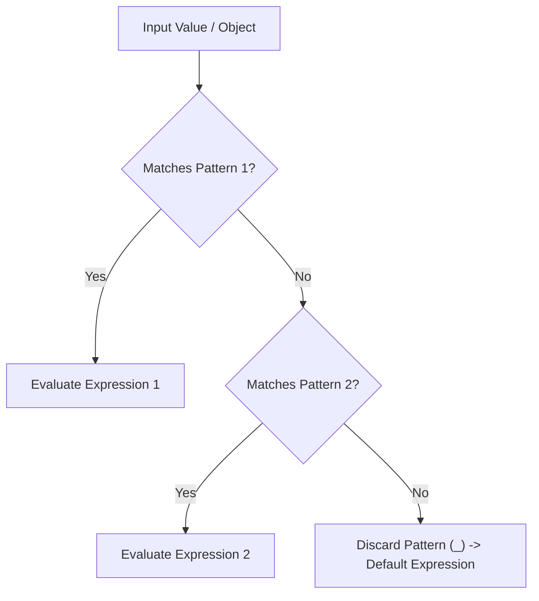

# Topic 04: Decision-Making and Loops

## 📖 Theoretical Overview

### 1. Control Flow Structures
- **`if / else if / else`:** General-purpose boolean condition branching.
- **`switch` Statements:** Branching based on discrete values with `case` blocks.
- **`switch` Expressions (Modern C#):** Functional, value-producing expressions using pattern matching syntax (`val => result`).

### 2. Looping Constructs & Decision Matrix
| Loop Type | Best Suited For | Condition Evaluated |
|---|---|---|
| **`for`** | Known iteration count (e.g., indices, arrays) | Before each iteration |
| **`while`** | Indefinite loops dependent on an ongoing condition | Before each iteration (can run 0 times) |
| **`do-while`** | Scenarios where the body must execute at least once (e.g., input prompts) | After each iteration (runs $\ge$ 1 time) |
| **`foreach`** | Iterating through `IEnumerable<T>` collections without index handling | Iteration via enumerator |

### 3. Control Jump Statements
- `break`: Immediately exits the enclosing loop or switch block.
- `continue`: Skips the remainder of the current iteration and jumps to the next evaluation.

---

## 📊 Modern Switch Expression Pattern Matching

