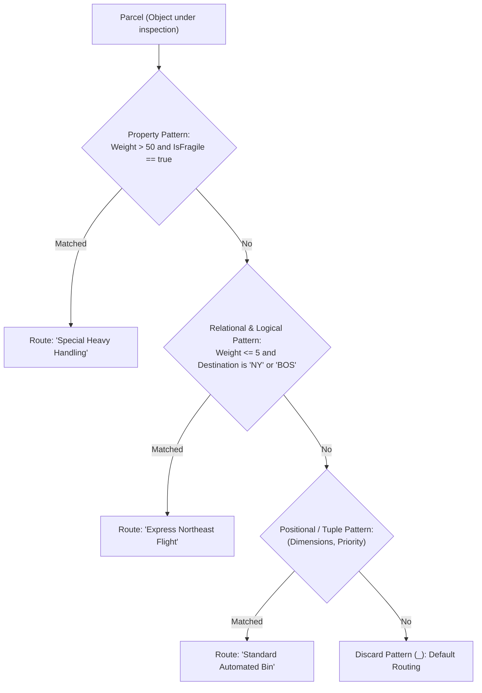

# Topic 04: Decision-Making, Loops & Pattern Matching

## 🌟 The Story: The Smart Logistics Hub & The Optical Sorters

Picture an ultra-modern global fulfillment hub sorting hundreds of thousands of parcels every hour. To keep the facility running without collisions or logjams, the hub relies on two fundamental systems:

### 1. The Railway Tracks vs. The 3D Optical Sorter (Branching)
In the old days, a mechanical switch on the conveyor track merely read a destination zip code:
> *"If Zip == 10001, switch track to New York. Else if Zip == 90001, switch track to Los Angeles. Else, drop into the manual inspection bin."*

This was the traditional, verbose `if-else` or legacy `switch` statement.

Modern fulfillment centers use **3D Optical Laser Sorters**. As a parcel zooms past at 30 miles per hour, high-speed cameras evaluate its weight, 3D dimensions, fragile labels, and destination all at once:
- *Is it heavier than 50 kg AND labeled Fragile?* -> Route to the Two-Person Heavy Lift Station.
- *Is it a letter-sized envelope going to an international hub?* -> Route to the Air Cargo Container.
- *Does it match nothing else?* -> Standard ground transport.

This is **C#'s Modern Pattern Matching & Switch Expressions**. Rather than writing deeply nested `if-else` labyrinths, you declare the shape and conditions of the data, and the compiler instantly routes execution to the correct path.

---

### 2. The Four Conveyor Belt Operators (Looping Strategies)

Every movement of parcels through the warehouse is controlled by loops. Choosing the wrong loop can stall an assembly line:

| The Warehouse Operator | Loop Construct | When to Deploy |
|---|---|---|
| **The Fixed Tally Operator** | **`for`** | You know the exact number of iterations beforehand (e.g. iterate over 50 pallet slots or an indexed array). |
| **The Motion Sensor Operator** | **`while`** | You continue processing as long as an ongoing condition remains true. If no packages arrive at the sensor, the belt **never runs at all (0 iterations)**. |
| **The Security Checkpoint Guard** | **`do-while`** | The action **must execute at least once** before evaluating the exit condition (e.g. prompting a driver for a passcode or reading user input). |
| **The Quality Assurance Auditor** | **`foreach`** | Inspects every element in a sequence or collection from start to finish via an iterator (`IEnumerator`), without caring about index arithmetic. |

---

## 🔬 The Technical Deep Dive

### 1. Modern Pattern Matching in Switch Expressions
C# switch expressions are functional, clean, and return a value directly. They support a rich taxonomy of patterns:



#### Code Syntax:
```csharp
public record Shipment(double WeightKg, bool IsFragile, string Destination);

public static string DetermineRouting(Shipment shipment) => shipment switch
{
    // Property pattern with relational condition
    { WeightKg: > 50, IsFragile: true } => "Heavy Fragile Team",
    
    // Relational + Logical 'and' / 'or' patterns
    { WeightKg: <= 1.0, Destination: "NYC" or "BOS" } => "Express Northeast Air",
    
    // Type pattern checking subclass
    SpecialHandlingShipment s => $"Escorted: {s.SecurityClearanceLevel}",
    
    // Discard pattern (mandatory fallback)
    _ => "Standard Ground Transport"
};
```

---

### 2. The Danger of Modifying Collections in `foreach`
The `foreach` loop relies on an underlying enumerator (`IEnumerator<T>`). In .NET collections like `List<T>`, the collection maintains an internal `_version` counter. 

If you add, remove, or clear items inside a `foreach` loop, the collection detects that its version has changed and immediately throws:
> `System.InvalidOperationException: Collection was modified; enumeration operation may not execute.`

**The Solution:** If you need to remove items while looping, either iterate backwards using a standard `for` loop or use LINQ's `.RemoveAll(...)`.

---

### 3. Loop Control: `break` vs. `continue` vs. Nested Loops
- **`continue` (The Skip Button):** Immediately terminates the current iteration and jumps to the next condition check.
- **`break` (The Emergency Stop):** Completely terminates the innermost loop and resumes execution after the closing brace.
- **Nested Loops with Flags:** To break out of multiple nested loops simultaneously, use a boolean flag or return directly from an extracted method.
