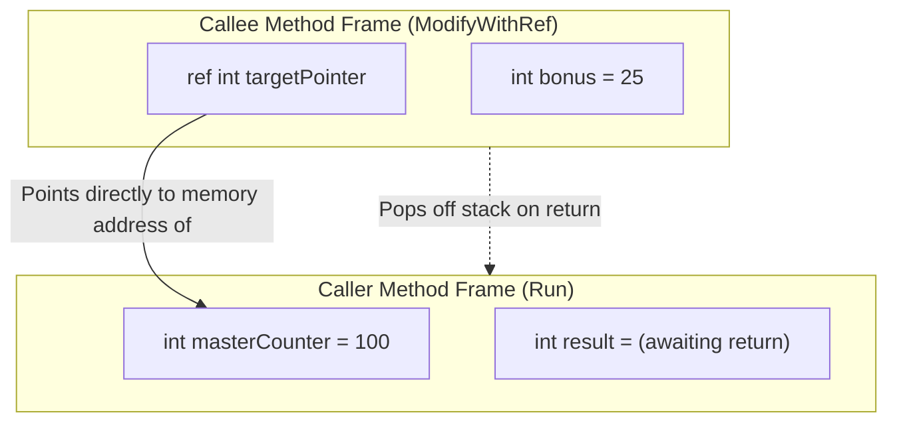

# Topic 05: Methods, Parameter Modifiers & Recursion

## 🌟 The Story: The Master Clockmaker's Workshop

Imagine you operate an elite artisanal watchmaking workshop. You cannot personally forge every balance spring, polish every sapphire glass, and calibrate every jewel. Instead, you design your workshop into **specialized workstations**—these are your **Methods**.

To delegate work effectively and safely, you establish strict courier protocols:

### 1. The Four Courier Delivery Protocols (`val`, `ref`, `out`, `in`)

| Protocol | Real-World Scenario | C# Modifier | Behavior in Memory |
|---|---|---|---|
| **Standard Mail** | You photocopy your master design blueprint and mail it to a supplier. The supplier can spill ink on it, fold it, or scribble on it. Your original master blueprint sitting in your safe is **completely untouched**. | *(None - Default)* | **Pass-by-Value:** A bitwise copy of the argument is placed on the callee's stack frame. |
| **The Live Radio Link** | You hand the technician a live remote-control wire connected directly to the master pendulum in your workshop. If the technician twists the dial, the clock in your workshop moves in real time. | **`ref`** | **Pass-by-Reference:** Passes the memory address of the caller's variable. The method reads and mutates the caller's memory directly. |
| **The Empty Cargo Crate** | You hand a courier an empty crate with a delivery manifest. The courier does not care what was in the crate before. However, the supplier **must** place goods in the crate before returning to you. | **`out`** | **Output Parameter:** The variable does not need to be initialized before the call, but the method **is legally required by the compiler** to assign a value before returning. |
| **The Armored Display Case** | You let an appraiser inspect a massive, heavy antique clock. Moving or copying the giant clock is expensive. So you let him inspect it in place, but behind bulletproof glass: he can look at all of it, but cannot alter a single screw. | **`in`** | **Read-Only Reference:** Passes a reference to avoid memory-copy overhead for large structs, while the compiler strictly forbids any mutation. |

---

## 🔬 The Technical Deep Dive

### 1. Stack Frame Architecture During Method Invocations

Every time a method is called, the CPU allocates a new **Stack Frame** containing local variables, parameters, and the return address. When the method returns, that stack frame is popped instantly with zero garbage collection overhead.



---

### 2. Method Overloading & Resolution Rules
**Method Overloading** allows multiple methods in the same class to share the same name, provided they have **different parameter signatures** (different types, different counts, or different order of types).

> ⚠️ **Rule:** The return type **alone** cannot differentiate overloads! `int Calculate()` and `double Calculate()` will fail to compile because the compiler cannot determine which one you intended to call from invocation syntax alone.

---

### 3. Optional & Named Arguments
- **Optional Arguments:** Defined with default values at the end of the parameter list (`int timeoutMs = 3000`).
- **Named Arguments:** Allow you to pass parameters by name (`CreateUser(email: "a@b.com", name: "Alice")`), freeing you from matching positional order and drastically improving code readability for methods with many boolean flags.

---

### 4. The `params` Keyword: Variable Argument Lists
The `params` keyword permits callers to pass zero or more comma-separated arguments, or a single array, without explicit array initialization:

```csharp
public static double Average(params double[] values)
{
    if (values.Length == 0) return 0.0;
    double sum = 0;
    foreach (var v in values) sum += v;
    return sum / values.Length;
}

// All three invocations are valid:
Average(10.5, 20.0, 35.5);
Average(90.0);
Average(); // values.Length == 0
```

---

### 5. Recursion & The Call Stack Limit
**Recursion** occurs when a method calls itself to solve a smaller sub-problem. 

#### The Golden Rule of Recursion:
Every recursive method **must** have an unreachable **Base Case** that stops further calls. Without a base case, the method will push frames onto the Stack until the allocated stack size (typically 1MB on 32-bit or 4MB on 64-bit) is exhausted, triggering a fatal `System.StackOverflowException`.

```csharp
// Safe Recursive Factorial
public static long Factorial(int n)
{
    // 1. Base Case: stops infinite recursion
    if (n <= 1) return 1;

    // 2. Recursive Step
    return n * Factorial(n - 1);
}
```
