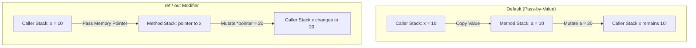

# Topic 05: Methods & Parameter Modifiers

## 📖 Theoretical Overview

### 1. Anatomy of a Method
Methods encapsulate reusable behavior. Modern C# supports standard block-bodied methods and concise **Expression-Bodied Methods** (`int Add(int a, int b) => a + b;`).

### 2. Parameter Modifiers: `val` vs `ref` vs `out` vs `in`
| Modifier | Direction | Initialized Before Call? | Must Be Modified in Method? | Intended Purpose |
|---|---|---|---|---|
| *(None)* | In | Yes | No (changes don't affect caller) | Standard pass-by-value |
| **`ref`** | In / Out | **Yes** | No | Pass memory reference; modify caller's variable |
| **`out`** | Out | No | **Yes (before returning)** | Returning multiple values |
| **`in`** | In | **Yes** | **No (Read-Only reference)** | High-performance value type passing without copy overhead |

### 3. Special Method Keywords
- **`params`:** Allows passing a variable number of comma-separated arguments as an array.
- **Local Functions:** Functions defined inside another method, scoped exclusively to that method.
- **Named Arguments:** Calling methods via `Method(age: 25, name: "Alice")` regardless of argument order.

---

## 📊 Parameter Modifiers Comparison

