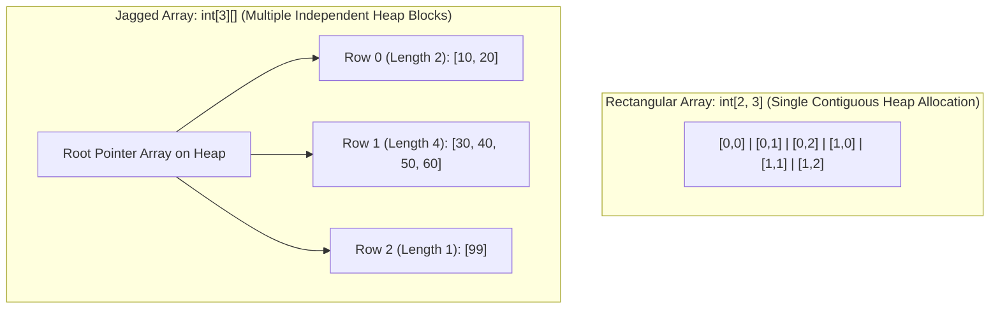

# Topic 06: Arrays, Strings, and the Intern Pool

## 🌟 The Story: The Modular High-Rise & The Inscribed Clay Tablets

To master memory and performance in C#, you must understand how sequential data lives in RAM:

### 1. The Concrete High-Rise vs. The Hillside Village (Arrays)
- **Rectangular Array (`int[,]`):** Picture a modern concrete apartment building. Every single floor has identical dimensions—say, 3 units per floor. In computer memory, the CLR allocates one single, contiguous, unbroken rectangle of memory. Calculating the address of any room is pure arithmetic: `Row * TotalColumns + Column`.
- **Jagged Array (`int[][]` - Array of Arrays):** Picture an eclectic hillside village. House 1 has 2 bedrooms; House 2 has 6 bedrooms; House 3 has 1 bedroom. The main entry gate does not point to rooms—it points to independent paths leading to completely separate houses on the Heap. Because each sub-array can have a unique length, jagged arrays give immense flexibility and often outperform rectangular arrays due to JIT compiler array-bounds optimizations!

---

### 2. The Inscribed Clay Tablet (String Immutability)
In ancient Sumer, scribes carved words into wet clay tablets and baked them hard in an oven. Once baked, **the tablet was permanent and immutable**.
- If the king wanted to append the word `" World"` to a tablet that read `"Hello"`, the scribe could **not** stretch the clay. 
- He was forced to fetch a brand-new slab of wet clay, carve the full sentence `"Hello World"`, bake the new tablet, and abandon the old tablet in the rubble.

**In C#, Strings are baked clay tablets.** Every time you do:
```csharp
string text = "Hello";
text += " World"; // Creates a BRAND-NEW string object on the Heap!
```
The original string `"Hello"` is left abandoned on the Heap to be collected by the Garbage Collector. If you concatenate strings inside a loop of 10,000 iterations, you allocate 10,000 discarded objects on the Heap!

### 3. The Reusable Whiteboard (`StringBuilder`)
Instead of carving and throwing away thousands of clay tablets, you pull out an erasable whiteboard—**`StringBuilder`**. You append, insert, replace, and modify characters inside an in-memory mutable buffer. Only when you are completely finished do you call `.ToString()` to bake your final immutable string.

---

## 🔬 The Technical Deep Dive

### 1. Array Memory Layout Comparison



---

### 2. The String Intern Pool
Because strings are immutable, having 10,000 instances of the exact same string literal (e.g. `"US"`) in memory is a massive waste of RAM. 

The CLR maintains an internal table called the **Intern Pool**. When the CLR loads an assembly, it checks all string literals:
- If `"System"` is already in the pool, the CLR points the new variable to the existing string in memory.
- You can manually check or register strings at runtime using `string.IsInterned(str)` and `string.Intern(str)`.

```mermaid
flowchart LR
    S1["string a = 'Alpha'; (Stack)"] --> Pool["CLR String Intern Pool (Heap)<br/>Unique Instance: 'Alpha'"]
    S2["string b = 'Alpha'; (Stack)"] --> Pool
    Note over S1,S2: Both variables share the exact same memory pointer!
```

---

### 3. String Comparison: Ordinal vs. Cultural
The most dangerous string bug in software engineering is comparing strings using default culture-sensitive rules instead of binary byte equality.

| Comparison Mode | How it Evaluates | When to Use |
|---|---|---|
| **`StringComparison.Ordinal`** | Compares raw byte code points (ASCII / Unicode values). Fastest. | **Always use for:** File paths, URLs, JSON keys, XML tags, HTTP headers, dictionary lookups. |
| **`StringComparison.OrdinalIgnoreCase`** | Compares raw byte code points ignoring casing via simple uppercase conversion. | **Always use for:** Case-insensitive internal tokens, environment variables, commands. |
| **`StringComparison.CurrentCulture`** | Uses the user's localized operating system linguistic rules (e.g. Turkish `i` vs `İ`). | **Only use for:** Displaying alphabetically sorted text to end-users on UI screens. |

---

### 4. Modern String Literals: Verbatim vs. Raw
- **Verbatim Strings (`@""`):** Ignores escape sequences like `\` (ideal for regular expressions and Windows file paths).
- **Raw String Literals (`""" ... """` in C# 11+):** Allows multi-line strings, unescaped quotes `"`, and JSON without ugly `\"` escapes:

```csharp
// Clean JSON formatting without escaping:
string payload = """
{
    "user": "Kunal",
    "role": "Lead Architect",
    "status": "Active"
}
""";
```
