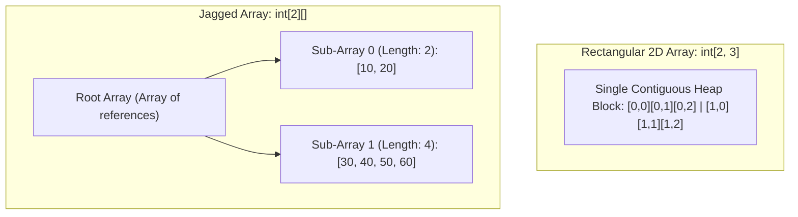

# Topic 06: Arrays and Strings

## 📖 Theoretical Overview

### 1. Array Architectures
- **Single-Dimensional Array:** Contiguous block of memory holding elements of the same type (`int[] arr = new int[5];`).
- **Multidimensional (Rectangular) Array:** Fixed 2D/3D grid (`int[,] matrix = new int[3, 3];`).
- **Jagged Array (Array of Arrays):** An array whose elements are themselves independent arrays, allowing rows of differing lengths (`int[][] jagged = new int[3][];`).

### 2. String Mechanics & Immutability
- Strings in .NET are **immutable** reference types. Any modification (e.g. `s += " extra"`) leaves the original string intact on the heap and allocates a brand-new string.
- **`StringBuilder`:** A mutable buffer in `System.Text` that avoids repeated heap reallocations when appending in loops.

---

## 📊 Rectangular vs. Jagged Array Memory Layout

