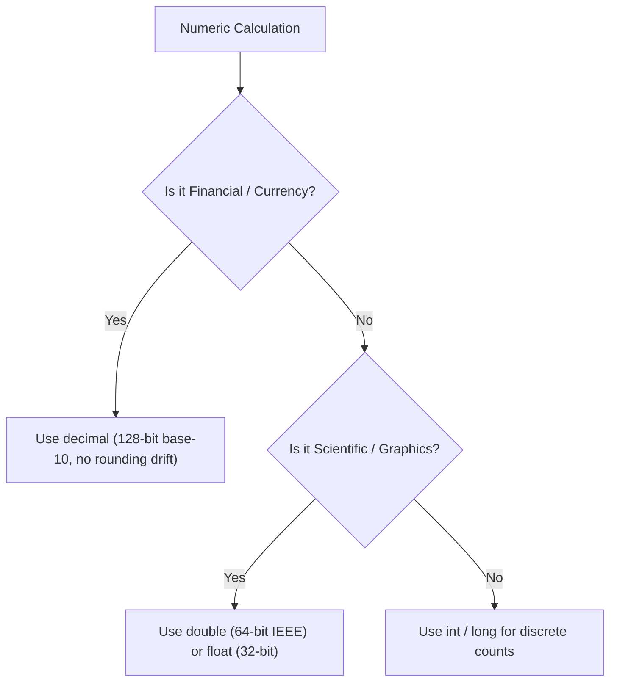

# Topic 07: Essential Built-in Types

## 📖 Theoretical Overview

### 1. Primitive Numeric Types
- `int` (32-bit signed) / `long` (64-bit signed).
- `float` (32-bit IEEE float) / `double` (64-bit IEEE float) - suited for scientific computation.
- `decimal` (128-bit high-precision floating point) - mandatory for financial/currency calculations to avoid binary floating-point rounding errors.

### 2. Modern Date & Time Types (.NET 6+)
- `DateTime`: Date and time of day, optional time zone offset.
- `DateOnly`: Represents a pure calendar date (e.g. birthday) without time or timezone ambiguity.
- `TimeOnly`: Represents a pure time of day (e.g. alarm clock) without a date.
- `TimeSpan`: Represents a duration or time interval.

### 3. Enums, Tuples & Guids
- `enum`: Strongly-typed set of named numeric constants.
- `Guid` (Globally Unique Identifier): 128-bit integer guaranteed to be globally unique.
- `ValueTuple` (`(int x, string y)`): Lightweight, mutable value-type grouping without class overhead.

---

## 📊 Precision & Financial Data Type Matrix

