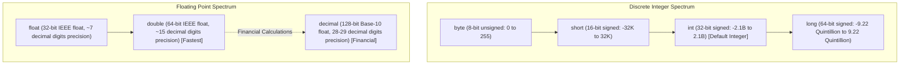

# Topic 07: Essential Built-in Types

## 🌟 The Story: The Swiss Bank Vault & The Universal Clock

Choosing the correct built-in type is the difference between an application that runs with flawless precision and one that quietly bleeds money or corrupts timezones.

### 1. The Bank Teller's Nightmare (`double` vs. `decimal`)
Imagine a Swiss banker and an aerospace physicist comparing scales:
- **The Physicist uses `double` (64-bit IEEE 754 Floating-Point):** It calculates atomic velocities and orbital trajectories at astronomical speed. But in binary base-2, the fractions $1/10$ and $2/10$ have no finite representation (just as $1/3 = 0.3333...$ has no finite representation in base-10). As a result:
  $$0.1 + 0.2 = 0.30000000000000004$$
  In an airplane simulator, that tiny fraction of a micron is harmless. In a high-volume financial exchange, that rounding drift results in stolen fractions of pennies and catastrophic audit failures.
- **The Banker insists on `decimal` (128-bit Base-10 Floating-Point):** It does not compute in binary fractions; it computes in pure powers of ten. `0.1m + 0.2m` is guaranteed to equal exactly `0.3m` with 28 digits of unwavering precision.
- **Golden Rule:** *Never use `float` or `double` for currency, invoices, interest, or balances. Always use `decimal`.*

---

### 2. The Flight Dispatcher's Calendar (`DateTime`, `DateOnly`, `TimeOnly`)
Imagine you run an international airline:
- If a passenger was born on **October 21**, storing that as a legacy `DateTime` (`2026-10-21 00:00:00 UTC`) is dangerous. When viewed by a flight attendant in New York (UTC-5), the clock converts to `2026-10-20 19:00:00`—their birthday shifted backward by a day!
- **`DateOnly` (Introduced in .NET 6):** Represents a pure calendar date. A birthday or national holiday has no clock time and no timezone.
- **`TimeOnly` (Introduced in .NET 6):** Represents a recurring clock time. The morning pre-flight checklist occurs at `08:30 AM` every single day, independent of date.
- **`DateTimeOffset`:** The premier type for event logging. It pairs a UTC timestamp with the exact local timezone offset (`2026-10-21 14:30:00 +05:30`), leaving zero ambiguity about when an event happened in world history.

---

## 🔬 The Technical Deep Dive

### 1. Numeric Precision & Storage Hierarchy



---

### 2. Nullable Value Types: `Nullable<T>` or `T?`
A value type (like `int` or `bool`) cannot naturally be `null` because it holds bits directly in its stack memory. 

To represent missing or database-null states, C# provides `Nullable<T>` (syntactic sugar: `int?`). Under the hood, it is a lightweight struct containing two fields:
1. `bool hasValue`
2. `T value`

```csharp
int? optionalScore = null;

if (optionalScore.HasValue)
{
    Console.WriteLine($"Score: {optionalScore.Value}");
}

// Convenient fallback helper:
int finalScore = optionalScore.GetValueOrDefault(fallback: 0);
```

---

### 3. The `Guid` (Globally Unique Identifier)
A 128-bit integer (16 bytes) generated using cryptographic randomness and hardware identifiers. The mathematical probability of two independently generated GUIDs colliding is approximately 1 in $2^{128}$ ($3.4 \times 10^{38}$)—practically zero in the observable universe.

---

### 4. Lightweight Data Bundles: `ValueTuple`
Instead of authoring a full class or struct just to return two values from a method, C# provides `ValueTuple` (`(int StatusCode, string Message)`).
- Allocated directly on the **Stack** (zero GC overhead).
- Supports clean **Deconstruction**:

```csharp
// Returning a tuple
public static (double Latitude, double Longitude) GetCoordinates() => (40.7128, -74.0060);

// Deconstructing directly into local variables:
var (lat, lon) = GetCoordinates();
```
