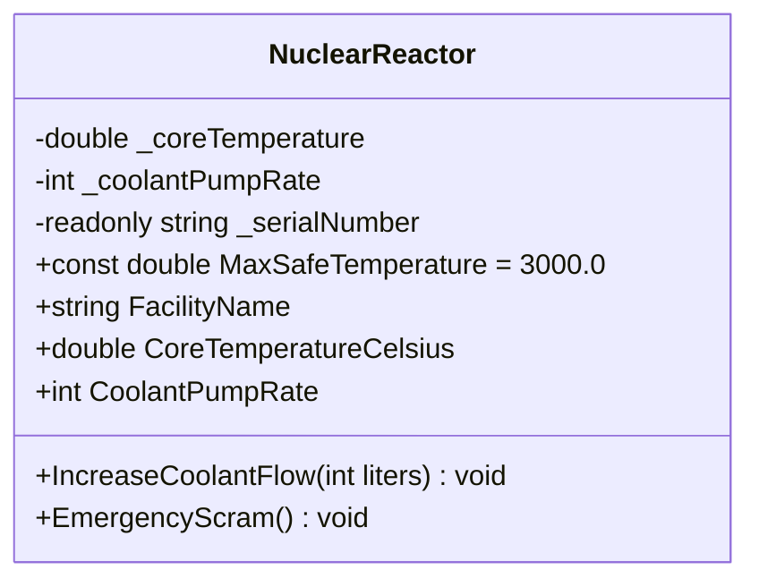

# Topic 08: OOP Fundamentals, Encapsulation & Mutability

## 🌟 The Story: The Nuclear Power Plant & The Sealed Control Console

Imagine designing the control systems for a nuclear power facility.

### 1. The Core Reactor (Private Encapsulated State)
Deep within the facility sits the nuclear reactor core containing control rods and pressurized cooling water. 
- You would **never** allow arbitrary external visitors to walk into the reactor room and manually yank out control rods:
  ```csharp
  reactor._coreTemperature = 15000; // CATASTROPHIC MELTDOWN!
  ```
- Exposing raw fields directly invites corruption, illegal states, and total system failure. Therefore, the core reactor state is strictly **`private`**—completely sealed off from the outside world.

### 2. The Control Room Console (Public Methods & Validated Properties)
Instead of touching raw fuel rods, engineers sit in a fortified control center. They interact with the reactor exclusively through **validated, safety-interlocked controls**:
- To raise cooling water, they turn a dial: `IncreaseCoolantFlow(litersPerSecond)`. Inside that method, computer safety interlocks verify that the pumps are online and pressure tolerances are safe before altering the internal valves.
- To check heat, they look at a digital readout: `CoreTemperatureCelsius`—a **read-only property** that permits inspection without allowing anyone to tamper with the reading.

**This is the essence of Encapsulation:** Guarding internal state integrity, enforcing business invariants, and hiding implementation mechanics behind clean public abstractions.

---

### 3. The Security Badges: Access Modifiers

| Security Badge | C# Access Modifier | Accessibility Scope |
|---|---|---|
| **Public Visitor** | **`public`** | Unrestricted access across all projects, assemblies, and libraries. |
| **Corporate Employee** | **`internal`** | Accessible anywhere within the **same compiled assembly (.dll)**, but completely invisible to outside projects. |
| **Family Heirloom** | **`protected`** | Accessible within the declaring class and any **derived subclass**, even if that subclass lives in a different assembly. |
| **Personal Diary** | **`private`** | Strictly accessible **only within the exact class** or struct that declared it. |
| **Corporate Branch** | **`protected internal`** | Accessible by any code in the **same assembly**, OR by derived subclasses in other assemblies. |
| **Immediate Family in Same House** | **`private protected`** | Accessible **only by derived subclasses within the same assembly**. |

---

## 🔬 The Technical Deep Dive

### 1. Class Architecture & Property Evolution



---

### 2. `const` vs. `readonly` vs. `static readonly`
The difference between `const` and `readonly` is one of the most frequently asked questions in C# technical interviews:

| Dimension | `const` | `readonly` | `static readonly` |
|---|---|---|---|
| **Evaluation Time** | **Compile-Time** | **Run-Time** | **Run-Time** |
| **Memory Inlining** | Inlined directly into every call site like a hardcoded number. | Stored in heap object memory. | Stored once in global type metadata. |
| **Initialization** | Must be assigned at declaration (`const int x = 10;`). | Can be assigned at declaration OR inside a **constructor**. | Assigned in a **static constructor** or static declaration. |
| **Cross-Assembly Risk** | **High!** If Library A changes a `const`, Library B will not see the change until Library B is recompiled! | **Safe.** Values are loaded dynamically from memory at runtime. | **Safe.** Dynamic runtime resolution. |

```csharp
public class Facility
{
    // Compile-time inlined constant (laws of nature)
    public const double SpeedOfLightMps = 299_792_458.0;

    // Runtime instance-specific immutability (set per instance in constructor)
    public readonly string SerialNumber;

    // Runtime application-wide immutability
    public static readonly DateTime BootTimestamp = DateTime.UtcNow;

    public Facility(string serial)
    {
        SerialNumber = serial; // Legal only inside constructor!
    }
}
```

---

### 3. Properties: Backing Fields vs. Auto-Properties
- **Auto-Implemented Properties (`public string Name { get; set; }`):** The compiler synthesizes a hidden, private backing field (`<Name>k__BackingField`) behind the scenes.
- **Full Properties with Backing Field:** Used when you need custom validation, logging, or caching when a property is read or written.
- **Expression-Bodied Read-Only Properties:** Calculated dynamically upon every access:
  ```csharp
  public bool IsOverheating => _coreTemperature > MaxSafeTemperature;
  ```
