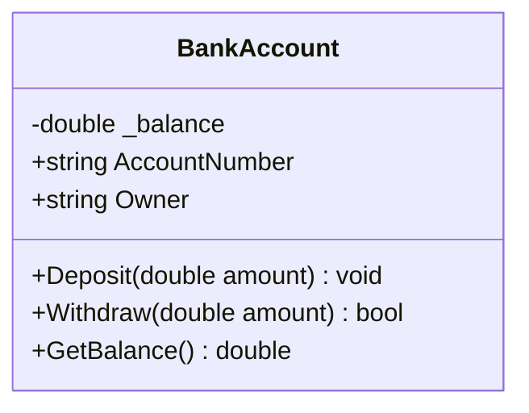

# Topic 08: OOP Fundamentals - Classes, Objects & Encapsulation

## 📖 Theoretical Overview

### 1. The Core Pillars of OOP
- **Encapsulation:** Bundling data and behavior within a class and restricting direct access to internal representations.
- **Abstraction:** Exposing essential characteristics while hiding background implementation details.
- **Inheritance:** Enabling new classes to receive properties and behaviors from existing classes.
- **Polymorphism:** Enabling entities to take on multiple forms depending on context.

### 2. Access Modifiers in C#
| Modifier | Accessibility Scope |
|---|---|
| `public` | Unrestricted access across all assemblies |
| `private` | Accessible only within the containing class or struct |
| `protected` | Accessible within the containing class and derived classes |
| `internal` | Accessible anywhere within the same assembly (.dll) |
| `protected internal` | Accessible within the same assembly OR derived classes in other assemblies |
| `private protected` | Accessible only within the containing class or derived classes in the *same* assembly |

---

## 📊 Class Encapsulation Architecture

