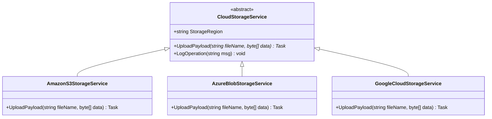

# Topic 09: Inheritance, Abstraction & Dynamic Polymorphism

## 🌟 The Story: The Universal Remote Control & The Secret Agent

Polymorphism comes from the Greek words *poly* (many) and *morph* (form). It is the crown jewel of Object-Oriented Programming.

### 1. The Universal Remote Control (Dynamic Dispatch)
Imagine you hold a universal smart remote with a single button: **`ExecuteAction()`**.
- Point it at your **Smart OLED Television**, and it lights up 8 million pixels.
- Point it at your **Surround Soundbar**, and it fires up a 100-watt subwoofer.
- Point it at your **Motorized Window Blinds**, and it spins an electric motor to let in sunlight.

The remote control does not need to know the inner circuitry of every gadget in your house. It only knows that each gadget complies with a standard contract. When you press the button, the remote dispatches the signal, and **each device responds in its own unique, specialized way**.

---

### 2. The Great Interview Trap: `override` vs. `new` (The Imposter Agent)
Imagine a master class `Father` and a derived class `Son`:

#### A. True Polymorphism (`override`):
The `Father` declares a `virtual void Speak() => "Father speaking"`. The `Son` uses `override void Speak() => "Son speaking"`.
- If you treat the son as a father:
  ```csharp
  Father person = new Son();
  person.Speak(); // OUTPUT: "Son speaking"!
  ```
  Even though the variable is typed as `Father`, the CLR inspects the object's **Virtual Method Table (vtable)** in memory at runtime and dispatches to the true `Son` implementation.

#### B. Method Hiding (`new` - The Imposter):
If the `Son` uses the `new` keyword instead of `override`:
- The son merely created a completely separate method that happens to share the same name, breaking the virtual dispatch chain.
- If you treat the son as a father:
  ```csharp
  Father person = new Son();
  person.Speak(); // OUTPUT: "Father speaking"! (The Son's method was completely hidden!)
  ```

---

## 🔬 The Technical Deep Dive

### 1. Abstract Class vs. Interface: Architectural Decision Matrix

| Dimension | Abstract Class | Interface |
|---|---|---|
| **Relationship** | **"IS-A"** Identity (e.g. `Dog` is an `Animal`) | **"CAN-DO"** Capability (e.g. `Drone` can `IFlyable`) |
| **State / Fields** | Can hold instance fields, backing fields, and state (`private int _age;`) | **Cannot hold instance fields**. Only constants and static members are allowed. |
| **Constructors** | Has constructors to initialize base state (invoked via `base(...)`) | **Cannot have instance constructors**. |
| **Multiple Inheritance** | **No.** C# enforces single class inheritance (a class can only inherit from one base class). | **Yes.** A class can implement an unlimited number of interfaces (`IOrder, ILoggable, IDisposable`). |
| **Evolution** | Adding a concrete method with body does not break derived classes. | Since C# 8, default interface methods are allowed, but abstract classes remain the cleanest way to share state. |

---

### 2. Polymorphic VTable Hierarchy


