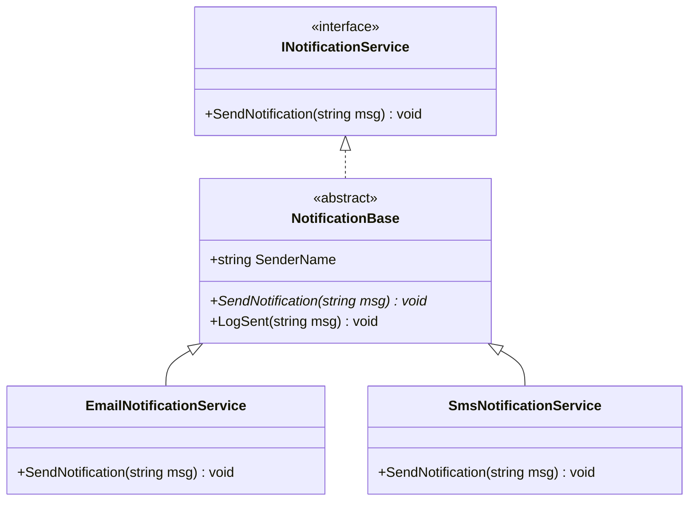

# Topic 09: OOP Inheritance and Polymorphism

## 📖 Theoretical Overview

### 1. Abstract Class vs. Interface
| Feature | Abstract Class | Interface |
|---|---|---|
| **Multiple Inheritance** | No (Single class inheritance only) | Yes (A class can implement many interfaces) |
| **State (Fields)** | Can have instance fields (`private int _id;`) | Cannot have instance fields (constants allowed) |
| **Constructor** | Has constructors (called via `base(...)`) | Cannot have constructors |
| **Purpose** | Defines an "IS-A" relationship and shared core state | Defines a "CAN-DO" behavior contract |

### 2. Method Overriding Mechanics
- **`virtual`:** Declared in the base class to signal that derived classes *may* customize the behavior.
- **`override`:** Declared in the derived class to provide a specialized implementation.
- **`sealed`:** Prevents further derived classes from overriding the method or inheriting the class.
- **`base`:** Allows derived classes to call into base class logic.

---

## 📊 Polymorphic Hierarchy

