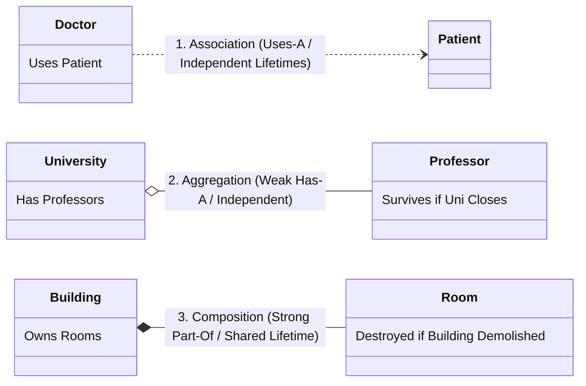
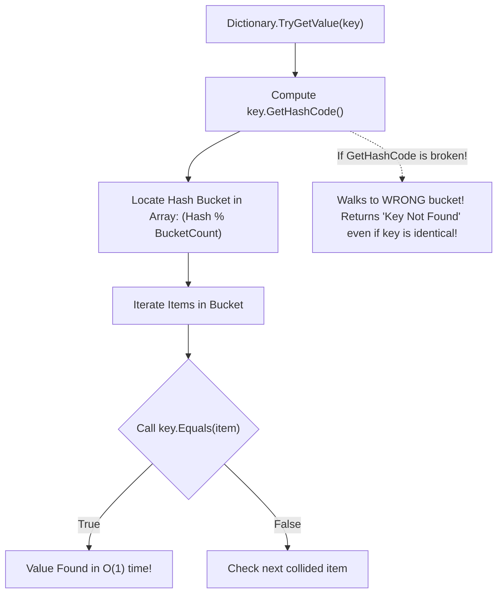

# Topic 10: Advanced OOP Concepts & Architectural Patterns

## 🌟 The Story: The High-End Hi-Fi Stereo & The Dual-Identity Agent

Advanced Object-Oriented Programming is where novice coders become software architects.

### 1. Composition Over Inheritance (The Modular Hi-Fi System)
Imagine building a high-end living room entertainment system:
- **The Fragile Inheritance Trap:** You make `HomeTheater` inherit from `LaserDiscPlayer`. What happens when LaserDiscs go obsolete and streaming takes over? Your entire `HomeTheater` inheritance hierarchy collapses.
- **The Resilient Composition Design:** The `HomeTheater` merely **has an** audio input (`IAudioSource`). Today, you plug in a `StreamingService`. Tomorrow, you swap it for a `VinylTurntable`. The theater doesn't change a single line of internal code.
> 💡 *Architectural Principle:* **Favor object composition over class inheritance.** Inheritance creates tight compile-time coupling; composition creates flexible runtime modularity.

---

### 2. The 3 Levels of Object Coupling: Association, Aggregation & Composition



1. **Association ("Uses-A"):** A loose relationship. A `Doctor` treats a `Patient`. Both can exist completely independently of one another.
2. **Aggregation ("Has-A" - Weak):** A `Department` has `Employees`. If the department is disbanded, the employees do not vanish from existence; they can be transferred elsewhere.
3. **Composition ("Part-Of" - Strong):** A `Building` has `Rooms`. The rooms cannot physically exist floating in space without the building. If the building is demolished, the rooms are destroyed simultaneously.

---

### 3. The Dual-Identity Agent (Explicit Interface Implementation)
Imagine an undercover agent named James.
- To the British Tax Office, he is an **`ICitizen`** with a method `ReportStatus()`.
- To MI6 Intelligence, he is an **`ISecretAgent`** with a method `ReportStatus()`.

If both interfaces declare `void ReportStatus()`, how can James provide his tax return to the tax auditor while giving classified intelligence to MI6?

**Explicit Interface Implementation** allows a single class to implement methods bound exclusively to their specific interface contract:
```csharp
public class SecretAgent : ICitizen, ISecretAgent
{
    void ICitizen.ReportStatus() => Console.WriteLine("Filing tax return.");
    void ISecretAgent.ReportStatus() => Console.WriteLine("Target neutralized.");
}
```

---

## 🔬 The Technical Deep Dive

### 1. The Immutable Contract of Object Equality & `GetHashCode()`
Every class in .NET inherits `Equals(object)` and `GetHashCode()` from `System.Object`. 

#### The Golden Law of Hash Codes:
> If two objects are considered equal (`a.Equals(b) == true`), their hash codes **MUST BE IDENTICAL** (`a.GetHashCode() == b.GetHashCode()`).



---

### 2. Partial Classes (`partial class`)
The `partial` keyword allows a single class, struct, or interface definition to be split across multiple physical files on disk. 
- During compilation, the Roslyn compiler automatically merges all partial files into one unified type.
- **Primary Use Cases:**
  1. Source Generators (compiler automatically writes code in a companion `.g.cs` file).
  2. Large complex domain entities divided by feature areas (e.g. `Customer.Billing.cs` and `Customer.Profile.cs`).

---

### 3. Records vs. Classes vs. Structs

| Dimension | `class` | `struct` | `record class` | `record struct` |
|---|---|---|---|---|
| **Memory** | Heap (Reference) | Stack (Value) | Heap (Reference) | Stack (Value) |
| **Equality** | Reference by default | Value (via reflection) | Value (Auto-generated compiler methods) | Value |
| **Immutability** | Mutable by default | Mutable by default | Encouraged immutable (`init`) | Encouraged immutable (`readonly`) |
| **`with` Expressions**| Not supported | Not supported | **Supported (Non-destructive mutation)** | **Supported** |

---

### 4. Dependency Inversion Principle (DIP)
- **High-level modules** should not depend on low-level modules. Both should depend on **abstractions** (interfaces).
- **Abstractions** should not depend on details. Details should depend on abstractions.
- This decoupling allows software to swap out physical databases, email providers, or cloud services without changing core business logic.
