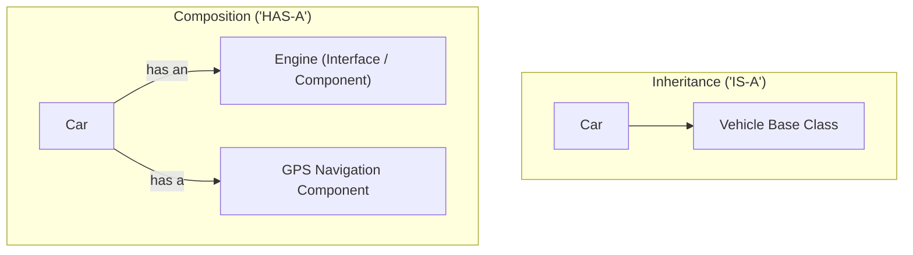

# Topic 10: Advanced OOP Concepts

## 📖 Theoretical Overview

### 1. Composition vs. Inheritance
- **Inheritance ("IS-A"):** Tight compile-time coupling. Base class changes break derived classes (fragile base class problem).
- **Composition ("HAS-A"):** Loose runtime coupling. Objects contain other objects and delegate work to them. *Guideline: Favor composition over inheritance.*

### 2. Modern Properties & Init-Only Setters
- `init`: Allows property setting only during object creation (constructor or object initializer). Once initialized, the property becomes strictly read-only.
- **Indexers (`this[int index]`):** Enables instances to be indexed like arrays (`myCollection[3]`).

### 3. Records, Value Equality & `GetHashCode`
- Records automatically implement value-based `Equals()` and `GetHashCode()`.
- Rule of Object Equality: If `a.Equals(b)` is true, `a.GetHashCode()` **must** equal `b.GetHashCode()`. If not, hash collections like `Dictionary` and `HashSet` fail silently!

---

## 📊 Composition vs. Inheritance Design

