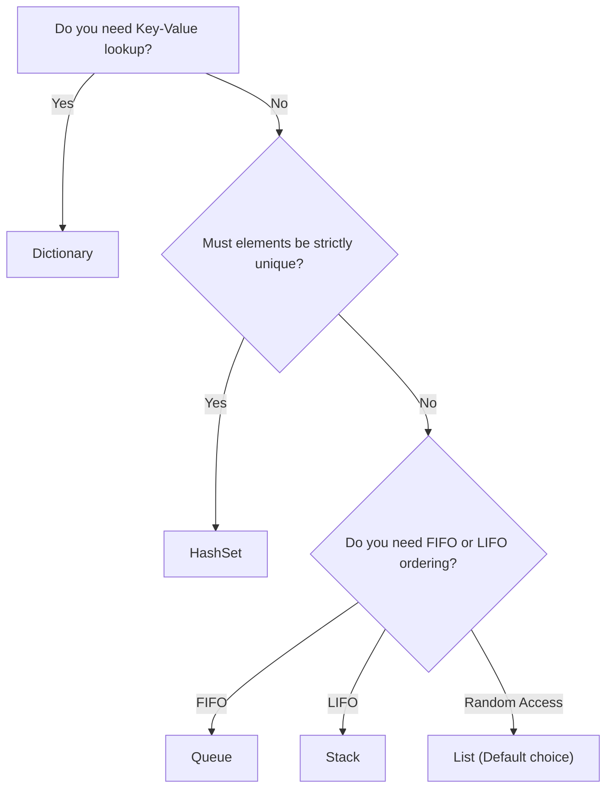

# Topic 11: Collections and Data Structures

## 📖 Theoretical Overview

### 1. The Collection Hierarchy
- `IEnumerable<T>`: Read-only forward iteration via `GetEnumerator()`.
- `ICollection<T>`: Adds `Count`, `Add()`, `Remove()`, `Contains()`.
- `IList<T>`: Adds positional index-based access (`this[int index]`).

### 2. Time Complexities & Collection Characteristics
| Collection | Internal Data Structure | Lookup Time | Insert / Delete | Best Use Case |
|---|---|---|---|---|
| **`List<T>`** | Dynamic contiguous array | $O(1)$ by index | $O(1)$ amortized append; $O(n)$ insert at middle | General-purpose indexed lists |
| **`Dictionary<TKey, TValue>`** | Hash table with buckets | $O(1)$ average | $O(1)$ average | Key-value associations |
| **`HashSet<T>`** | Hash table (keys only) | $O(1)$ average | $O(1)$ average | High-speed uniqueness & set operations |
| **`Queue<T>`** | Circular array | $O(1)$ peek | $O(1)$ Enqueue / Dequeue | FIFO (First In, First Out) processing |
| **`Stack<T>`** | Array buffer | $O(1)$ peek | $O(1)$ Push / Pop | LIFO (Last In, First Out) undo/call stacks |
| **`LinkedList<T>`** | Doubly-linked nodes | $O(n)$ search | $O(1)$ node insertion / removal | Frequent insertions/deletions in middle |

---

## 📊 Collection Selection Decision Tree

