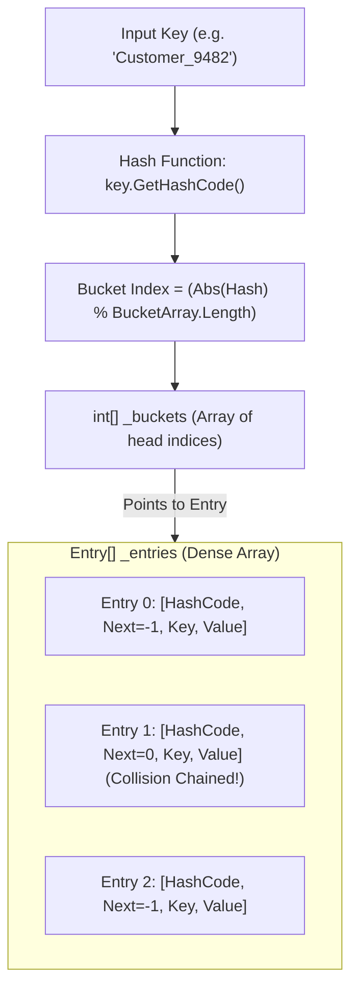
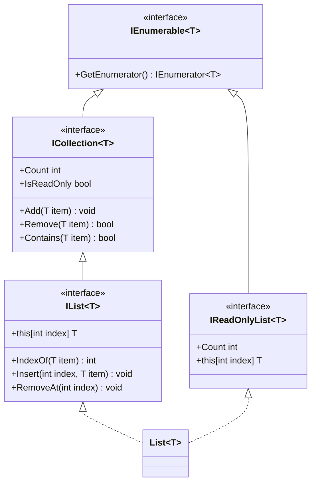

# Topic 11: Collections & Data Structures Architecture

## 🌟 The Story: The Grand Central Postal Station & The Specialized Bins

Imagine you are managing the central parcel distribution center for a global empire. Every minute, millions of packages of varying sizes, priorities, and delivery requirements enter the depot. 

If you store everything in a disorganized pile, your entire delivery network will collapse into chaos. To run with military precision, you deploy specialized storage systems:

### 1. The Obsolete Junk Bin (`ArrayList`) vs. The Laser-Guided Tray (`List<T>`)
In the early days of .NET (pre-2005), developers used `ArrayList`. It was a giant wooden junk bin that accepted any `System.Object`. 
- You could throw an `int`, a `string`, a `Customer`, and a `DateTime` into the exact same bin.
- **The Disaster:** Whenever you retrieved an item, you had to manually cast it: `int count = (int)list[0];`. If a colleague accidentally dropped a string into slot 0, your program crashed at runtime with an `InvalidCastException`. Worse, every value type was painfully **boxed** onto the Heap and **unboxed** back to the Stack, burning CPU cycles.
- **The Modern Solution:** `List<T>` is a precision-machined tray crafted exclusively for type `T`. It guarantees compile-time type safety with zero boxing overhead and $O(1)$ amortized append speed.

---

### 2. The 10,000 P.O. Box Wall (`Dictionary<TKey, TValue>`)
If you have 1,000,000 packages and you search for one package sequentially from beginning to end ($O(n)$ search), you will examine 500,000 boxes on average!
- Instead, the postal center installs a wall of numbered **P.O. Boxes (Hash Buckets)**.
- When a customer asks for their package using their tracking number (`Key`), a mathematical formula (`GetHashCode() % BucketCount`) computes the exact box index in nanoseconds.
- The postal clerk walks straight to that box and hands over the parcel in **$O(1)$ constant time**, whether the warehouse holds 100 packages or 100,000,000 packages!

---

### 3. The Queue vs. The Stack vs. The Linked List
- **The Boarding Gate (`Queue<T>` - FIFO):** First In, First Out. The first passenger to arrive at the boarding queue is the first to step onto the plane.
- **The Spring-Loaded Cafeteria Tray Dispenser (`Stack<T>` - LIFO):** Last In, First Out. The clean tray placed on top of the stack last is the very first tray grabbed by the next customer. Perfect for "Undo" operations, browser back buttons, and compiler call stacks.
- **The Treasure Hunt Clue Chain (`LinkedList<T>`):** Each clue in a scavenger hunt contains a piece of paper and a string tied to the next clue. You cannot jump directly to Clue #50 ($O(n)$ navigation), but you can slice the string and insert a new clue between Clue #2 and #3 in **$O(1)$ instant time** without shifting any other clues!

---

## 🔬 The Technical Deep Dive

### 1. Internal Anatomy of a `Dictionary<TKey, TValue>`

#### Collision Resolution:
When two different keys produce the same bucket index (a **hash collision**), .NET uses **Chaining**. The entry stores a `next` field pointing to the next colliding entry, forming a fast linked list within the contiguous `_entries` array.

---

### 2. The Great Comparison Matrix: Choosing the Right Collection

| Collection | Internal Structure | Search / Lookup | Insert / Add | Memory Footprint | When to Choose |
|---|---|---|---|---|---|
| **`List<T>`** | Contiguous Dynamic Array | $O(1)$ by index $O(n)$ by value | $O(1)$ amortized append $O(n)$ at middle | Low (minimal overhead) | Default choice for ordered sequences and random index access. |
| **`Dictionary<K, V>`** | Hash Buckets + Dense Array | **$O(1)$ average** $O(n)$ worst-case | **$O(1)$ average** | High (~32 bytes per entry + buckets) | Blazing-fast key-based lookups and associations. |
| **`HashSet<T>`** | Hash Buckets (Keys only) | **$O(1)$ average** | **$O(1)$ average** | Moderate | Enforcing uniqueness and high-speed set math (Union, Intersect). |
| **`SortedSet<T>`** | Self-Balancing Red-Black Tree | **$O(\log n)$** | **$O(\log n)$** | High (pointers per node) | When elements must remain **permanently sorted** in memory. |
| **`SortedDictionary<K, V>`** | Red-Black Binary Tree | **$O(\log n)$** | **$O(\log n)$** | High | Key-value pairs that must maintain alphabetical or sorted key order. |
| **`LinkedList<T>`** | Doubly-Linked Nodes | $O(n)$ | **$O(1)$** (if node reference held) | High (2 pointers per node) | High-frequency insertions/deletions in the middle of a list. |
| **`Queue<T>`** | Circular Array Buffer | $O(n)$ | **$O(1)$** Enqueue / Dequeue | Low | Background message queues, task processing pipelines (FIFO). |
| **`Stack<T>`** | Dynamic Array Buffer | $O(n)$ | **$O(1)$** Push / Pop | Low | Undo buffers, parsing parentheses, syntax tree traversal (LIFO). |

---

### 3. The Interface Contract Hierarchy

#### The Golden Rule of API Design:
- **Return the most specific type:** Return `List<T>` or `T[]` if callers need indexing.
- **Accept the least specific type:** Accept `IEnumerable<T>` or `IReadOnlyCollection<T>` as method parameters so callers can pass arrays, lists, or sets without conversion overhead.
