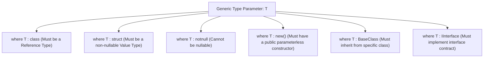

# Topic 12: Generics, Type Constraints & Variance

## 🌟 The Story: The Universal 3D Printer & The Airport Pet Carrier

Before Generics arrived in C# 2.0, developers had to write repetitive duplicate classes—one for `IntList`, one for `StringList`, and one for `CustomerList`—or suffer the dangerous type-casting errors of `ArrayList`.

### 1. The Industrial 3D Printer (Code Reusability without Compromise)
Imagine an advanced industrial 3D printer. 
- You do **not** construct one factory line solely to manufacture titanium bolts, a second separate factory line to print carbon-fiber winglets, and a third factory to print ceramic dental crowns.
- Instead, engineers construct **One Master 3D Printer** equipped with a universal material feed: **`Printer<TMaterial>`**.
  - When loaded with `<Titanium>`, it yields indestructible aerospace fasteners.
  - When loaded with `<Biopolymer>`, it prints biocompatible implants.
- The machine mechanics (heating curves, nozzle speed, coordinate layering) are authored **exactly once**. Yet the final product is 100% strictly typed with zero casting and zero memory waste.

---

### 2. The Airport Pet Carrier: Covariance (`out`) vs. Contravariance (`in`)
Variance is often considered the most confusing concept in modern C#. Here is the mental model that makes it click permanently:

#### A. Covariance (`out T` - Output Only / Producers):
Imagine an animal shelter that hands out pets:
- You have an adoption cage producing puppies: `IEnumerable<Dog>`.
- An adopter arrives and announces: *"I want a box of `IEnumerable<Animal>`."*
- Can you hand them your `IEnumerable<Dog>`? **YES!** Because every dog coming **OUT** of that box is guaranteed to be an `Animal`.
- In C#, this is marked with the **`out`** keyword: `public interface IEnumerable<out T>`. The type parameter `T` can only appear in **return/output positions**.

#### B. Contravariance (`in T` - Input Only / Consumers):
Imagine a universal veterinary vaccination machine:
- You have a device capable of vaccinating *any* animal: `IComparer<Animal>` or `Action<Animal>`.
- A customer arrives with a sick golden retriever and asks: *"Can your machine treat my `Dog`?"*
- Can you use your `Animal` device on their `Dog`? **YES!** Because if the device can accept *any* generic animal going **INTO** it, it can safely handle a dog!
- In C#, this is marked with the **`in`** keyword: `public interface IComparer<in T>`. The type parameter `T` can only appear in **parameter/input positions**.

---

## 🔬 The Technical Deep Dive

### 1. Comprehensive Generic Constraints Taxonomy

Constraints instruct the Roslyn compiler what capabilities the type argument `T` is guaranteed to have:



#### Multi-Constraint Syntax:
```csharp
// T must be a reference type, implement IEntity and IComparable, and have a public constructor
public class EntityRepository<T> 
    where T : class, IEntity, IComparable<T>, new()
{
    public T CreateDefault() => new T();
}
```

---

### 2. Variance Rules Summary

| Variance | Keyword | Direction | Definition | Example Interface |
|---|---|---|---|---|
| **Invariant** | *(None)* | In and Out | Type must match **exactly**. No polymorphism allowed across containers. | `IList<T>`, `List<T>` |
| **Covariant** | **`out`** | **Output Only** | Allows using a **more derived** type than specified. Preserves assignment compatibility. | `IEnumerable<out T>`, `IReadOnlyList<out T>` |
| **Contravariant** | **`in`** | **Input Only** | Allows using a **less derived** (broader) type than specified. Inverts assignment compatibility. | `IComparer<in T>`, `Action<in T>` |

---

### 3. Generic Delegates: `Action`, `Func`, and Custom Transformers
Generics make delegates universally adaptable:
```csharp
// Custom generic delegate with Contravariant input and Covariant output:
public delegate TOutput Transformer<in TInput, out TOutput>(TInput input);
```
