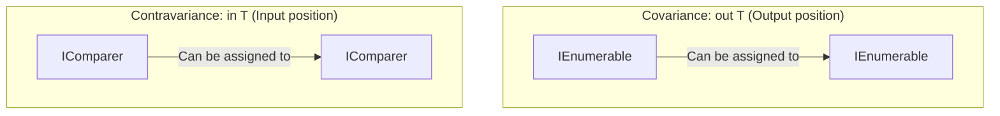

# Topic 12: Generics & Type Constraints

## 📖 Theoretical Overview

### 1. Why Generics?
Before Generics (C# 1.0), collections like `ArrayList` operated on `System.Object`. This caused two severe problems:
1. **Lack of Type Safety:** Any object could be added, causing runtime `InvalidCastException`.
2. **Performance Degradation:** Value types were repeatedly **boxed** onto the Heap and **unboxed** back to the Stack.
Generics introduce parameterized types, providing compile-time type safety with zero boxing overhead.

### 2. Common Generic Constraints
- `where T : class`: T must be a reference type.
- `where T : struct`: T must be a non-nullable value type.
- `where T : notnull`: T must be a non-nullable type.
- `where T : new()`: T must possess a public parameterless constructor.
- `where T : BaseClass`: T must inherit from `BaseClass`.
- `where T : IComparable<T>`: T must implement `IComparable<T>`.

### 3. Covariance (`out`) and Contravariance (`in`)
- **Covariance (`out T`):** Allows using a more derived type than originally specified (e.g. `IEnumerable<Dog>` as `IEnumerable<Animal>`). Only permitted in output/return positions.
- **Contravariance (`in T`):** Allows using a less derived type (e.g. `IComparer<Animal>` as `IComparer<Dog>`). Only permitted in input parameter positions.

---

## 📊 Covariance (`out`) vs Contravariance (`in`)

