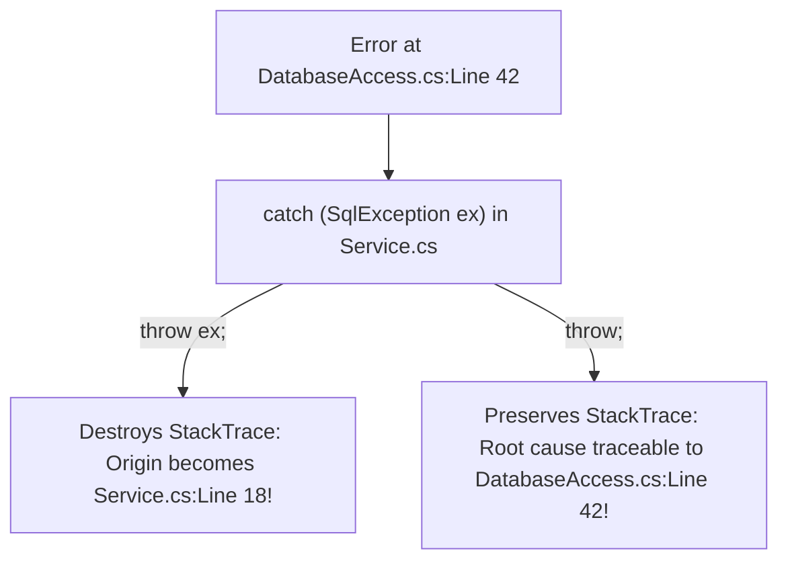

# Topic 14: Robust Exception Handling

## 📖 Theoretical Overview

### 1. The `try-catch-finally` Architecture
- **`try`:** Encloses statements that might encounter runtime faults.
- **`catch`:** Handles specific exception types.
- **`finally`:** Guaranteed to execute whether an exception occurred or not (used for cleanup).
- **Exception Filters (`when`):** Evaluates a boolean expression before entering the catch block without unwinding the stack.

### 2. Critical Interview Pitfall: `throw` vs. `throw ex`
- **`throw;` (Correct):** Re-throws the active exception, preserving the entire original `StackTrace` pointing directly to where the bug occurred.
- **`throw ex;` (Dangerous Anti-Pattern):** Resets the `StackTrace` to the current line, destroying valuable diagnostic history!

---

## 📊 StackTrace Preservation: `throw` vs `throw ex`

