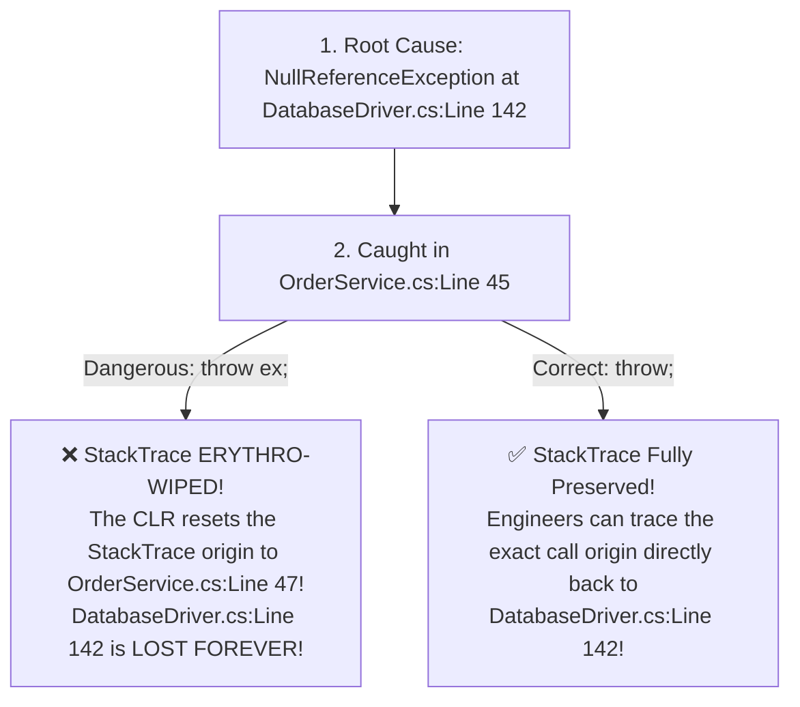
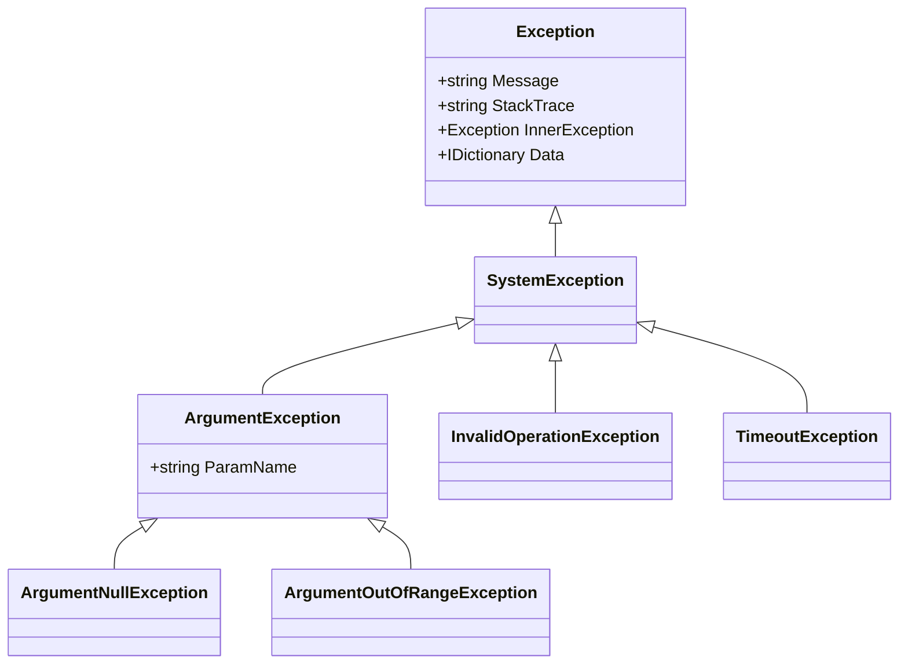

# Topic 14: Robust Exception Handling Architecture

## 🌟 The Story: The Aircraft Black Box & The Crime Scene Tamperer

In mission-critical software, unexpected failures (network timeouts, disk crashes, corrupt inputs) are inevitable. What separates amateur software from enterprise-grade systems is how those failures are reported, handled, and recovered.

### 1. The Pilot's Alarm: Catching Specific Faults vs. Flying Blind
Imagine an aircraft cruising at 35,000 feet:
- An engine sensor detects that oil pressure has dropped below critical thresholds. The sensor sounds an alert: `throw new LowOilPressureException(...)`.
- The cockpit computer has dedicated recovery protocols for oil pressure. It diverts oil from auxiliary tanks to stabilize the engine.
- **The Catastrophic Anti-Pattern:** Imagine if the co-pilot installed a blanket switch that silenced every alarm without looking at it:
  ```csharp
  try { FlyAirplane(); }
  catch (Exception) { /* Swallow and do nothing */ } // DISASTER!
  ```
  Silencing exceptions indiscriminately hides catastrophic hardware failures until the plane falls out of the sky. 
  > 💡 *Golden Rule:* **Never catch generic `Exception` unless you are logging it at the topmost boundary of your application!** Always catch specific, expected exceptions.

---

### 2. The Crime Scene Tamperer: `throw` vs. `throw ex`
This is arguably the most famous .NET interview question in history:



- **`throw;`:** Re-throws the active exception while keeping the call stack completely intact.
- **`throw ex;`:** Resets the call stack origin to the current line, destroying vital forensic evidence about where the bug actually occurred.

---

## 🔬 The Technical Deep Dive

### 1. The .NET Exception Taxonomy



---

### 2. Exception Filters: The `when` Keyword
Introduced in C# 6, **Exception Filters** evaluate a boolean expression before the CLR enters the catch block:

```csharp
try
{
    await httpClient.GetAsync("https://api.gateway.com/data");
}
catch (HttpRequestException ex) when (ex.StatusCode == System.Net.HttpStatusCode.NotFound)
{
    // Executes ONLY if status code is 404!
    Console.WriteLine("Resource does not exist.");
}
catch (HttpRequestException ex) when (ex.StatusCode == System.Net.HttpStatusCode.Unauthorized)
{
    // Executes ONLY if status code is 401!
    Console.WriteLine("Authentication credentials expired.");
}
```

#### Why Filters Beat `if` Checks Inside the Catch Block:
If you catch an exception and then inspect an `if` condition inside the catch body, the CLR has **already unwound the stack**. 
An exception filter evaluates the condition **without unwinding the stack**, meaning crash dumps, minidumps, and Windows Error Reporting capture the pristine state of the thread at the moment of failure!

---

### 3. Preserving Traces Across Threads: `ExceptionDispatchInfo`
When handling exceptions in asynchronous pipelines or background tasks, using `ExceptionDispatchInfo.Capture(ex).Throw()` re-throws an exception while preserving the original call stack across thread transitions.
