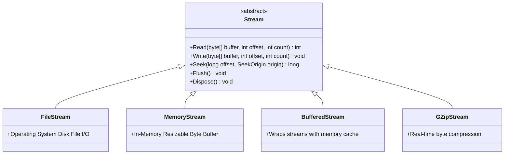

# Topic 15: File Handling, Streams & Serialization

## 🌟 The Story: The Olympic Swimming Pool & The Garden Hose

Imagine a massive Olympic swimming pool containing 10 million liters of water. This pool represents a massive 10-Gigabyte server log file.

### 1. The Glass Tank Disaster (`File.ReadAllText`) vs. The Garden Hose (`Stream`)
- **The Amateur Approach (`File.ReadAllText`):** You attempt to scoop up the entire 10-million-liter pool in one single gigantic glass tank and drop it onto your living room floor. The glass shatters under the weight, flooding your house. In software, reading a 10GB file into a single string immediately throws a catastrophic **`System.OutOfMemoryException`** and crashes your server.
- **The Master Engineer's Approach (`Stream`):** You connect a garden hose (a **`FileStream`**). Water flows through the hose smoothly at 4 Kilobytes per second. You read a line, process it, discard it, and read the next line. Using streams, an application running on a low-powered machine with only 512MB of RAM can process a 500-Gigabyte dataset with **zero memory strain**!

---

### 2. The Casual Visitor vs. The Resident Keyholder (`File` vs. `FileInfo`)
- **`File` & `Directory` (Static Utility Methods):** Best for simple, one-shot operations (`File.WriteAllText(path, text)`). Every single call forces the OS kernel to perform security audits, resolve paths, and query physical disk sectors.
- **`FileInfo` & `DirectoryInfo` (Instance Objects):** If you are performing multiple operations on the same file (checking size, reading timestamps, altering attributes, opening a stream), `FileInfo` resolves OS security and metadata **once**, caching the file descriptor for superior performance.

---

## 🔬 The Technical Deep Dive

### 1. The .NET Stream Inheritance Hierarchy



#### Adapters on Top of Streams:
- **`StreamReader` / `StreamWriter`:** Translates raw bytes into human-readable characters and strings using character encodings (`Encoding.UTF8`).
- **`BinaryReader` / `BinaryWriter`:** Reads and writes raw primitive types (`int`, `double`, `bool`) in their exact binary byte format without text conversion.

---

### 2. Cross-Platform Path Handling: The Slash Trap
Never hardcode directory slashes like `"C:\\data\\file.txt"` or `"/data/file.txt"`!
Windows uses backslashes (`\`), while Linux, Docker containers, and macOS use forward slashes (`/`).

> 💡 *Golden Rule:* Always construct paths using **`Path.Combine(...)`**. The .NET runtime automatically injects the correct platform-specific directory separator (`Path.DirectorySeparatorChar`).

---

### 3. Production JSON Serialization (`System.Text.Json`)
.NET features a built-in, ultra-fast, zero-allocation JSON engine:

```csharp
var options = new JsonSerializerOptions
{
    WriteIndented = true, // Formats with clean tabs & newlines
    PropertyNameCaseInsensitive = true,
    PropertyNamingPolicy = JsonNamingPolicy.CamelCase // Converts 'FirstName' to 'firstName'
};

string json = JsonSerializer.Serialize(myObject, options);
MyClass obj = JsonSerializer.Deserialize<MyClass>(json, options)!;
```
