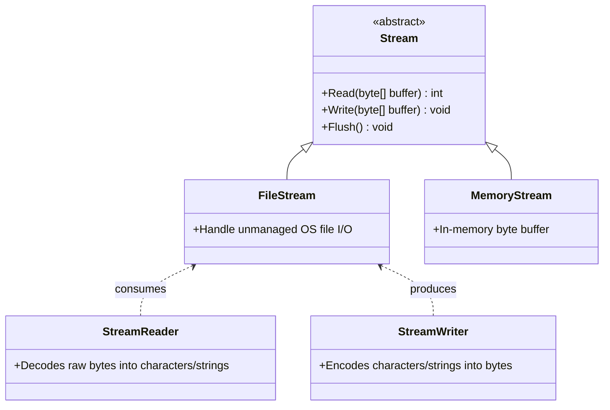

# Topic 15: File Handling, Streams & Serialization

## 📖 Theoretical Overview

### 1. File APIs: Static vs. Instance
- **`File` / `Directory`:** Static utility methods. Best for quick, one-off operations (`File.ReadAllText`, `File.WriteAllLines`).
- **`FileInfo` / `DirectoryInfo`:** Instance-based classes. Best when performing multiple operations on the same file/folder without repeated OS security checks.

### 2. Stream Architecture & `using` Statement
- Streams provide a sequence of bytes. Since streams hold unmanaged OS file handles, they implement `IDisposable`.
- Always wrap streams in `using` statements (or declarations `using var stream = ...;`) to guarantee prompt disposal, even during unexpected exceptions.

### 3. Serialization
- **JSON Serialization (`System.Text.Json`):** Fast, low-allocation serializer for modern APIs.
- **`Path.Combine()`:** Always construct filesystem paths using `Path.Combine` to ensure cross-platform compatibility across Windows (`\`) and Linux/macOS (`/`).

---

## 📊 .NET Stream Architecture

