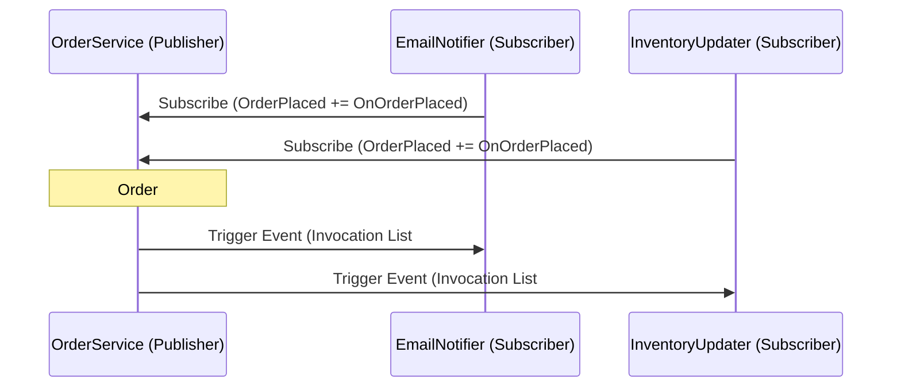

# Topic 16: Delegates, Events and Lambdas

## 📖 Theoretical Overview

### 1. Delegates: Type-Safe Function Pointers
A delegate is a reference type that holds a reference to a method with a specific signature.
- **`Action<...>`:** Encapsulates a method returning `void` (takes 0 to 16 parameters).
- **`Func<..., TResult>`:** Encapsulates a method returning a value `TResult` (last type argument is always the return type).
- **`Predicate<T>`:** Specialized delegate returning a `bool` (`Func<T, bool>`).

### 2. Events & Publisher-Subscriber Pattern
- An **event** is a encapsulated wrapper around a multicast delegate that limits operations: outside code can only subscribe (`+=`) or unsubscribe (`-=`), never invoke or overwrite (`= null`) the delegate directly.

### 3. Closures
When a lambda expression references variables from its enclosing scope, the compiler synthesizes a hidden class to capture and preserve those variables on the Heap.

---

## 📊 Publisher-Subscriber Event Flow

