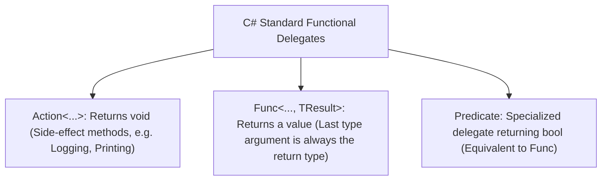
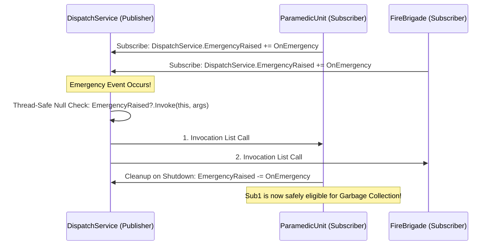

# Topic 16: Delegates, Events & Functional Lambdas

## 🌟 The Story: The Emergency Radio Tower & The Vampire Memory Leak

To build decoupled, reactive, event-driven architectures, you must master the communication nervous system of C#:

### 1. The Walkie-Talkie Frequency (Delegates)
Imagine an emergency response dispatch tower:
- The chief dispatcher does not need to know the personal phone numbers of the 50 paramedic drivers on duty.
- Instead, the tower broadcasts on an agreed radio frequency: **`Action<EmergencyAlert>`**.
- Any emergency vehicle can tune into this frequency. When an earthquake occurs, the tower transmits once, and Ambulance 1, Fire Engine 2, and Police Cruiser 3 all hear the broadcast simultaneously.
- A **Delegate** in C# is a type-safe function pointer. It holds references to one or more methods with an identical signature, allowing methods to be passed as data parameters and invoked dynamically.

---

### 2. The Armored Transmitter (Why We Have `event`)
What happens if the dispatch frequency is left as a raw public delegate?
```csharp
public Action<Alert> OnEmergency; // DANGEROUS!
```
Any rogue radio operator could accidentally overwrite the frequency:
```csharp
tower.OnEmergency = null; // CATASTROPHIC! Wipes out all emergency subscribers!
```
Or worse, an outside vehicle could trigger the alarm artificially: `tower.OnEmergency.Invoke(fakeAlert);`.

**An `event` is a compiler-enforced armored lockbox.** When you mark a delegate with `event`, outside code is strictly forbidden from invoking it or overwriting it. External objects can **only subscribe (`+=`) or unsubscribe (`-=`)**. Only the publishing class itself possesses the legal authority to trigger (`Invoke`) the event!

---

### 3. The Vampire Memory Leak (The Unsubscribed Listener)
Imagine a short-lived pop-up window in your application (e.g. an "Invoice Details" window). 
- When the window opens, it subscribes to the application's global `StockTickerService`:
  ```csharp
  StockTickerService.PriceUpdated += OnPriceUpdated;
  ```
- When the user closes the window, the developer forgets to unsubscribe (`StockTickerService.PriceUpdated -= OnPriceUpdated;`).
- **The Catastrophe:** Because `StockTickerService` is a long-lived singleton, its internal delegate holds a **strong memory reference** pointing to the closed window.
- The Garbage Collector attempts to collect the closed window, sees that the singleton service is still holding a live reference to it, and **aborts collection**!
- Every time the user opens and closes that window, another phantom copy remains trapped in memory forever like a vampire that refuses to die.

---

## 🔬 The Technical Deep Dive

### 1. The Built-in Functional Trinity: `Action`, `Func`, and `Predicate`



---

### 2. Publisher-Subscriber Event Lifecycle Architecture



---

### 3. Closures & Variable Hoisting
When a lambda expression references a variable from its outer lexical scope:
```csharp
int threshold = 50;
Func<int, bool> isAboveThreshold = x => x > threshold;
```
The Roslyn compiler secretly synthesizes a hidden heap class (a **Display Class**) and moves `threshold` from the Stack onto the Heap! This ensures the variable remains alive even after the containing method returns.
