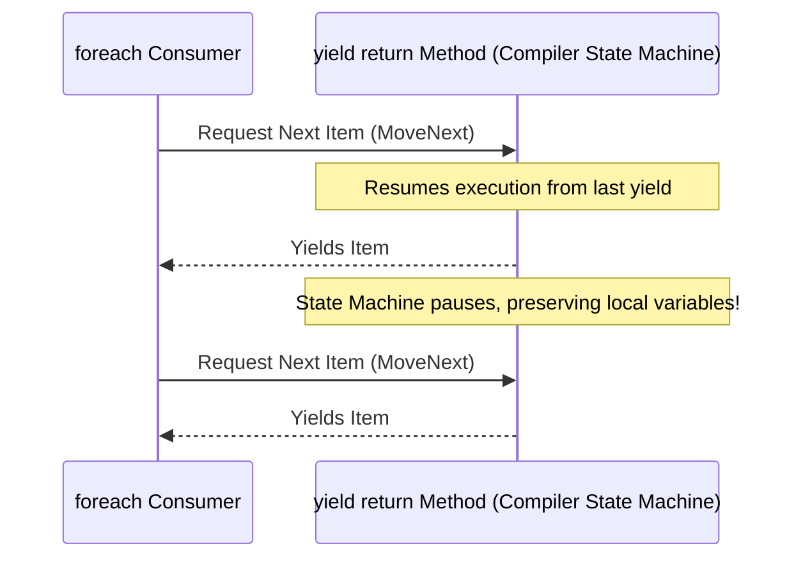

# Topic 17: Modern C# Features, Reflection & Metaprogramming

## 🌟 The Story: The Billion-Dollar Antidote & The X-Ray Inspector

C# has evolved at a breathtaking pace over the past decade. It is no longer just an enterprise OOP language; it is a cutting-edge, high-expression language.

### 1. The Billion-Dollar Mistake Solved (Nullable Reference Types)
Sir Tony Hoare, who invented the `null` pointer reference in 1965, famously stated:
> *"I call it my billion-dollar mistake... It has led to innumerable errors, vulnerabilities, and system crashes."*

For decades, any reference type (`string`, `Customer`) could secretly harbor `null`. When a developer forgot to write a null check, the application detonated with a catastrophic `NullReferenceException`.

Modern C# (C# 8+) introduces **Static Null-State Analysis**:
- **Non-Nullable Reference Types (`string name`):** The compiler treats `null` assignment as an actionable warning/error.
- **Nullable Reference Types (`string? nickname`):** You explicitly declare when a variable is permitted to be null. The compiler forces you to handle null safely using `?.` or `??` before accessing members!

---

### 2. The Customs Inspector's X-Ray: Reflection & Custom Attributes
Imagine shipping high-value cargo crates internationally:
- Bolted onto the exterior of a crate is a tamper-evident golden badge: **`[EncryptedData(Algorithm = "AES-256")]`**.
- The crate itself does not know how to encrypt itself; the badge is simply **declarative metadata**.
- When the crate arrives at border control, the automated X-Ray machine (**Reflection**) reads the badge dynamically, extracts its properties, and invokes specialized security protocols on the fly without knowing anything about the crate's internal classes at compile time!

---

### 3. The On-Demand Bakery (`yield return` State Machine)
Imagine a bakery that promises infinite fresh croissants:
- If the baker baked 1,000,000 croissants in advance and crammed them into the store, the bakery would burst at the seams (`OutOfMemoryException`), and stale croissants would rot on the floor.
- Instead, the baker uses **`yield return`**. When the customer asks for a croissant, the baker bakes exactly one, hands it across the counter, and **pauses his kitchen state in suspended animation**. Only when the customer asks for another does the baker resume execution!

---

## 🔬 The Technical Deep Dive

### 1. Modern Syntax Quick Reference

| Feature | Modern C# Syntax | What It Replaced |
|---|---|---|
| **Collection Expressions** (C# 12) | `int[] nums = [1, 2, 3];` | `new int[] { 1, 2, 3 };` |
| **Spread Operator** (C# 12) | `int[] all = [..partA, ..partB];` | Complex `.Concat().ToArray()` LINQ calls |
| **Extension Methods** | `public static bool IsValid(this string s)` | Clunky static utility classes: `StringHelper.IsValid(s)` |
| **Anonymous Types** | `var item = new { Sku = "A1", Price = 99 };` | Writing single-use DTO classes |
| **`nameof` Operator** | `nameof(user.Email)` | Hardcoded error strings: `"Email"` that break during refactoring |
