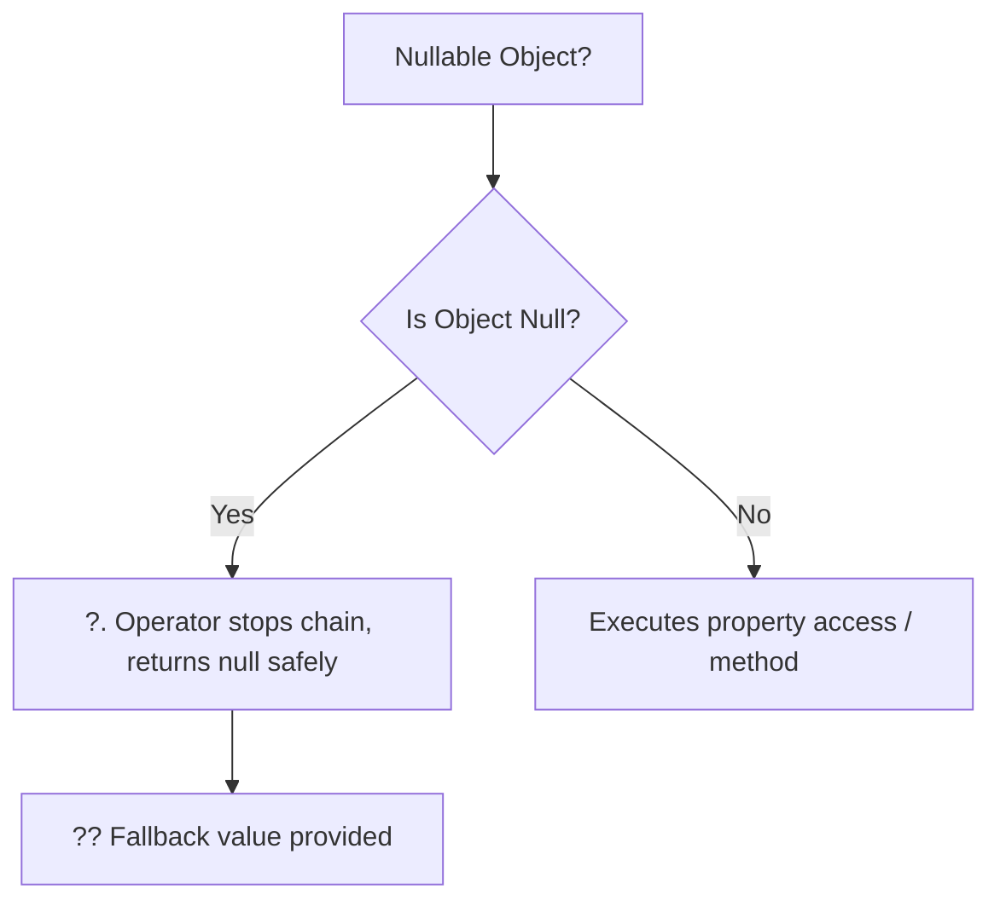

# Topic 17: Modern C# Language Features (C# 10, 11, 12)

## 📖 Theoretical Overview

### 1. Null Safety & Nullable Reference Types (NRT)
Introduced in C# 8, the compiler tracks null state statically.
- `string nonNull = null;` produces a compiler warning.
- `string? nullable = null;` explicitly expresses intent.
- `?.` (Null-Conditional) and `??` (Null-Coalescing) prevent `NullReferenceException`.

### 2. Collection Expressions (C# 12)
A unified syntax `[1, 2, 3]` for initializing arrays, `List<T>`, `Span<T>`, and immutable collections without writing verbose `new List<int> { ... }`.

### 3. Extension Methods
Allows adding new methods to existing types (even types in closed external libraries) without modifying the original source or using inheritance. Defined as static methods in static classes using the `this` modifier on the first parameter.

### 4. Iterators (`yield return`)
Generates state-machine based streaming collections on the fly. Elements are calculated lazily one at a time.

---

## 📊 Null Handling Pipeline

