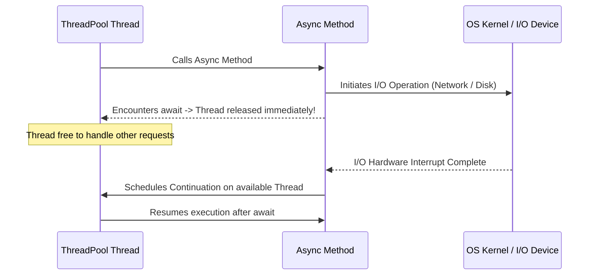

# Topic 18: Asynchronous Programming (`async` / `await`)

## 📖 Theoretical Overview

### 1. Synchronous vs. Asynchronous Execution
- **Synchronous:** The calling thread is blocked while waiting for I/O operations (network latency, disk reads, database queries) to return.
- **Asynchronous:** The calling thread is released back to the ThreadPool. When the I/O completes, an OS interrupt schedules a continuation, maximizing server scalability and UI responsiveness.

### 2. Under the Hood: The Roslyn State Machine
When you write `async` and `await`, the compiler rewrites your method into an `IAsyncStateMachine` struct. Awaiting yields control; resuming restores local variables.

### 3. Golden Rules & Pitfalls
- **Avoid `async void`:** Exceptions in `async void` bypass standard `try/catch` handlers and crash the application process. Only use `async void` for top-level UI event handlers.
- **Never call `.Result` or `.Wait()`:** Causes thread pool starvation and classic synchronous-over-asynchronous deadlocks.
- **Use `CancellationToken`:** Always allow cancellation of long-running operations.

---

## 📊 Asynchronous Execution & Continuation

