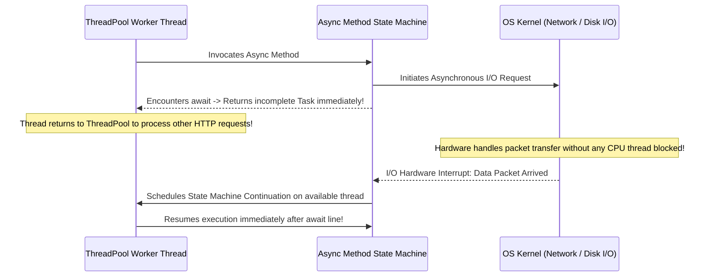

# Topic 18: Asynchronous Programming (`async` / `await`) & Concurrency

## 🌟 The Story: The Frozen Waiter vs. The Vibrating Kitchen Buzzer

Asynchronous programming is not about making computations run faster; it is about **freeing up threads while waiting for slow operations** (network requests, database queries, disk I/O).

### 1. The Frozen Waiter (Synchronous Thread Blocking)
Imagine a busy restaurant with 10 waiters:
- A waiter takes an order for a stone-oven pizza that takes 20 minutes to bake.
- The waiter walks into the kitchen, stands directly in front of the oven, crosses his arms, and stares at the crust for 20 continuous minutes.
- While he stares at the oven, he cannot seat new guests, cannot refill water glasses, and cannot deliver bills.
- If 10 tables order pizza simultaneously, **all 10 waiters are frozen solid**. New customers standing at the front door are ignored, and the restaurant grinds to a halt!
- In .NET, this is **Synchronous Thread Blocking** (`Thread.Sleep(20000)` or `httpClient.GetStringAsync().Result`). You have burned an expensive 1MB OS thread to do absolutely nothing!

---

### 2. The Smart Kitchen Buzzer (`async` & `await`)
- The smart waiter puts the pizza into the oven, grabs an electronic vibrating pager (**`Task`**), and **immediately walks back to the dining room**.
- For the next 20 minutes, that single waiter seats dozens of guests, clears tables, and pours drinks.
- When the pizza finishes baking, the oven timer beeps (an **OS I/O Completion Port interrupt**). Whichever waiter is currently free grabs the hot pizza and delivers it to Table 4 (**The Asynchronous Continuation**).
- With just 5 smart waiters, the restaurant can effortlessly serve 500 guests!

---

## 🔬 The Technical Deep Dive

### 1. The Roslyn State Machine (`IAsyncStateMachine`)

When you mark a method with `async` and use `await`, the Roslyn compiler completely dismantles your method and generates a hidden `struct` implementing `IAsyncStateMachine`.



---

### 2. The 3 Deadly Sins of Asynchronous Programming

#### Sin #1: `async void` (The Silent Crasher)
- Returning `void` from an async method is only permitted for top-level UI event handlers (e.g. `button_Click`).
- **Why it is fatal:** Any unhandled exception thrown inside an `async void` method **cannot be caught by an outside `try/catch`**! It is posted directly to the synchronization context and immediately crashes the entire application process. Always return `Task` or `Task<T>`.

#### Sin #2: Calling `.Result` or `.Wait()` (The Classic Deadlock)
- Calling `.Result` blocks the current thread synchronously until the task completes.
- In UI applications (WPF/WinForms) or legacy ASP.NET, the continuation needs to post back to the single UI thread. But the UI thread is blocked waiting for `.Result`! The two threads wait for each other in an infinite deadlock.
- **Rule:** *It's async all the way down.* Never block on async code.

#### Sin #3: Allocating `Task` for Fast Synchronous Paths (`ValueTask`)
If a method returns immediately 99% of the time (e.g. from an in-memory cache) and only does async I/O 1% of the time, allocating a heap `Task<T>` object every time creates unnecessary GC pressure. Use **`ValueTask<T>`** (a stack struct) for zero-allocation performance on cached paths.

---

### 3. Async Streams: `IAsyncEnumerable<T>`
Introduced in C# 8, **Async Streams** combine `async` and `yield return`. Instead of waiting for a 100,000-row database query to complete in memory, the records stream across the wire and are processed one by one as they arrive using **`await foreach`**:

```csharp
await foreach (var item in FetchRecordsAsync())
{
    Console.WriteLine($"Processed: {item}");
}
```
