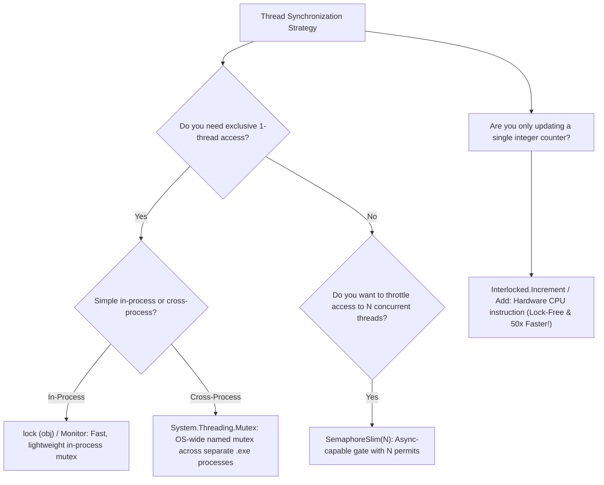

# Topic 19: Multithreading, Synchronization & Deadlocks

## 🌟 The Story: The Two Chefs at the Same Stove & The Deadly Standoff

Parallel computing allows multi-core CPUs to crunch billions of operations simultaneously. But the moment two threads attempt to read and write to the same shared memory location, software enters dangerous territory.

### 1. The Corrupted Soup Pot (The Race Condition)
Imagine two chefs standing over the same pot of soup without communicating:
- **Chef Alpha** checks the recipe tally: it currently says `10` spoons of spice.
- Simultaneously, **Chef Beta** checks the recipe tally: it also reads `10` spoons.
- Chef Alpha adds a spoon, and updates the tally to `11`.
- Chef Beta adds a spoon, and updates his tally to `11`—**completely overwriting Chef Alpha's addition!**
- Two spoons of spice were added, but the final tally recorded only one. In software, this is a **Race Condition**. In banking systems or inventory databases, race conditions corrupt data silently and cause millions of dollars in losses.

---

### 2. The Kitchen Door Bolt (`lock` / `Monitor`)
To stop the chefs from corrupting the soup, you install a bolt on the kitchen door:
```csharp
private static readonly object _stoveLock = new();

lock (_stoveLock)
{
    // CRITICAL SECTION: Only ONE thread on Earth can be here at any given microsecond!
    sharedCounter++;
}
```
Under the hood, C#'s `lock` statement is shorthand for `Monitor.Enter` and `Monitor.Exit` wrapped in a `try/finally` block.

---

### 3. The Deadly Standoff (The Deadlock)
Imagine two chefs making a banquet:
- **Chef Alpha** grabs the **Master Knife** (Lock A), and now needs the **Cutting Board** (Lock B) to slice vegetables.
- **Chef Beta** grabs the **Cutting Board** (Lock B), and now needs the **Master Knife** (Lock A) to slice bread.
- Chef Alpha refuses to put down the knife until he gets the cutting board.
- Chef Beta refuses to put down the cutting board until he gets the knife.
- **Both chefs stand motionless forever.** The kitchen freezes solid! 
- In software, this is a **Deadlock** (Lock Inversion). It occurs when two threads acquire the same locks in opposite orders.

---

## 🔬 The Technical Deep Dive

### 1. Synchronization Primitives Comparison



---

### 2. Lock-Free Hardware Operations (`Interlocked`)
Instead of forcing the operating system to perform expensive thread context switches and kernel transitions, the modern CPU possesses hardware-level **Compare-And-Swap (CAS)** instructions.

The `System.Threading.Interlocked` class exposes these instructions directly:
```csharp
// Atomically increments counter in a single, un-interruptible CPU cycle:
Interlocked.Increment(ref _globalCounter);

// Atomically swaps values only if original matches expected:
Interlocked.CompareExchange(ref _target, newValue, expectedValue);
```

---

### 3. Data Parallelism with `Parallel.For` & `Parallel.ForEach`
Part of the Task Parallel Library (TPL), `Parallel.ForEach` automatically partitions an in-memory collection across all physical CPU cores on the machine, handling thread scheduling, work stealing, and load balancing automatically!
