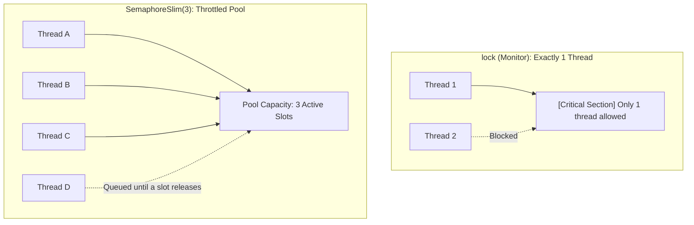

# Topic 19: Multithreading, Parallelism & Synchronization

## 📖 Theoretical Overview

### 1. Concurrency vs. Parallelism
- **Concurrency:** Handling multiple tasks by interleaving execution (can run on 1 CPU core via time-slicing).
- **Parallelism:** Executing multiple computational tasks simultaneously on multiple physical CPU cores (e.g. `Parallel.For`).

### 2. Thread Synchronization Primitives
- **`lock (obj)` (`Monitor`):** Mutual exclusion lock ensuring only one thread enters a critical code section at a time.
- **`Interlocked`:** Hardware-level atomic operations (`Increment`, `Add`, `Exchange`) without lock overhead.
- **`SemaphoreSlim`:** Throttles access, allowing a defined number ($N$) of threads to enter concurrently. Supports asynchronous awaiting (`await semaphore.WaitAsync()`).
- **Concurrent Collections:** `ConcurrentDictionary<TKey, TValue>`, `ConcurrentBag<T>`, `ConcurrentQueue<T>` provide lock-free or fine-grained locking for thread safety.

---

## 📊 Mutual Exclusion (`lock`) vs Semaphore Throttling

