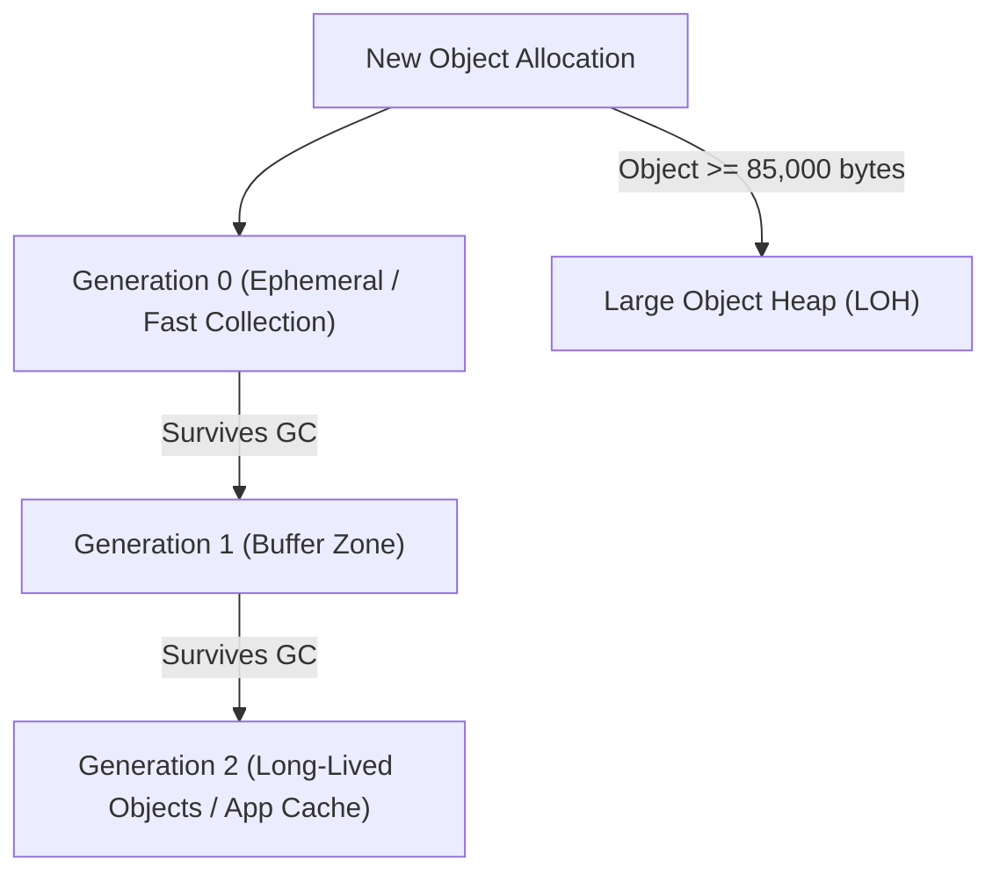

# Topic 20: Memory Management, GC & High-Performance Types

## 📖 Theoretical Overview

### 1. The .NET Garbage Collector & Generations
The .NET Garbage Collector (GC) manages the Heap. To optimize performance, it divides objects into **three generations**:
- **Generation 0 (Gen 0):** Short-lived, newly allocated objects (e.g. temporary variables, loop variables). Collected most frequently and very fast.
- **Generation 1 (Gen 1):** Buffer generation between short-lived and long-lived objects.
- **Generation 2 (Gen 2):** Long-lived objects (e.g. static data, app cache). Collected least frequently.
- **Large Object Heap (LOH):** Objects $\ge$ 85,000 bytes. Allocated directly on LOH and rarely compacted due to copy cost.

### 2. High-Performance Zero-Allocation: `Span<T>` and `Memory<T>`
- **`Span<T>`:** A `ref struct` that provides a type-safe contiguous window over arbitrary memory (arrays, Stack, native memory) without allocating new Heap memory.
- `text.AsSpan(0, 5)` slices a string without allocating a second substring!

### 3. Boxing & Unboxing
- **Boxing:** Converting a value type to `object` or an interface type; wraps the value and allocates it on the Heap.
- **Unboxing:** Extracting the value type back from the `object` reference to the Stack.
*Rule: Avoid boxing in hot performance paths.*

---

## 📊 .NET Garbage Collection Generations

