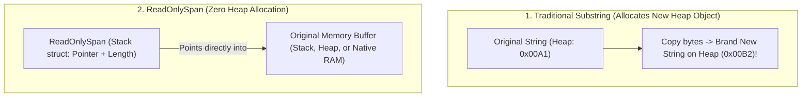
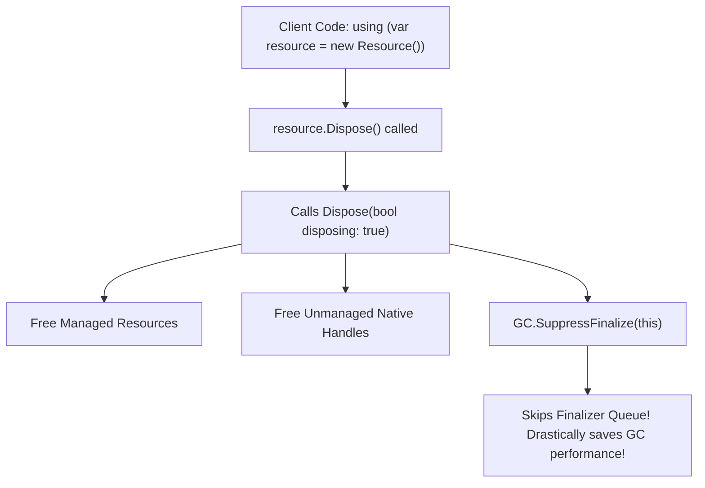

# Topic 20: Memory Management, GC Generations & High-Performance Span<T>

## 🌟 The Story: The City Sanitation Department & The Zero-Copy Magnifying Glass

Memory management in .NET is one of the most sophisticated engineering achievements in computer science. To write high-throughput, low-latency applications, you must understand how the CLR allocates, tracks, and cleans up memory.

### 1. The 3 Generations of Garbage Collection (The Generational Hypothesis)
Most software objects are ephemeral: they are created inside a method, used for 5 microseconds, and never needed again. The .NET Garbage Collector exploits this **Generational Hypothesis**:
- **Generation 0 (The Kitchen Trash Can):** Holds newly allocated, short-lived objects (temporary strings, loop counters, DTOs). Gen 0 collections happen frequently (often multiple times per second) and complete in sub-millisecond time.
- **Generation 1 (The Basement / Buffer Zone):** Objects that survived a Gen 0 collection get promoted to Gen 1. It acts as a staging ground.
- **Generation 2 (The City Landfill / Long-Lived Objects):** Holds objects that survived multiple GC sweeps (e.g. application-wide caches, static singletons, thread pools). A **Gen 2 Collection (Full GC)** scans the entire heap, pausing application threads ("Stop-the-World").
- **The Large Object Heap (LOH):** Any object $\ge 85,000$ bytes (such as large arrays or high-resolution images) bypasses Generations 0-2 and is placed directly on the LOH. To avoid catastrophic CPU costs, the LOH is rarely compacted.

---

### 2. The Photocopier vs. The Magnifying Glass (`Span<T>`)
Imagine you need to inspect characters 10 through 25 of a large 10-Megabyte string:
- **The Traditional Photocopier (`Substring`):** The CLR creates a brand-new string on the Heap, copies the 15 characters, and returns the new object. If executed in a loop of 1,000,000 requests, you flood the Heap with 15MB of garbage and trigger constant Gen 0 collections!
- **The Surgeon's Magnifying Glass (`ReadOnlySpan<char>`):** You do **not** copy a single byte. You slide a lightweight stack-only magnifying glass over the existing memory. It provides direct, bounds-checked access to the characters with **zero Heap allocations**.



---

## 🔬 The Technical Deep Dive

### 1. The Standard Dispose Pattern (`IDisposable`)
The Garbage Collector knows how to clean up managed memory. It does **not** know how to close unmanaged operating system file handles, database socket connections, or Windows API pointers. 

To clean up unmanaged resources deterministically, classes implement the **Full Dispose Pattern**:



#### The Golden Implementation:
```csharp
public class SecureResourceHolder : IDisposable
{
    private bool _disposed = false;
    private IntPtr _unmanagedHandle; // Simulated unmanaged OS pointer

    public void Dispose()
    {
        Dispose(true);
        // Instructs GC not to run the expensive finalizer ~SecureResourceHolder()
        GC.SuppressFinalize(this);
    }

    protected virtual void Dispose(bool disposing)
    {
        if (_disposed) return;

        if (disposing)
        {
            // Free other managed IDisposable objects here
        }

        // Free unmanaged native OS handles here
        _unmanagedHandle = IntPtr.Zero;
        _disposed = true;
    }

    // Finalizer (Fallback only if caller forgot to call Dispose)
    ~SecureResourceHolder()
    {
        Dispose(false);
    }
}
```

---

### 2. `Span<T>` vs. `Memory<T>`
- **`Span<T>`:** Declared as a `ref struct`. It is guaranteed by the compiler to live **exclusively on the Stack**. 
  - *Limitation:* It cannot be boxed, cannot be stored in a regular class field, and cannot be used across `await` boundaries in async methods!
- **`Memory<T>`:** A heap-safe representation of contiguous memory. It can live on the Heap, be stored in class fields, and be passed across asynchronous `await` calls. When you need to slice it, you call `.Span`.

---

### 3. Caching without Preventing Collection: `WeakReference<T>`
A standard reference prevents the GC from reclaiming an object. A **`WeakReference<T>`** tracks an object in memory while still permitting the GC to collect it if the operating system runs low on RAM. Ideal for large in-memory image or report caches!
